# Ruta Norte 2.0 (Visual Edition) — Sistema Kiosco de Transporte Intercantonal
**Carchi e Imbabura, Ecuador · Corredor Panamericana E35**

> **Concepto:** MVP Ultra-Visual, Accesible (estilo Kiosco Táctil Interactivo) y Simplificado.  
> Diseñado con botones gigantes (`h-16`/`h-20`), tipografía grande (`text-xl` a `text-3xl`), fotografías reales en alta resolución, cero formularios complejos y compra directa en 1 clic.  
> **Autores / Desarrolladores (UPEC):**
> - **Cristopher Lomas**
> - **Alejandra Changuan**
> - **Adrianna Guamialama**  
> **Institución:** Universidad Politécnica Estatal del Carchi (UPEC)  
> **Despliegue Web en Producción (Vercel):** [https://ruta-norte.vercel.app](https://ruta-norte.vercel.app)

---

## 🏛️ Arquitectura Limpia de 3 Capas

```mermaid
graph LR
    subgraph Frontend["Frontend Kiosco (Next.js 14)"]
        UI["UI Visual Accesible<br>(Tailwind CSS + Lucide)"]
        AXIOS["Axios Client Centralizado<br>(src/lib/axiosClient.ts)"]
    end

    subgraph Backend["Backend REST (Spring Boot 3.3.4)"]
        AUTH["auth: Login Demo 1 Clic"]
        CATALOG["catalog: Ciudades & Buses"]
        TRIPS["trips: Salidas & Asientos"]
        TICKETS["tickets: Compra 1 Clic & QR"]
    end

    subgraph Database["Base de Datos (PostgreSQL 15+)"]
        T1["users (3 roles)"]
        T2["cities (9 terminales)"]
        T3["buses (40 asientos fijos)"]
        T4["trips (turnos y fechas)"]
        T5["tickets (token QR único)"]
    end

    UI --> AXIOS
    AXIOS -->|HTTP REST /api/v1| Backend
    Backend -->|Spring Data JPA / JDBC| Database
```



---

## 👥 Los 3 Roles del Sistema (Modo Demo en 1 Clic)

En la barra superior (`NavbarVisual`) se encuentra disponible permanentemente el selector para alternar entre las 3 vistas en 1 clic:

| Rol | Ruta | Funcionalidad Clave |
|:---|:---|:---|
| **🧍 Pasajero (`PASSENGER`)** | `/pasajero` | **Wizard Visual en 4 Pasos:**<br>1. Selección de origen y destino con fotos de 9 ciudades.<br>2. Filtro por turnos (☀️ Mañana, 🌤️ Tarde, 🌙 Noche) y tarjetas de buses.<br>3. Mapa gráfico del bus estándar de 40 asientos.<br>4. Boarding Pass digital con código QR gigante (`RN-XXXXXXXXXXXX`). |
| **🎫 Taquillero / Chofer (`STAFF`)** | `/operaciones` | **Venta Rápida y Validación:**<br>• Pestaña 1: Cobro en efectivo en 1 segundo y emisión de QR.<br>• Pestaña 2: Escáner QR con modales gigantes en **VERDE** (autorizado) o **ROJO** (usado/inválido) y lista de prueba para demos. |
| **⚙️ Administrador (`ADMIN`)** | `/admin` | **Gestión y Despacho:**<br>• Tarjetas de métricas del día (boletos vendidos, recaudación $, salidas activas).<br>• Programador visual de frecuencias.<br>• Catálogo fotográfico de flota de 40 asientos. |

---

## 🗺️ Las 9 Ciudades con Terminal (Corredor E35)

- **Provincia del Carchi:**
  1. **Tulcán:** Terminal Terrestre de Tulcán
  2. **Julio Andrade:** Terminal Parroquial Julio Andrade
  3. **San Gabriel:** Terminal Terrestre San Gabriel
  4. **Bolívar:** Terminal Cantonal Bolívar
  5. **El Ángel:** Terminal Terrestre El Ángel
- **Provincia de Imbabura:**
  6. **Ibarra:** Terminal Terrestre de Ibarra
  7. **Atuntaqui:** Terminal Intercantonal Atuntaqui
  8. **Otavalo:** Terminal Terrestre de Otavalo
  9. **Cotacachi:** Terminal Terrestre Cotacachi

---

## 🚌 Flota Estándar de 40 Asientos

Todos los buses del sistema cuentan con una distribución uniforme de **40 asientos físicos**:
- **10 filas de 4 asientos** (2 a la izquierda, pasillo central `🚶`, 2 a la derecha).
- Asientos identificados del **1 al 40**:
  - 🟢 **Verde:** Libre (clicable).
  - 🔵 **Azul:** Seleccionado por el usuario.
  - 🔴 **Gris:** Ocupado.

---

## 🗄️ Esquema de Base de Datos Simplificado (5 Tablas)

Ubicación: [database/schema_v2.sql](file:///c:/Users/toshiba/Desktop/Proyecto%20Aplicaciones%20WEB/Rutas/database/schema_v2.sql) y [database/seed_v2.sql](file:///c:/Users/toshiba/Desktop/Proyecto%20Aplicaciones%20WEB/Rutas/database/seed_v2.sql).

1. **`users`:** `id (UUID)`, `full_name`, `email`, `password_hash`, `role` (`PASSENGER`, `STAFF`, `ADMIN`), `created_at`.
2. **`cities`:** `id (SERIAL)`, `name`, `province` (`Carchi`, `Imbabura`), `terminal_name`, `image_url`.
3. **`buses`:** `id (SERIAL)`, `cooperative_name`, `unit_number`, `plate`, `photo_url`, `capacity = 40`.
4. **`trips`:** `id (UUID)`, `origin_city_id`, `destination_city_id`, `bus_id`, `departure_date`, `departure_time`, `shift` (`MORNING`, `AFTERNOON`, `NIGHT`), `price`.
5. **`tickets`:** `id (UUID)`, `trip_id`, `passenger_name`, `seat_number` (1..40), `qr_token` (`RN-...`), `status` (`PAID`, `BOARDED`), `created_at`, `boarded_at`, `CONSTRAINT uk_trip_seat UNIQUE (trip_id, seat_number)`.

---

## 🚀 Guía de Inicio Rápido

### 1. Base de Datos (PostgreSQL 15+)
```bash
# Ejecutar esquema v2 de 5 tablas y datos semilla de 9 ciudades y salidas
psql -U postgres -d rutanorte -f database/schema_v2.sql
psql -U postgres -d rutanorte -f database/seed_v2.sql
```

### 2. Backend (Spring Boot 3.3.4 con Java 17)
```bash
cd backend
mvn clean compile
mvn spring-boot:run
# API REST disponible en: http://localhost:8080/api/v1
# Swagger UI: http://localhost:8080/swagger-ui.html
```

### 3. Frontend (Next.js 14 con Axios)
```bash
cd frontend
npm install
npm run dev
# Kiosco visual interactivo en: http://localhost:3000/pasajero
```

### 4. Pruebas Automatizadas
```bash
npm test
# Ejecuta la suite de 103 pruebas unitarias en Vitest (100% aprobadas)
```

---

## 🔑 Credenciales para Demostración

| Rol | Correo de Acceso | Contraseña | Vista Rápida |
|:---|:---|:---|:---|
| **Administrador** | `admin@rutanorte.ec` | `Admin123!` | `/admin` |
| **Taquillero / Chofer** | `taquilla@rutanorte.ec` | `Staff123!` | `/operaciones` |
| **Pasajero Frecuente** | `pasajero@rutanorte.ec` | `Pasajero123!` | `/pasajero` |

---

*Proyecto de Aplicaciones Web — Carrera de Computación / Software — UPEC 2026*
