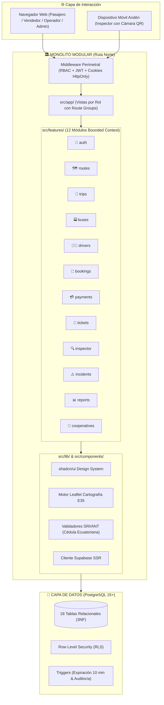

# Ruta Norte — Sistema Web de Transporte Interparroquial y Venta de Boletos

> **Arquitectura:** Monolítica Modular (*Modular Monolith*)  
> **Stack Principal:** Next.js 14 (App Router) · TypeScript Strict · Tailwind CSS · shadcn/ui · Supabase PostgreSQL  
> **Autores / Equipo de Desarrollo:**
> - **Cristopher Lomas**
> - **Alejandra Changuan**
> - **Adrianna Guamialama**  
> **Región Operativa:** Norte de Ecuador (Provincias de Carchi e Imbabura — Eje Vial Panamericana E35)  
> **Despliegue de Producción (Vercel):** [https://ruta-norte.vercel.app](https://ruta-norte.vercel.app)  
> **Presentación Interactiva de Defensa:** [https://ruta-norte.vercel.app/presentacion](https://ruta-norte.vercel.app/presentacion)

---

## 1. Visión General de la Arquitectura

**Ruta Norte** está diseñado e implementado bajo el patrón arquitectónico **Monolítico Modular** (*Modular Monolith*). Combina un único repositorio y una sola unidad de despliegue atómica con una estricta modularización interna basada en **Bounded Contexts (DDD)**.



---

## 2. Estructura de Directorios del Monolito Modular

El proyecto se organiza de manera canónica en las siguientes carpetas:

```
ruta-norte/
├── src/                                  # Código fuente principal de la aplicación
│   ├── app/                              # Capa de Presentación & Rutas (Next.js App Router)
│   │   ├── (public)/                     # Vistas públicas (buscador de viajes, checkout, boletos)
│   │   ├── (auth)/                       # Flujo de autenticación (login, registro, recuperación)
│   │   ├── (passenger)/                  # Portal del pasajero (mis boletos digitales)
│   │   ├── (seller)/                     # Taquilla de venta y emisión presencial
│   │   ├── (inspector)/                  # Terminal móvil del inspector (escáner QR de andén)
│   │   ├── (operator)/                   # Panel del operador (despachos, viajes, incidencias)
│   │   ├── (admin)/                      # Panel administrativo (rutas, flota, conductores, reportes)
│   │   ├── api/                          # Route Handlers RESTful para consumo móvil/externo
│   │   ├── globals.css                   # Tokens de diseño CSS y Tailwind
│   │   └── layout.tsx                    # Layout raíz con proveedores y fuentes
│   │
│   ├── features/                         # 12 Módulos de Dominio Bounded Context
│   │   ├── auth/                         # Autenticación, RBAC y sesión
│   │   ├── bookings/                     # Reservas temporales (10 min) y bloqueo de asientos
│   │   ├── buses/                        # Flota, cooperativas y layouts de asientos (30/40/44)
│   │   ├── cooperatives/                 # Cooperativas de transporte interparroquial
│   │   ├── drivers/                      # Conductores, licencias y disponibilidad
│   │   ├── incidents/                    # Reporte y trazabilidad de incidencias en ruta
│   │   ├── inspector/                    # Escáner móvil de andén y validación antifraude
│   │   ├── payments/                     # Pasarela de pagos simulada académica
│   │   ├── reports/                      # Analítica de ocupación y recaudación
│   │   ├── routes/                       # Rutas, secuencias de paradas y cálculo vial
│   │   ├── tickets/                      # Emisión de boletos y tokens QR criptográficos
│   │   └── trips/                        # Programación, búsqueda y manifiesto de pasajeros
│   │
│   ├── components/                       # Sistema de Diseño UI
│   │   ├── ui/                           # Primitivas accesibles de shadcn/ui sobre Radix
│   │   └── shared/                       # Componentes compartidos de dominio (SeatMap, Timer)
│   │
│   ├── lib/                              # Infraestructura y Servicios Transversales
│   │   ├── supabase/                     # Clientes de base de datos (SSR, Admin, Middleware)
│   │   ├── auth/                         # Guards de permisos y redirecciones por rol
│   │   ├── maps/                         # Motor geoespacial Leaflet y cálculo de distancias
│   │   └── validations/                  # Validaciones de cédula ecuatoriana y formato de placa
│   │
│   ├── types/                            # Contratos y tipos globales de TypeScript
│   └── middleware.ts                     # Guard perimetral de seguridad RBAC
│
├── supabase/                             # Capa de Persistencia y Base de Datos
│   ├── migrations/                       # DDL relacional versionado (001 a 008) y políticas RLS
│   └── seed.sql                          # Dataset maestro reproducible (18 localidades, rutas, flota)
│
├── tests/                                # Suite de Pruebas Automatizadas
│   ├── unit/                             # 103 pruebas unitarias de reglas de negocio (Vitest)
│   └── e2e/                              # Pruebas end-to-end de flujos críticos (Playwright)
│
├── docs/                                 # Documentación de Ingeniería de Software
│   ├── requirements.md                   # Requisitos funcionales y no funcionales
│   ├── architecture.md                   # Especificación formal de arquitectura
│   ├── data-model.md                     # Modelo relacional de 18 tablas en 3NF
│   ├── security-model.md                 # Modelo de seguridad y políticas RLS
│   └── implementation-plan.md            # Plan de desarrollo e hitos
│
├── public/                               # Activos estáticos y presentación interactiva
│   ├── presentacion.html                 # Diapositivas interactivas de defensa
│   └── presentacion/index.html           # Ruta limpia de presentación
│
├── backend/                              # (Módulo de Referencia) Implementación Spring Boot 3
└── package.json                          # Manifiesto de dependencias y scripts de npm
```

---

## 3. Ventajas de la Arquitectura Monolítica Modular

1. **Cero Latencia de Red Interna:** Las mutaciones de negocio se ejecutan mediante Server Actions directas al motor PostgreSQL, eliminando la sobrecarga HTTP y serializaciones JSON entre frontend y backend.
2. **Tipado Estricto de Extremo a Extremo:** TypeScript en modo estricto garantiza que los tipos de base de datos, lógica de dominio y componentes React compartan el mismo contrato.
3. **Seguridad en Profundidad (Defense in Depth):** RLS activo en PostgreSQL a nivel de fila (`auth.uid()`) + Middleware perimetral con cookies `HttpOnly` + Validación Zod en cada Server Action.
4. **Despliegue Atómico y Mantenibilidad:** Un solo pipeline de compilación y despliegue (en Vercel) sin desincronización de versiones entre microservicios.

---

## 4. Instrucciones de Ejecución

### Prerrequisitos
- **Node.js:** Versión 18+ LTS
- **npm:** Versión 9+

### Instalación y Desarrollo
```bash
# Instalar dependencias
npm install

# Iniciar servidor de desarrollo en puerto 3000
npm run dev

# Ejecutar las 103 pruebas unitarias con Vitest
npm test

# Compilar para producción
npm run build
```

---

*Proyecto de Aplicaciones Web — Universidad Politécnica Estatal del Carchi (UPEC)*
