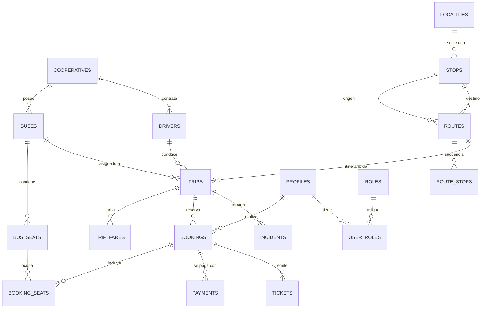

# 🗄️ Capa de Base de Datos — Ruta Norte (PostgreSQL 15+)

Este directorio contiene la arquitectura de persistencia relacional completa del sistema de transporte interparroquial **Ruta Norte**.

---

## 1. Contenido del Directorio

| Archivo / Carpeta | Descripción |
|---|---|
| `schema.sql` | Script DDL consolidado con todas las 18 tablas, tipos enumerados, índices, triggers y funciones PL/pgSQL. |
| `seed.sql` | Dataset maestro poblado con cooperativas, 18 localidades georreferenciadas (Carchi e Imbabura), rutas, buses, choferes y viajes programados. |
| `migrations/` | Historial de migraciones SQL incrementales numeradas para versionamiento formal. |

---

## 2. Entidades Principales (18 Tablas Relacionales)



---

## 3. Despliegue en PostgreSQL Local o Cloud

### Opción A: Despliegue Directo con `psql`
```bash
# 1. Crear base de datos
createdb -U postgres rutanorte_db

# 2. Ejecutar esquema consolidado
psql -U postgres -d rutanorte_db -f database/schema.sql

# 3. Poblar datos semilla de prueba
psql -U postgres -d rutanorte_db -f database/seed.sql
```

### Opción B: Uso con Docker
```bash
docker run --name rutanorte-postgres \
  -e POSTGRES_DB=rutanorte_db \
  -e POSTGRES_USER=postgres \
  -e POSTGRES_PASSWORD=postgres \
  -p 5432:5432 -d postgres:15-alpine
```
