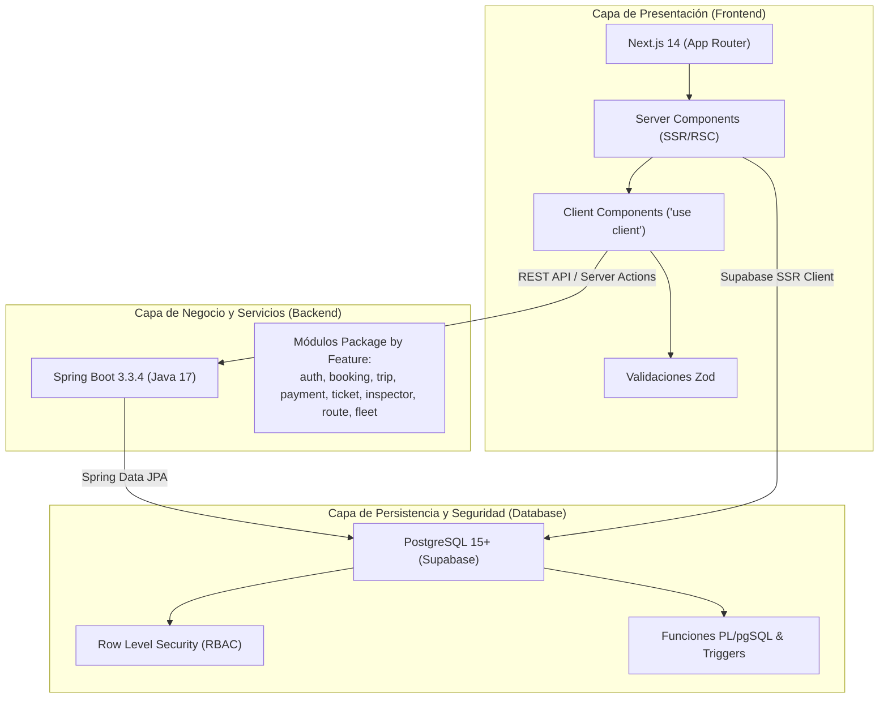
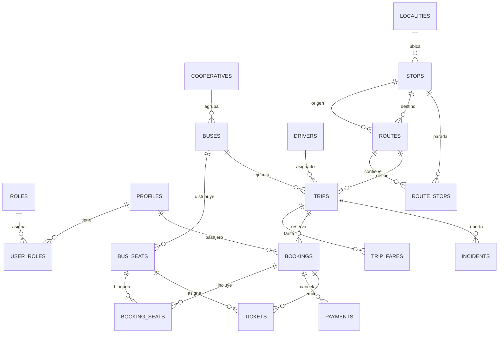
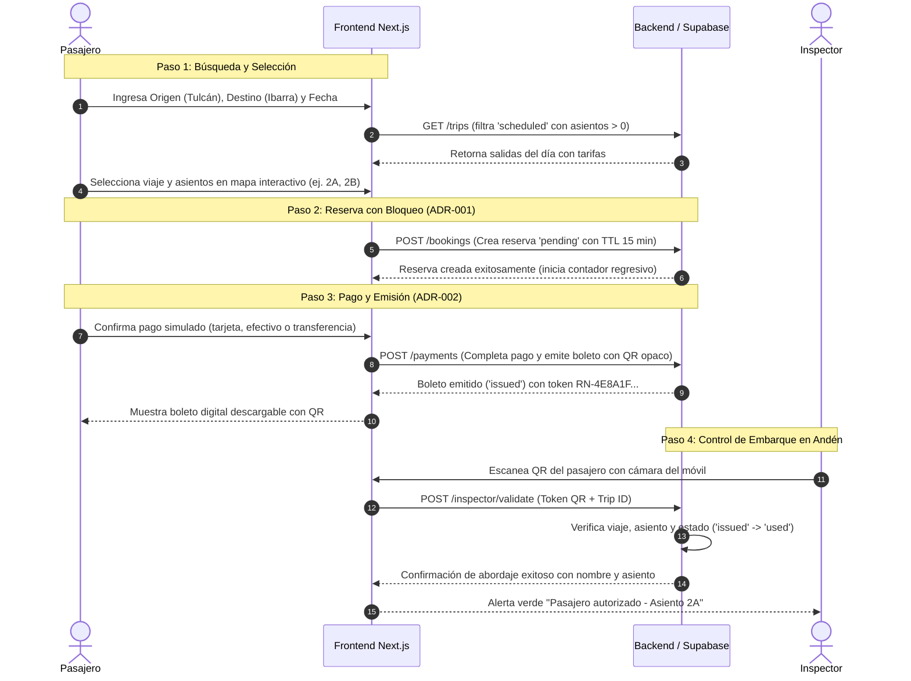

# RUTA NORTE — DOCUMENTO TÉCNICO DE INDUCCIÓN Y ARQUITECTURA
**Sistema Web de Gestión de Transporte Interparroquial, Rutas y Venta de Boletos**  
*Región Norte del Ecuador (Provincias de Carchi e Imbabura)*

---

> **Destinatario:** Ingenieros de Software, Desarrolladores Full Stack y Evaluadores Técnicos.  
> **Objetivo:** Documento maestro para comprender la arquitectura, el diseño de datos, los flujos de negocio y la puesta en marcha del proyecto en menos de 15 minutos.  
> **Estado del Sistema:** Producción activa en Vercel · 103/103 Pruebas Unitarias Aprobadas (100%) · Base de datos poblada para 1 mes.

---

## 1. Ficha Técnica del Proyecto

| Parámetro | Especificación |
|:---|:---|
| **Nombre del Sistema** | **Ruta Norte** |
| **Dominio de Negocio** | Transporte público intercantonal e interparroquial, despacho de unidades, boletaje digital con QR y control de abordaje en andén. |
| **Zona Operativa** | Corredor E35 y ramales parroquiales de las provincias de **Carchi** (Tulcán, San Gabriel, El Ángel, Mira, Huaca, Bolívar) e **Imbabura** (Ibarra, Otavalo, Cotacachi, San Antonio, Zuleta, Pimampiro). |
| **Frontend** | Next.js 14 (App Router), React 18, TypeScript Strict, Tailwind CSS, shadcn/ui, Lucide React. |
| **Backend** | Spring Boot 3.3.4 (Java 17, Maven), arquitectura modular *Package by Feature*, JPA/Hibernate, Spring Security. |
| **Base de Datos** | PostgreSQL 15+ (Supabase Cloud), 18 tablas en 3NF, Row Level Security (RLS) en todas las entidades, Triggers y PL/pgSQL. |
| **Testing** | Vitest (103 pruebas unitarias y de integración que validan seguridad, RLS, concurrencia de reservas y tokenización QR). |
| **Despliegue Web** | Vercel Serverless Edge (App: `https://ruta-norte.vercel.app` \| Presentación: `/presentacion`). |

---

## 2. Arquitectura de Alto Nivel (Monorepo Modular)

El proyecto está diseñado bajo una arquitectura de **Monolito Modular** distribuido en tres capas físicas desacopladas dentro del mismo repositorio:



### Principios Arquitectónicos Fundamentales
1. **Separación Estricta de Responsabilidades:** El frontend se encarga del renderizado dinámico, accesibilidad y experiencia de usuario; el backend gestiona la lógica de dominio transaccional pesada; la base de datos garantiza la consistencia relacional y aplica aislamiento mediante RLS.
2. **Defensa en Profundidad:** Las autorizaciones no solo se validan en la interfaz (ocultando botones), sino que se re-validan en los Server Actions / APIs de Spring Boot y se refuerzan obligatoriamente a nivel de filas en PostgreSQL (`auth.uid() = ...`).
3. **Inmutabilidad y Auditoría:** Ninguna venta, pago, boleto o cancelación se borra físicamente de la base de datos (`soft delete` o histórico de estados inmutable en `audit_logs`).

---

## 3. Estructura de Directorios del Repositorio

```
Rutas/
├── frontend/                     # Aplicación Web Next.js 14
│   ├── src/
│   │   ├── app/                  # Rutas por grupos de roles: (public), (auth), (passenger),
│   │   │                         # (operator), (seller), (inspector), (admin), presentacion/
│   │   ├── components/           # Componentes UI reutilizables (shadcn/ui + layouts)
│   │   ├── features/             # Lógica por dominio (actions, components, hooks, tipos)
│   │   │   ├── auth/             # Sesión, registro, recuperación
│   │   │   ├── bookings/         # Carrito de compra, bloqueo temporal de asientos
│   │   │   ├── buses/            # Layout de cabina, unidades, cooperativas
│   │   │   ├── inspector/        # Escaneo de abordaje con cámara
│   │   │   ├── tickets/          # Visualización y descarga de boleto QR
│   │   │   └── trips/            # Buscador de frecuencias, itinerarios y precios
│   │   ├── lib/                  # Clientes Supabase SSR, validaciones Zod y utilitarios
│   │   └── types/                # Interfaces TypeScript estrictas
│   └── vitest.config.ts          # Configuración del motor de pruebas unitarias
│
├── backend/                      # Servicio REST Spring Boot 3.3.4 (Java 17)
│   ├── pom.xml                   # Dependencias Maven (Spring Data JPA, Security, etc.)
│   └── src/main/java/ec/edu/upec/rutanorte/
│       ├── auth/                 # Controladores y servicios de autenticación y roles
│       ├── booking/              # Gestión de reservas, estados y TTL de expiración
│       ├── trip/                 # Programación de salidas y manifiestos de viaje
│       ├── payment/              # Pasarela académica de pago simulado
│       ├── ticket/               # Generador de códigos QR opacos y verificación
│       ├── inspector/            # Endpoints de validación de abordaje en ruta
│       ├── route/                # Rutas, paradas georreferenciadas y tarifas
│       ├── fleet/                # Cooperativas, buses, layout JSONB y choferes
│       └── shared/               # Manejador global de excepciones, DTOs y utilidades
│
├── database/                     # PostgreSQL y Supabase
│   ├── schema.sql                # DDL consolidado (18 tablas, 3NF, claves foráneas e índices)
│   ├── seed.sql                  # Script maestro SQL determinista para 1 mes de salidas
│   ├── migrations/               # Migraciones versionadas (000001 a 000004)
│   └── scripts/                  # Scripts de aprovisionamiento masivo (seed-complete-demo.js)
│
├── docs/                         # Especificaciones, ADRs y manuales de defensa
├── tests/                        # 19 suites de pruebas unitarias y de integración
├── AGENTS.md                     # Convenciones de desarrollo y reglas del equipo
└── package.json                  # Scripts del monorepo (build, test, dev)
```

---

## 4. Módulos y Arquitectura del Backend (Spring Boot)

El backend sigue el patrón **Package by Feature**, donde cada paquete contiene todo lo referente a un módulo:

```
ec.edu.upec.rutanorte.<modulo>/
  ├── controllers/       # Controladores REST (@RestController, @RequestMapping)
  ├── services/          # Lógica transaccional de negocio (@Service, @Transactional)
  ├── repositories/      # Acceso a datos (@Repository, JpaRepository)
  ├── entities/          # Mapeo relacional JPA (@Entity, @Table)
  └── dto/               # Objetos de transferencia de datos con validaciones Bean Validation
```

### Módulos Principales:
1. **`ec.edu.upec.rutanorte.booking`**: Implementa la reserva con bloqueo atómico de asientos por 15 minutos, transición de estados (`pending` → `confirmed` \| `expired` \| `cancelled`).
2. **`ec.edu.upec.rutanorte.ticket`**: Emisión del boleto, ensamblado de token HMAC y firma criptográfica sin PII.
3. **`ec.edu.upec.rutanorte.inspector`**: Endpoint de alta velocidad para escaneo de códigos QR, validación de fecha/hora de viaje y registro de inspector.
4. **`ec.edu.upec.rutanorte.trip`**: Búsqueda multi-criterio de viajes por origen, destino, fecha y disponibilidad de asientos.
5. **`ec.edu.upec.rutanorte.fleet`**: Gestión de unidades, cálculo de filas y columnas de asientos mediante JSONB.

---

## 5. Diseño de Base de Datos y Modelo Relacional

La base de datos contiene **18 tablas en 3NF**, con claves primarias basadas en `UUID v4` y tipos ENUM nativos de PostgreSQL:



### Entidades Centrales del Modelo:
- **`trips`**: Salidas concretas con fecha/hora de salida y llegada, bus asignado, chofer y contador de asientos disponibles.
- **`bookings`**: Transacción de reserva con fecha de expiración (`expires_at`) calculada a `NOW() + INTERVAL '15 minutes'`.
- **`booking_seats`**: Asociación única `(booking_id, bus_seat_id)` con estado (`reserved`, `sold`, `cancelled`).
- **`tickets`**: Boleto digital con código QR opaco (`RN-...`), payload JSON y auditoría de abordaje (`boarded_at`, `boarded_by`).
- **`incidents`**: Registro de contingencias viales (retrasos climáticos, fallas mecánicas, desvíos).
- **`audit_logs`**: Trazabilidad inmutable de cambios de estado, autorización de roles y validaciones.

---

## 6. Decisiones de Arquitectura de Software (ADRs)

El proyecto documenta formalmente 4 decisiones de arquitectura clave en `docs/decisions.md`:

### ADR-001: Bloqueo Temporal de Asientos (TTL 15 Minutos)
- **Problema:** Evitar sobreventa (*overbooking*) y colisiones de asientos simultáneos cuando dos pasajeros intentan comprar el mismo asiento al mismo tiempo.
- **Solución:** Al seleccionar asientos, se genera un registro en `bookings` con estado `pending` y `expires_at = now() + interval '15 minutes'`. Durante este lapso, el asiento queda bloqueado para otros compradores. Si no se completa el pago en 15 minutos, el asiento se libera automáticamente.

### ADR-002: Código QR Seguro, Opaco y sin Exposición de PII
- **Problema:** Si el código QR impreso o en pantalla contiene la cédula, nombres o teléfono del pasajero en texto plano, cualquier persona con una app lectora de QR podría vulnerar la privacidad del usuario.
- **Solución:** El QR codifica exclusivamente un **token opaco** de 16 caracteres hexadecimales (`RN-XXXXXXXXXXXXXXXX`) generado mediante un hash seguro (HMAC/SHA-256). Solo los inspectores autenticados en el sistema pueden descifrar y validar el estado del boleto en la base de datos.

### ADR-003: Layout Dinámico de Buses en JSONB
- **Problema:** Cada cooperativa posee buses con configuraciones distintas (1 o 2 pisos, 32 a 44 asientos, filas de 4 asientos con pasillo intermedio, asientos preferenciales).
- **Solución:** Se diseñó el campo `layout_config` en formato `JSONB` dentro de la tabla `buses`. Una función SQL PL/pgSQL (`generate_bus_seats`) genera automáticamente el inventario físico de asientos preservando la tipología (`accessibility` para 1A y 1B, `standard` para el resto).

### ADR-004: Cuentas y Datos de Demostración Identificados
- **Problema:** Demostrar el sistema a evaluadores y profesores sin mezclar métricas simuladas con operaciones reales.
- **Solución:** Se incorporó el atributo `is_demo: true` en perfiles y registros de prueba. La interfaz despliega etiquetas visibles indicando que se trata de datos simulados para fines académicos.

---

## 7. Flujo Integral: Búsqueda, Compra y Abordaje



---

## 8. Seguridad y Control de Acceso Basado en Roles (RBAC)

La seguridad se implementa en múltiples capas:

1. **Autenticación:** Tokens JWT emitidos por Supabase Auth, transmitidos vía cookies HTTP-only seguras con validación en middleware de Next.js.
2. **Protección de Rutas en Next.js:** Redirección automática si el rol del usuario no coincide con el grupo de rutas solicitado.
3. **Row Level Security (RLS) en PostgreSQL:**

| Tabla | Pasajero (`passenger`) | Inspector (`inspector`) | Operador (`operator`) | Vendedor (`seller`) | Administrador (`admin`) |
|:---|:---:|:---:|:---:|:---:|:---:|
| **`routes`** | Solo lectura | Solo lectura | Lectura / Escritura | Solo lectura | Control Total |
| **`trips`** | Solo lectura | Solo lectura | Despacho / Edición | Solo lectura | Control Total |
| **`bookings`** | Solo sus reservas | Ninguno | Lectura general | Emisión en taquilla | Control Total |
| **`tickets`** | Solo sus boletos | Lectura y validación | Manifiesto general | Emisión presencial | Control Total |
| **`incidents`** | Ninguno | Ninguno | Creación / Cierre | Ninguno | Control Total |
| **`audit_logs`** | Ninguno | Ninguno | Ninguno | Ninguno | Solo lectura |

---

## 9. Datos de Demostración Disponibles (1 Mes de Salidas)

El entorno incluye datos reales y coherentes para demostraciones operativas:
- **14 Rutas:**
  - *Tulcán – Julio Andrade*, *Tulcán – San Gabriel*, *Tulcán – El Ángel*, *Tulcán – Huaca*, *Tulcán – Mira*, *Tulcán – Bolívar*.
  - *Tulcán – Ibarra (Directo E35)*, *San Gabriel – Ibarra*.
  - *Ibarra – Otavalo*, *Ibarra – Cotacachi*, *Ibarra – San Antonio*, *Ibarra – Zuleta (Ruta Bordados)*, *Otavalo – Cotacachi*, *Ibarra – Pimampiro*.
- **304 Salidas Programadas:** 8 frecuencias diarias (06:00, 08:00, 10:00, 12:00, 14:00, 16:00, 18:00, 20:00) abarcando desde 7 días en el pasado hasta 30 días en el futuro.
- **120 Reservas y 85 Boletos con QR** listos para ser escaneados y probados en tiempo real con el rol de inspector.

---

## 10. Guía Rápida para Levantar el Proyecto Localmente

### Paso 1: Clonar y configurar variables de entorno
```bash
git clone https://github.com/CristopherLomas/Ruta-Norte.git
cd Ruta-Norte
cp .env.example .env.local
```

### Paso 2: Instalar dependencias y ejecutar pruebas unitarias
```bash
npm install
npm test
```
> **Resultado esperado:** 103 de 103 pruebas pasando exitosamente en Vitest.

### Paso 3: Levantar el Frontend (Next.js 14)
```bash
npm run dev
# Abrir en el navegador: http://localhost:3000
```

### Paso 4: Levantar el Backend (Spring Boot 3.3.4)
```bash
cd backend
mvn clean compile
mvn spring-boot:run
# API REST disponible en: http://localhost:8080
```

### Paso 5: Poblar o restablecer la Base de Datos
```bash
# Poblar Supabase Cloud directamente con el seeder interactivo:
node database/scripts/seed-complete-demo.js
```

---

## 11. Cuentas de Acceso para Demostración

| Rol | Correo Electrónico | Contraseña | Panel Asignado |
|:---|:---|:---|:---|
| **Administrador General** | `admin@rutanorte.ec` | `Admin123!` | `/admin` |
| **Operador de Flota** | `operador@rutanorte.ec` | `Operador123!` | `/operator` |
| **Vendedor de Taquilla** | `vendedor@rutanorte.ec` | `Vendedor123!` | `/seller` |
| **Inspector de Ruta** | `inspector@rutanorte.ec` | `Inspector123!` | `/inspector/escanear` |
| **Pasajero Frecuente** | `pasajero@rutanorte.ec` | `Pasajero123!` | `/passenger` |

---

## 12. Enlaces del Proyecto en Producción

- **Aplicación Web Desplegada:** [https://ruta-norte.vercel.app](https://ruta-norte.vercel.app)
- **Presentación Interactiva de Arquitectura:** [https://ruta-norte.vercel.app/presentacion](https://ruta-norte.vercel.app/presentacion)
- **Repositorio GitLab UPEC:** `https://gitlab.upec.edu.ec/Cris_Lomas/ruta_norte.git`
- **Repositorio GitHub:** `https://github.com/CristopherLomas/Ruta-Norte.git`
