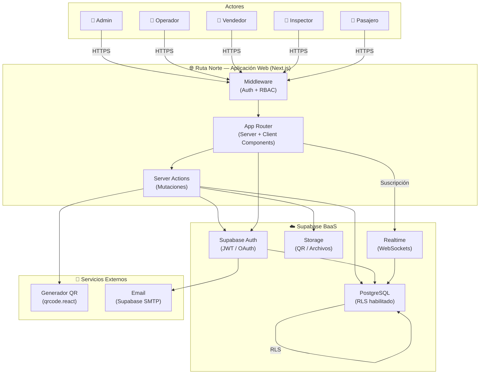
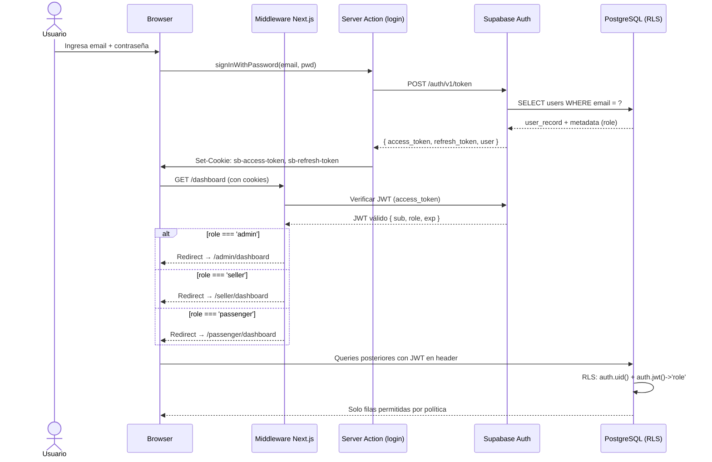
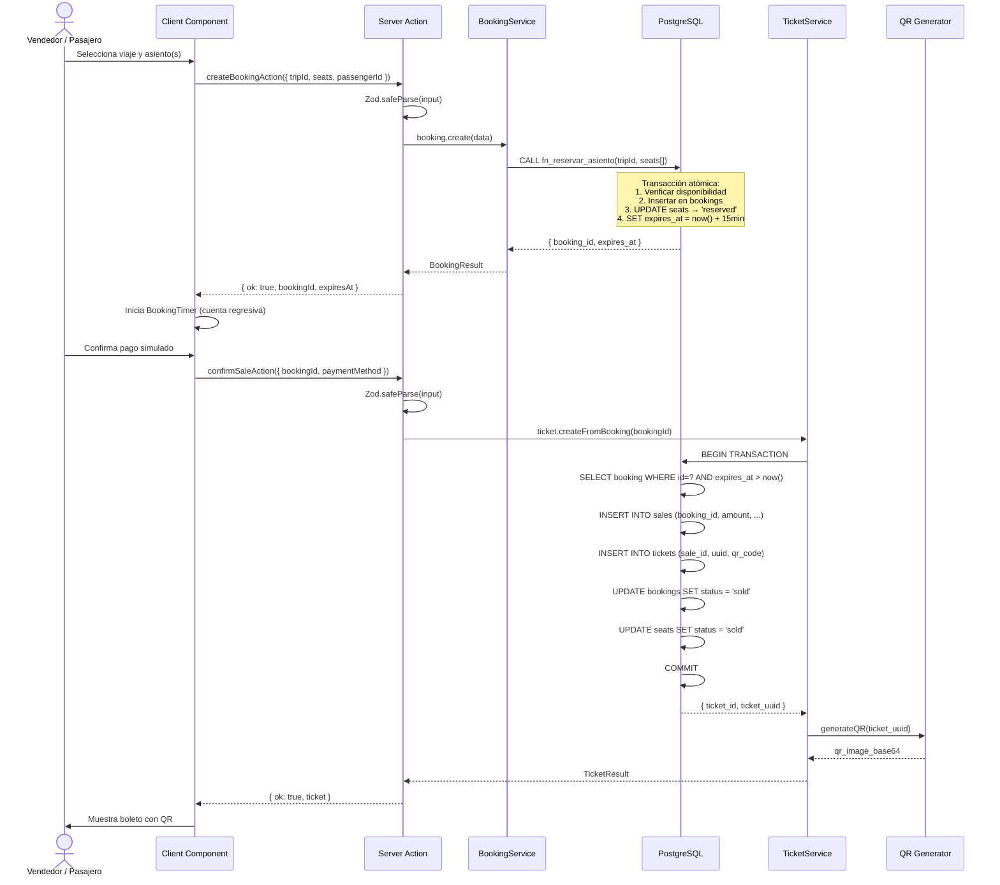
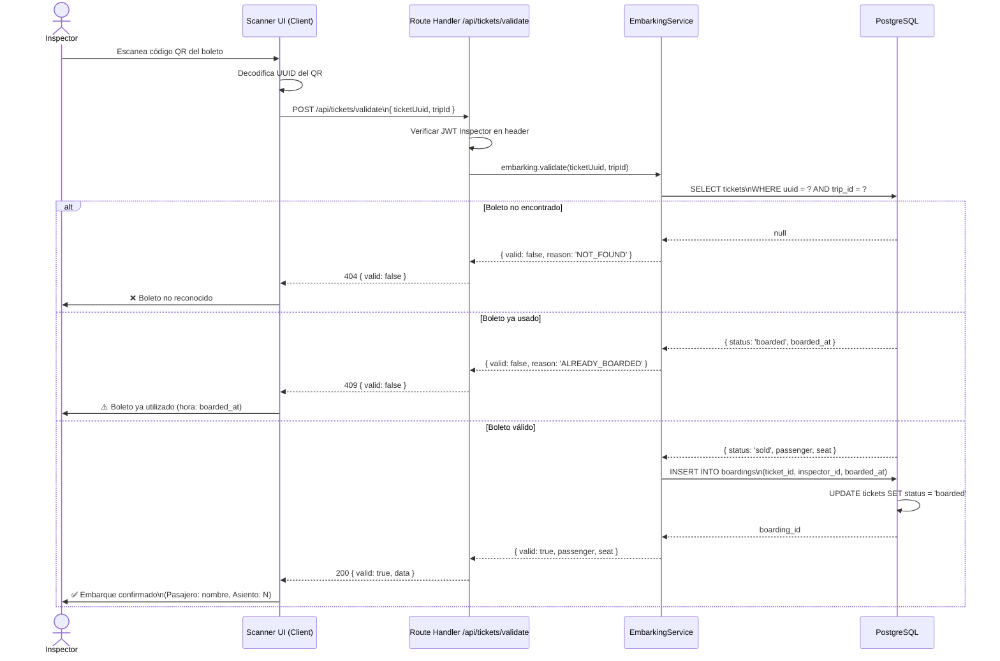
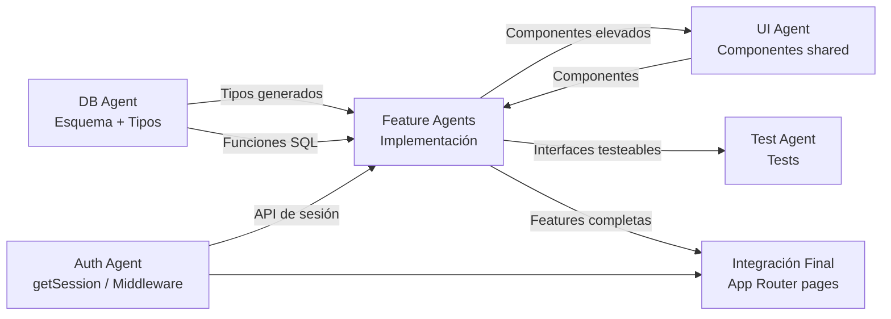

# Arquitectura del Sistema — Ruta Norte

> **Versión:** 1.0.0  
> **Fecha:** 2026-10-11  
> **Estado:** Borrador aprobado  
> **Responsable:** Equipo de Arquitectura — Ruta Norte

---

## Tabla de Contenidos

1. [Visión General](#1-visión-general)
2. [Capas de la Aplicación](#2-capas-de-la-aplicación)
3. [Estructura de Directorios](#3-estructura-de-directorios)
4. [Flujos Principales](#4-flujos-principales)
5. [Patrones y Decisiones de Diseño](#5-patrones-y-decisiones-de-diseño)
6. [Estrategia de Agentes de Desarrollo](#6-estrategia-de-agentes-de-desarrollo)
7. [Decisiones Técnicas y Alternativas Consideradas](#7-decisiones-técnicas-y-alternativas-consideradas)
8. [Limitaciones Conocidas](#8-limitaciones-conocidas)

---

## 1. Visión General

### 1.1 Descripción de la Arquitectura

**Ruta Norte** es un sistema web de gestión de transporte interparroquial y venta de boletos orientado a las zonas norte de Ecuador. Está construido sobre una arquitectura **monolítica modular**, que combina la potencia del framework full-stack **Next.js 14 (App Router)** con el Backend-as-a-Service **Supabase**.

Este enfoque permite:

- **Un único repositorio** que contiene tanto el frontend como la lógica de servidor, reduciendo la complejidad operativa en etapas tempranas del proyecto.
- **Modularización interna** mediante la separación en _features_ cohesivas, de modo que el sistema pueda escalar o extraer módulos a microservicios en el futuro sin refactorizaciones masivas.
- **Delegación de infraestructura crítica** (autenticación, base de datos, almacenamiento, realtime) a Supabase, permitiendo al equipo enfocarse en la lógica de dominio.

La aplicación sigue los principios de **Clean Architecture adaptada a Next.js**: las capas de presentación, aplicación, dominio y datos están claramente delimitadas, aunque físicamente conviven en el mismo proyecto.

---

### 1.2 Diagrama de Contexto



---

### 1.3 Principios Arquitectónicos Aplicados

| # | Principio | Aplicación en Ruta Norte |
|---|-----------|--------------------------|
| 1 | **Separación de responsabilidades** | Cada capa tiene una función única: UI, lógica de aplicación, reglas de dominio, persistencia. |
| 2 | **Seguridad en profundidad** | RLS en base de datos + JWT en middleware + validación Zod en servidor. |
| 3 | **Server-first** | Máxima lógica en Server Components y Server Actions; el cliente solo recibe HTML hidratado y datos mínimos. |
| 4 | **Validación en el límite** | Toda entrada externa (formularios, API) se valida con Zod antes de tocar la base de datos. |
| 5 | **Fail-fast con feedback claro** | Errores de validación, permisos y negocio retornan mensajes claros al cliente sin exponer detalles internos. |
| 6 | **Reproducibilidad del entorno** | Migraciones versionadas + seed determinista garantizan entornos idénticos en desarrollo, staging y producción. |
| 7 | **Optimismo controlado** | El UI aplica optimistic updates en operaciones de baja criticidad (e.g., actualizar estado de asiento) y confirma o revierte según la respuesta del servidor. |
| 8 | **Contrato explícito entre módulos** | Cada _feature_ expone únicamente su API pública (tipos, acciones, componentes) y mantiene privados sus detalles de implementación. |

---

## 2. Capas de la Aplicación

### 2.1 Capa de Presentación

**Tecnologías:** Next.js App Router · React 18 · Tailwind CSS · shadcn/ui · Lucide React · Recharts

Responsabilidades:
- Renderizar la interfaz de usuario para cada rol mediante **Route Groups** de Next.js (`(admin)`, `(seller)`, `(passenger)`, etc.).
- Usar **React Server Components (RSC)** por defecto para minimizar el JavaScript enviado al cliente.
- Usar **Client Components** (`"use client"`) únicamente cuando se requiera estado, efectos o interactividad directa (formularios con React Hook Form, gráficas Recharts, modales).
- Gestionar el estado de UI efímero (open/close de modales, tabs activos) con `useState` local, sin necesidad de estado global.
- Presentar dashboards y reportes visuales con **Recharts** para administradores y operadores.

**Convenciones:**
- Los archivos de página se nombran `page.tsx` dentro de su segmento de ruta.
- Los layouts comparten chrome (sidebar, navbar) entre páginas del mismo grupo.
- Los componentes de UI reutilizables de shadcn/ui residen en `src/components/ui/`.
- Los componentes de dominio compartidos (e.g., `TripCard`, `TicketBadge`) residen en `src/components/shared/`.

---

### 2.2 Capa de Aplicación

**Tecnologías:** Next.js Server Actions · API Routes (Route Handlers) · Zod · React Hook Form

Responsabilidades:
- Orquestar las operaciones del sistema: recibir entradas del usuario, validarlas, invocar lógica de dominio y retornar resultados.
- **Server Actions** para todas las mutaciones (crear viaje, confirmar venta, registrar embarque).
- **Route Handlers** (`route.ts`) para endpoints consumidos por sistemas externos o integraciones (e.g., validación de QR desde dispositivo inspector).
- Aplicar validación con esquemas **Zod** antes de cualquier operación de escritura.
- Manejar errores de dominio y traducirlos a respuestas tipadas (`ActionResult<T>`).

**Patrón de Server Action:**
```typescript
// src/features/bookings/actions/create-booking.action.ts
"use server";

import { z } from "zod";
import { createBookingSchema } from "../validations/booking.schema";
import { bookingService } from "../services/booking.service";
import type { ActionResult } from "@/types/action-result";

export async function createBookingAction(
  raw: unknown
): Promise<ActionResult<{ bookingId: string }>> {
  const parsed = createBookingSchema.safeParse(raw);
  if (!parsed.success) {
    return { ok: false, error: parsed.error.flatten().fieldErrors };
  }
  try {
    const booking = await bookingService.create(parsed.data);
    return { ok: true, data: { bookingId: booking.id } };
  } catch (err) {
    return { ok: false, error: { _root: ["Error al crear reserva"] } };
  }
}
```

---

### 2.3 Capa de Dominio

**Tecnologías:** TypeScript estricto · Servicios de dominio puros

Responsabilidades:
- Contener las **reglas de negocio** del sistema de transporte, independientes de frameworks y de la base de datos.
- Implementar lógica crítica:
  - **Reserva:** verificar disponibilidad de asientos, calcular expiración (15 min por defecto), impedir doble reserva del mismo asiento.
  - **Venta:** confirmar pago simulado, convertir reserva en venta definitiva, generar boleto con UUID único.
  - **Embarque:** validar que el boleto pertenece al viaje activo, que no fue usado previamente, y registrar timestamp de uso.
  - **Tarifas:** calcular precio según ruta, tipo de pasajero (normal, tercera edad, discapacidad) y segmento de parada.
- Los servicios de dominio son clases o módulos TypeScript **sin efectos secundarios de UI**; reciben datos, aplican reglas y retornan resultados tipados.

**Conceptos de dominio clave:**

| Concepto | Descripción |
|----------|-------------|
| `Ruta` | Recorrido fijo con secuencia ordenada de paradas (localidades). |
| `Viaje` | Instancia concreta de una Ruta en fecha/hora específica con bus y conductor asignados. |
| `Reserva` | Retención temporal de uno o más asientos con timestamp de expiración. |
| `Venta` | Operación confirmada y pagada que convierte una Reserva en un Boleto. |
| `Boleto` | Derecho de embarque asociado a un asiento, viaje y pasajero; porta un código QR único. |
| `Embarque` | Evento de validación del Boleto en el punto de partida por un Inspector. |
| `Incidente` | Registro de eventos irregulares durante un viaje (atraso, accidente, rotura). |

---

### 2.4 Capa de Datos

**Tecnologías:** Supabase PostgreSQL 15 · Row Level Security (RLS) · Funciones SQL · Triggers · Migraciones versionadas

Responsabilidades:
- Persistir todo el estado del sistema con garantías **ACID**.
- Aplicar **Row Level Security** para que cada rol solo pueda leer/escribir sus propios datos, incluso si la lógica de aplicación falla.
- Implementar funciones SQL para operaciones atómicas complejas (e.g., `fn_reservar_asiento` que reserva y expira atómicamente).
- Mantener auditoría de cambios con triggers `before update` que insertan en tabla `audit_log`.
- Ejecutar **migraciones versionadas** con Supabase CLI (`supabase/migrations/`) para un historial reproducible.

**Reglas RLS por rol (ejemplo):**

| Tabla | `passenger` | `seller` | `operator` | `admin` |
|-------|-------------|----------|------------|---------|
| `trips` | SELECT (activos) | SELECT | SELECT + INSERT + UPDATE | ALL |
| `bookings` | SELECT (propias) | ALL | SELECT | ALL |
| `tickets` | SELECT (propios) | SELECT + INSERT | SELECT | ALL |
| `boardings` | — | — | SELECT + INSERT | ALL |
| `users` | SELECT (propio) | SELECT | SELECT | ALL |

---

### 2.5 Capa de Autenticación

**Tecnologías:** Supabase Auth · JWT · Next.js Middleware · `@supabase/ssr`

Responsabilidades:
- Gestionar el ciclo de vida completo de la sesión: registro, inicio de sesión, refresco de token, cierre de sesión.
- El **middleware de Next.js** intercepta todas las rutas, valida el JWT de Supabase Auth y aplica **RBAC (Role-Based Access Control)** redirigiendo a los usuarios sin permisos.
- El rol del usuario se almacena como `user_metadata.role` en Supabase Auth y se lee en el middleware para determinar el `Route Group` al que tiene acceso.
- Los Server Components acceden a la sesión mediante el cliente Supabase SSR (`createServerClient`), nunca exponiendo tokens al cliente.

**Flujo de tokens:**
```
[Browser] → Cookie (access_token + refresh_token)
         → Middleware valida access_token con Supabase Auth
         → Si expirado: refresca automáticamente usando refresh_token
         → Claims del JWT incluyen: sub (user_id), role, email
         → RLS usa auth.uid() y auth.jwt()->'role' para filtrar filas
```

---

## 3. Estructura de Directorios

```
ruta-norte/
├── src/
│   ├── app/                          # Next.js App Router
│   │   ├── (public)/                 # Rutas sin autenticación
│   │   │   ├── page.tsx              # Landing page
│   │   │   └── layout.tsx
│   │   ├── (auth)/                   # Flujo de autenticación
│   │   │   ├── login/
│   │   │   │   └── page.tsx
│   │   │   ├── register/
│   │   │   │   └── page.tsx
│   │   │   └── layout.tsx
│   │   ├── (admin)/                  # Panel de administrador
│   │   │   ├── dashboard/
│   │   │   │   └── page.tsx
│   │   │   ├── routes/
│   │   │   │   ├── page.tsx
│   │   │   │   ├── new/page.tsx
│   │   │   │   └── [id]/page.tsx
│   │   │   ├── buses/
│   │   │   ├── drivers/
│   │   │   ├── users/
│   │   │   ├── reports/
│   │   │   └── layout.tsx
│   │   ├── (operator)/               # Panel de operador
│   │   │   ├── dashboard/
│   │   │   ├── trips/
│   │   │   │   ├── page.tsx
│   │   │   │   ├── new/page.tsx
│   │   │   │   └── [id]/page.tsx
│   │   │   ├── incidents/
│   │   │   └── layout.tsx
│   │   ├── (seller)/                 # Panel de vendedor
│   │   │   ├── dashboard/
│   │   │   ├── trips/
│   │   │   │   └── [id]/
│   │   │   │       ├── page.tsx      # Selección de asiento
│   │   │   │       └── booking/page.tsx
│   │   │   ├── bookings/
│   │   │   └── layout.tsx
│   │   ├── (inspector)/              # Panel de inspector
│   │   │   ├── dashboard/
│   │   │   ├── scan/
│   │   │   │   └── page.tsx
│   │   │   └── layout.tsx
│   │   ├── (passenger)/              # Portal del pasajero
│   │   │   ├── dashboard/
│   │   │   ├── trips/
│   │   │   ├── my-tickets/
│   │   │   └── layout.tsx
│   │   ├── api/                      # Route Handlers (API REST)
│   │   │   ├── tickets/
│   │   │   │   └── validate/route.ts
│   │   │   └── webhooks/
│   │   │       └── route.ts
│   │   ├── globals.css
│   │   └── layout.tsx                # Root layout
│   │
│   ├── components/
│   │   ├── ui/                       # Componentes shadcn/ui (generados)
│   │   │   ├── button.tsx
│   │   │   ├── dialog.tsx
│   │   │   ├── form.tsx
│   │   │   ├── input.tsx
│   │   │   ├── select.tsx
│   │   │   ├── table.tsx
│   │   │   └── ...
│   │   └── shared/                   # Componentes de dominio reutilizables
│   │       ├── SeatMap.tsx           # Mapa visual de asientos del bus
│   │       ├── TripCard.tsx          # Tarjeta de resumen de viaje
│   │       ├── TicketBadge.tsx       # Insignia de estado del boleto
│   │       ├── QRDisplay.tsx         # Visualización del código QR
│   │       ├── RoleGuard.tsx         # Guarda de rol en Client Components
│   │       ├── DataTable.tsx         # Tabla de datos genérica con paginación
│   │       └── PageHeader.tsx        # Cabecera de página consistente
│   │
│   ├── features/                     # Módulos de dominio (feature-sliced)
│   │   ├── auth/
│   │   │   ├── actions/
│   │   │   │   ├── login.action.ts
│   │   │   │   └── logout.action.ts
│   │   │   ├── components/
│   │   │   │   ├── LoginForm.tsx
│   │   │   │   └── RegisterForm.tsx
│   │   │   └── hooks/
│   │   │       └── use-session.ts
│   │   ├── localities/
│   │   │   ├── actions/
│   │   │   ├── components/
│   │   │   ├── queries/
│   │   │   └── types.ts
│   │   ├── routes/
│   │   │   ├── actions/
│   │   │   │   ├── create-route.action.ts
│   │   │   │   └── update-route.action.ts
│   │   │   ├── components/
│   │   │   │   ├── RouteForm.tsx
│   │   │   │   └── StopSequenceEditor.tsx
│   │   │   ├── queries/
│   │   │   │   └── get-routes.ts
│   │   │   ├── services/
│   │   │   │   └── route.service.ts
│   │   │   ├── validations/
│   │   │   │   └── route.schema.ts
│   │   │   └── types.ts
│   │   ├── buses/
│   │   ├── drivers/
│   │   ├── trips/
│   │   │   ├── actions/
│   │   │   ├── components/
│   │   │   ├── queries/
│   │   │   ├── services/
│   │   │   │   └── trip.service.ts
│   │   │   ├── validations/
│   │   │   └── types.ts
│   │   ├── fares/
│   │   ├── bookings/
│   │   │   ├── actions/
│   │   │   │   ├── create-booking.action.ts
│   │   │   │   └── cancel-booking.action.ts
│   │   │   ├── components/
│   │   │   │   └── BookingTimer.tsx  # Cuenta regresiva de reserva (Client)
│   │   │   ├── queries/
│   │   │   ├── services/
│   │   │   │   └── booking.service.ts
│   │   │   ├── validations/
│   │   │   └── types.ts
│   │   ├── tickets/
│   │   │   ├── actions/
│   │   │   │   └── confirm-sale.action.ts
│   │   │   ├── components/
│   │   │   │   └── TicketPDF.tsx
│   │   │   ├── services/
│   │   │   │   └── ticket.service.ts
│   │   │   └── types.ts
│   │   ├── incidents/
│   │   ├── reports/
│   │   │   ├── components/
│   │   │   │   ├── OccupancyChart.tsx
│   │   │   │   └── RevenueChart.tsx
│   │   │   └── queries/
│   │   └── audit/
│   │       └── queries/
│   │
│   ├── lib/
│   │   ├── supabase/
│   │   │   ├── client.ts             # createBrowserClient (Client Components)
│   │   │   ├── server.ts             # createServerClient (Server Components / Actions)
│   │   │   └── middleware.ts         # createServerClient para middleware
│   │   ├── auth/
│   │   │   └── get-session.ts        # Helper para obtener sesión en servidor
│   │   └── validations/
│   │       └── common.schemas.ts     # Esquemas Zod compartidos (UUID, fecha, paginación)
│   │
│   └── types/
│       ├── database.types.ts         # Tipos generados por Supabase CLI
│       ├── action-result.ts          # ActionResult<T> genérico
│       ├── roles.ts                  # Enum de roles del sistema
│       └── index.ts                  # Re-exports
│
├── supabase/
│   ├── migrations/
│   │   ├── 20260101000000_initial_schema.sql
│   │   ├── 20260101000001_rls_policies.sql
│   │   ├── 20260101000002_functions.sql
│   │   └── 20260101000003_triggers.sql
│   └── seed.sql                      # Datos de prueba reproducibles
│
├── tests/
│   ├── unit/                         # Vitest — lógica de dominio y servicios
│   │   ├── booking.service.test.ts
│   │   ├── ticket.service.test.ts
│   │   └── fare.service.test.ts
│   └── e2e/                          # Playwright — flujos completos de usuario
│       ├── auth.spec.ts
│       ├── booking-flow.spec.ts
│       └── boarding-validation.spec.ts
│
├── docs/
│   ├── architecture.md               # Este documento
│   ├── database-schema.md
│   ├── api-reference.md
│   └── deployment.md
│
├── .env.local                        # Variables de entorno (no versionado)
├── .env.example                      # Plantilla de variables (versionado)
├── middleware.ts                     # Next.js Middleware (auth + RBAC)
├── next.config.ts
├── tailwind.config.ts
├── vitest.config.ts
├── playwright.config.ts
└── package.json
```

---

## 4. Flujos Principales

### 4.1 Flujo de Autenticación



---

### 4.2 Flujo de Reserva y Venta de Boleto



---

### 4.3 Flujo de Validación de Embarque



---

## 5. Patrones y Decisiones de Diseño

### 5.1 Server Components vs Client Components

La decisión sobre qué renderizar en servidor o cliente sigue una regla clara:

> **"Server por defecto. Client solo cuando sea necesario."**

| Criterio | Server Component | Client Component |
|----------|-----------------|-----------------|
| Acceso a base de datos | ✅ Sí | ❌ No |
| Acceso a sesión/JWT | ✅ Sí | ⚠️ Solo vía cookie |
| Estado interactivo (`useState`) | ❌ No | ✅ Sí |
| Efectos (`useEffect`) | ❌ No | ✅ Sí |
| Formularios con validación en tiempo real | ❌ No | ✅ Sí (React Hook Form) |
| Gráficas (Recharts) | ❌ No | ✅ Sí |
| Componentes de shadcn/ui con eventos | ❌ No | ✅ Sí |
| Peso en bundle del cliente | 0 bytes | Incluido en bundle |

**Patrón de composición recomendado:** Un Server Component obtiene datos y pasa props a un Client Component para interactividad.

```typescript
// page.tsx — Server Component (obtiene datos)
import { TripSeatSelector } from "@/features/trips/components/TripSeatSelector";
import { getTrip } from "@/features/trips/queries/get-trip";

export default async function TripPage({ params }: { params: { id: string } }) {
  const trip = await getTrip(params.id); // acceso directo a DB
  return <TripSeatSelector trip={trip} />;
  // TripSeatSelector es "use client" y maneja estado de selección
}
```

---

### 5.2 Server Actions para Mutaciones

Todas las operaciones de escritura (crear, actualizar, eliminar) se implementan como **Server Actions** en lugar de API Routes, lo que proporciona:

- **Tipado end-to-end** sin necesidad de definir contratos HTTP manualmente.
- **Progressive enhancement**: los formularios funcionan sin JavaScript en el cliente.
- **Eliminación de CSRF**: Next.js maneja la protección automáticamente para Server Actions.
- **Colocación con la feature**: el action vive en `src/features/<feature>/actions/`.

Cada action sigue el contrato `ActionResult<T>`:

```typescript
// src/types/action-result.ts
export type ActionResult<T = void> =
  | { ok: true; data: T }
  | { ok: false; error: Record<string, string[]> };
```

---

### 5.3 Optimistic UI

Para mejorar la percepción de velocidad en operaciones frecuentes (cambio de estado de asiento, confirmación de embarque), se aplica **Optimistic UI** con `useOptimistic` de React:

1. El cliente aplica el cambio visualmente de inmediato.
2. El Server Action se ejecuta en paralelo.
3. Si el action falla, React revierte automáticamente al estado anterior.
4. Si tiene éxito, el estado optimista se consolida.

Se aplica principalmente en:
- Selección de asiento en el mapa del bus (cambio visual inmediato).
- Cancelación de reserva propia por el pasajero.
- Marcado de incidente como resuelto por el operador.

---

### 5.4 Row Level Security como Capa de Seguridad de Datos

RLS es una **red de seguridad obligatoria**, no opcional. Aunque la lógica de aplicación ya impide accesos no autorizados mediante el middleware y validaciones en Server Actions, RLS garantiza que **incluso una vulnerabilidad en el código de aplicación no exponga datos de otros usuarios**.

Principios aplicados:
- Cada tabla tiene RLS habilitado (`ALTER TABLE ... ENABLE ROW LEVEL SECURITY`).
- Las políticas se basan en `auth.uid()` (identidad del usuario) y en el claim `role` del JWT.
- Las políticas de lectura son amplias dentro del rol; las de escritura son restrictivas.
- Las funciones SQL críticas se ejecutan con `SECURITY DEFINER` cuando necesitan sobrepasar RLS internamente (e.g., `fn_reservar_asiento` que verifica y reserva atómicamente).

---

### 5.5 Transacciones PostgreSQL para Concurrencia

Las operaciones críticas que involucran múltiples tablas se implementan como **funciones SQL con transacciones explícitas** para manejar concurrencia:

- **`fn_reservar_asiento(trip_id, seat_ids[])`:** Usa `SELECT ... FOR UPDATE` para bloquear los asientos antes de verificar disponibilidad, evitando reservas dobles simultáneas.
- **`fn_confirmar_venta(booking_id)`:** Verifica que la reserva no haya expirado y en una sola transacción crea la venta y el boleto.
- **Limpieza de reservas expiradas:** Un job programado (`pg_cron` o función de Supabase Edge Functions) ejecuta periódicamente `fn_limpiar_reservas_expiradas()`.

---

### 5.6 Seed Data Identificado y Reproducible

El archivo `supabase/seed.sql` contiene datos de prueba con UUIDs fijos (no generados aleatoriamente) para garantizar que los tests sean deterministas:

```sql
-- Datos de prueba con UUIDs fijos
INSERT INTO localities (id, name, province) VALUES
  ('00000000-0000-0000-0000-000000000001', 'Ibarra', 'Imbabura'),
  ('00000000-0000-0000-0000-000000000002', 'Tulcán', 'Carchi'),
  ('00000000-0000-0000-0000-000000000003', 'Otavalo', 'Imbabura');

INSERT INTO routes (id, name, origin_id, destination_id) VALUES
  ('00000000-0000-0000-0000-000000000010', 'Ibarra - Tulcán',
   '00000000-0000-0000-0000-000000000001',
   '00000000-0000-0000-0000-000000000002');
-- ... etc.
```

Los tests E2E y de integración referencian estos UUIDs directamente.

---

## 6. Estrategia de Agentes de Desarrollo

El proyecto es desarrollado por un equipo de agentes especializados que colaboran bajo contratos explícitos. Cada agente tiene un dominio claro y produce artefactos que otros agentes consumen.

### 6.1 Roles de Cada Agente

| Agente | Responsabilidad Principal | Artefactos Producidos |
|--------|--------------------------|----------------------|
| **Arquitecto** | Diseño de sistema, decisiones técnicas, documentación | `docs/`, esquemas de tipos, contratos de features |
| **DB Agent** | Esquema PostgreSQL, migraciones, funciones SQL, RLS | `supabase/migrations/`, `supabase/seed.sql`, `types/database.types.ts` |
| **Auth Agent** | Supabase Auth, middleware, guards de rol | `middleware.ts`, `src/lib/auth/`, `src/features/auth/` |
| **Feature Agent (por feature)** | Implementación completa de una feature | `src/features/<feature>/` completo |
| **UI Agent** | Componentes compartidos, sistema de diseño | `src/components/shared/`, `src/components/ui/` |
| **Test Agent** | Tests unitarios y E2E | `tests/unit/`, `tests/e2e/` |
| **DevOps Agent** | CI/CD, variables de entorno, deployment | `.github/`, configuraciones de entorno |

### 6.2 Contratos entre Agentes

Cada agente debe respetar las siguientes interfaces de contrato:

**DB Agent → Feature Agents:**
- Provee tipos generados en `src/types/database.types.ts` (generados via `supabase gen types typescript`).
- Documenta cada función SQL en `docs/database-schema.md` con firma, parámetros y valores de retorno.
- No introduce cambios breaking en columnas sin coordinación y migración correspondiente.

**Auth Agent → Feature Agents:**
- Expone `getSession()` en `src/lib/auth/get-session.ts` como único punto de acceso a la sesión en servidor.
- Expone `useSession()` hook para Client Components.
- Garantiza que el middleware protege todos los Route Groups excepto `(public)` y `(auth)`.

**Feature Agents → UI Agent:**
- Las features definen sus propios componentes internos en `src/features/<feature>/components/`.
- Si un componente debe ser reutilizado por otra feature, se eleva a `src/components/shared/` previa coordinación con el UI Agent.

**Feature Agents → Test Agent:**
- Cada feature expone una interfaz pública documentada (tipos + acciones + queries).
- Los servicios de dominio son testeables en aislamiento (sin dependencias de UI o Next.js).

### 6.3 Protocolo de Integración



**Protocolo paso a paso:**
1. **DB Agent** entrega esquema inicial y tipos generados.
2. **Auth Agent** configura middleware y helpers de sesión.
3. **Feature Agents** implementan features en paralelo, respetando las interfaces del DB y Auth.
4. **UI Agent** produce componentes compartidos según requerimientos de features.
5. **Test Agent** escribe tests contra las interfaces de las features.
6. **Integración:** Las páginas del App Router (`src/app/.../page.tsx`) componen features y componentes.

### 6.4 Convención de Ramas y Archivos

**Estrategia de ramas (GitHub Flow adaptado):**

```
main                    → Producción. Solo merges desde develop con PR aprobado.
develop                 → Rama de integración continua.
feature/<agente>/<nombre>  → Trabajo de cada agente.
fix/<descripcion-corta>    → Correcciones urgentes.
docs/<nombre>              → Solo cambios de documentación.
```

**Ejemplos:**
```
feature/db-agent/initial-schema
feature/auth-agent/middleware-rbac
feature/feature-agent/bookings-module
feature/ui-agent/seat-map-component
fix/booking-expiry-timer
docs/architecture-update
```

**Convenciones de archivos:**
- Componentes React: `PascalCase.tsx`
- Server Actions: `kebab-case.action.ts`
- Queries de datos: `kebab-case.ts` dentro de `queries/`
- Servicios de dominio: `kebab-case.service.ts`
- Esquemas Zod: `kebab-case.schema.ts`
- Tests unitarios: `<nombre>.test.ts`
- Tests E2E: `<nombre>.spec.ts`

---

## 7. Decisiones Técnicas y Alternativas Consideradas

### 7.1 Next.js App Router vs Pages Router

| Criterio | App Router ✅ | Pages Router |
|----------|--------------|--------------|
| React Server Components | Nativo | No disponible |
| Server Actions | Nativo | Requiere API Routes |
| Layouts anidados | Nativo | Manual |
| Caching granular | `fetch` + `cache` declarativo | Manual con SWR/React Query |
| Madurez | ≥ Next.js 13.4 (estable) | Legado |

**Decisión:** App Router. La capacidad de ejecutar lógica de servidor directamente en componentes y actions elimina capas intermedias y reduce la superficie de ataque.

---

### 7.2 Supabase vs Alternativas BaaS

| Criterio | Supabase ✅ | Firebase | PlanetScale |
|----------|------------|----------|-------------|
| Base de datos | PostgreSQL (SQL completo) | NoSQL (Firestore) | MySQL (sin FK) |
| RLS | Nativo y potente | Reglas Firestore (limitadas) | No disponible |
| Auth integrada | Sí, con JWT y roles | Sí | No |
| Migraciones SQL | CLI propio | No | CLI propio |
| Realtime | WebSockets nativos | Sí | No |
| Self-hosting | Posible (Docker) | No | No |

**Decisión:** Supabase. La combinación de PostgreSQL con RLS nativo es fundamental para la seguridad del sistema de ticketing.

---

### 7.3 Zod vs Otras Librerías de Validación

| Criterio | Zod ✅ | Yup | Valibot |
|----------|-------|-----|---------|
| Inferencia TypeScript | Excelente (`z.infer<T>`) | Buena | Excelente |
| Integración React Hook Form | `@hookform/resolvers/zod` | Sí | Sí |
| Bundle size | Moderado | Mayor | Menor |
| Ecosistema Next.js | Muy extendido | Extendido | Creciente |

**Decisión:** Zod. Es el estándar de facto en el ecosistema Next.js y su integración con TypeScript y React Hook Form es superior.

---

### 7.4 Estado Global: No Redux

Se decidió **no usar Redux ni Zustand** para estado global, por las siguientes razones:

1. Los datos del servidor se obtienen directamente en Server Components y se pasan como props.
2. Las mutaciones se realizan via Server Actions que revalidan el caché de Next.js automáticamente.
3. El estado de UI efímero (modales, tabs) es local con `useState`.
4. El estado de sesión es manejado por Supabase Auth con cookies HttpOnly.

Si en el futuro se requiere estado global complejo (e.g., carrito de múltiples boletos en flujo largo), se evaluará **Zustand** por su minimalismo y compatibilidad con RSC.

---

### 7.5 Testing: Vitest vs Jest

| Criterio | Vitest ✅ | Jest |
|----------|----------|------|
| Velocidad | Muy rápido (Vite) | Más lento |
| Configuración ESM | Nativo | Requiere ajustes |
| API compatible con Jest | Sí | — |
| Integración con Next.js | Buena | Buena |

**Decisión:** Vitest para tests unitarios. Playwright para E2E (estándar de la industria para aplicaciones web modernas).

---

## 8. Limitaciones Conocidas

> [!CAUTION]
> Las siguientes limitaciones son conocidas en la versión inicial y deben ser consideradas antes de escalar el sistema a producción con alta carga.

### 8.1 Limitaciones de Escalabilidad

| Limitación | Descripción | Mitigación Actual | Solución Futura |
|------------|-------------|-------------------|-----------------|
| **Monolito** | Una sola aplicación Next.js maneja todos los roles y features. | Modularización interna clara. | Extracción a microservicios si el tráfico lo requiere. |
| **Plan Supabase** | El plan gratuito tiene límites de conexiones simultáneas (60) y almacenamiento (500 MB). | Suficiente para MVP y pilotos locales. | Migrar a plan Pro o self-hosting con Docker. |
| **Limpieza de reservas** | La expiración de reservas depende de un job periódico; reservas expiradas pueden ocupar asientos visualmente hasta el siguiente ciclo. | Intervalo de limpieza configurable (5 min). | Implementar con Supabase Edge Functions + `pg_cron`. |

### 8.2 Limitaciones Funcionales

| Limitación | Descripción |
|------------|-------------|
| **Pago simulado** | El sistema no integra una pasarela de pago real (Payphone, Kushki, PayPal). El pago es confirmado manualmente o simulado. |
| **Notificaciones push** | No se implementan notificaciones push móviles. Los recordatorios son solo por email mediante Supabase Auth SMTP. |
| **Soporte offline** | La aplicación no funciona sin conexión a internet. No hay Service Worker ni estrategia PWA en la versión inicial. |
| **Multi-idioma** | La interfaz está en español únicamente. No hay soporte de internacionalización (i18n). |
| **Impresión de boletos** | La generación de PDF para impresión es básica (HTML print). No hay integración con impresoras térmicas de tickets. |

### 8.3 Limitaciones de Seguridad (Versión Inicial)

> [!WARNING]
> Las siguientes consideraciones de seguridad están identificadas y planificadas para versiones posteriores.

| Limitación | Descripción | Prioridad |
|------------|-------------|-----------|
| **Rate limiting** | No hay límite de intentos de login o de peticiones a la API. | Alta |
| **Auditoría de acciones** | La tabla `audit_log` registra cambios en datos, pero no todas las lecturas sensibles. | Media |
| **Rotación de QR** | Los códigos QR no expiran tras el embarque (depende de que el inspector marque el boleto). | Alta |
| **Cifrado de datos sensibles** | Los datos de pasajeros no están cifrados a nivel de columna en la base de datos (solo TLS en tránsito). | Media |

---

## Apéndice: Variables de Entorno Requeridas

```bash
# .env.example
# Supabase
NEXT_PUBLIC_SUPABASE_URL=https://<project>.supabase.co
NEXT_PUBLIC_SUPABASE_ANON_KEY=<anon-key>
SUPABASE_SERVICE_ROLE_KEY=<service-role-key>  # Solo en servidor, nunca al cliente

# Aplicación
NEXT_PUBLIC_APP_URL=http://localhost:3000
BOOKING_EXPIRY_MINUTES=15

# Opcional: Email personalizado
SMTP_HOST=
SMTP_PORT=
SMTP_USER=
SMTP_PASS=
```

> [!IMPORTANT]
> `SUPABASE_SERVICE_ROLE_KEY` nunca debe exponerse al cliente. Su uso en Server Actions debe ser mínimo y justificado (e.g., operaciones administrativas que sobrepasan RLS intencionalmente). Para la mayoría de operaciones, usar el cliente con el token del usuario autenticado.

---

*Documento generado para el proyecto **Ruta Norte** — Sistema de Gestión de Transporte Interparroquial, Norte del Ecuador.*  
*Última actualización: 2026-10-11*
