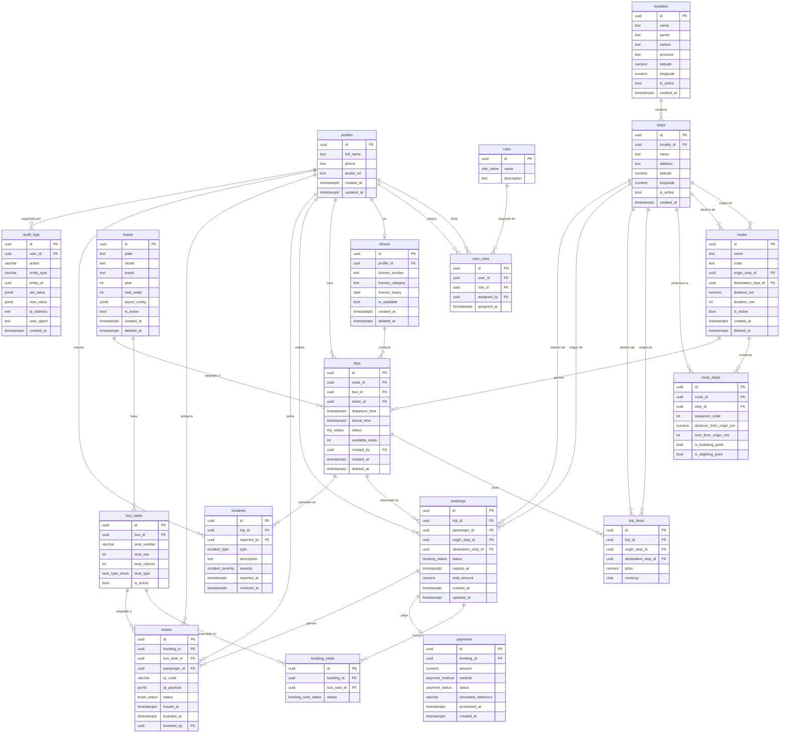

# Modelo de Datos — Ruta Norte

> **Versión:** 1.0.0  
> **Motor:** Supabase PostgreSQL 15+  
> **Esquema principal:** `public`  
> **Esquema de autenticación:** `auth` (gestionado por Supabase)

---

## Tabla de Contenidos

1. [Convenciones Globales](#1-convenciones-globales)
2. [Diagrama Entidad-Relación](#2-diagrama-entidad-relación)
3. [Definición de Tablas](#3-definición-de-tablas)
4. [Enums PostgreSQL](#4-enums-postgresql)
5. [Funciones y Triggers Críticos](#5-funciones-y-triggers-críticos)
6. [Índices de Rendimiento](#6-índices-de-rendimiento)
7. [Reglas de Integridad del Negocio](#7-reglas-de-integridad-del-negocio)
8. [Estrategia de Seed Data](#8-estrategia-de-seed-data)

---

## 1. Convenciones Globales

| Aspecto | Convención |
|---|---|
| **Clave primaria** | `UUID v4` generado con `gen_random_uuid()` en todas las tablas |
| **Nomenclatura** | `snake_case` para tablas, columnas, funciones, índices y triggers |
| **Timestamps** | `created_at TIMESTAMPTZ DEFAULT now() NOT NULL` y `updated_at TIMESTAMPTZ DEFAULT now() NOT NULL` en todas las tablas mutables |
| **Soft delete** | Columna `deleted_at TIMESTAMPTZ DEFAULT NULL` en entidades que lo requieran (`routes`, `buses`, `drivers`, `trips`) |
| **Valores fijos** | Enums PostgreSQL nativos prefijados con el nombre de la entidad (ej. `trip_status`) |
| **Moneda** | `NUMERIC(10,2)` para valores monetarios; código de moneda `CHAR(3)` con `DEFAULT 'USD'` |
| **Zona horaria** | Todos los timestamps almacenados en UTC (`TIMESTAMPTZ`); conversión a hora local (America/Guayaquil, UTC-5) en la capa de presentación |
| **JSONB** | Usado únicamente donde la estructura es genuinamente variable o semiestructurada |
| **Esquema** | Todo en esquema `public` salvo referencia explícita a `auth.users` |

> [!IMPORTANT]
> La tabla `auth.users` es gestionada exclusivamente por Supabase Auth. Nunca se insertan filas directamente en ella desde la aplicación. La tabla `profiles` extiende esa identidad en el esquema `public`.

---

## 2. Diagrama Entidad-Relación



---

## 3. Definición de Tablas

---

### 3.1 `profiles`

**Propósito:** Extiende la identidad de `auth.users` con datos de perfil del usuario. Es el ancla de todas las relaciones de persona en el sistema.

#### Columnas

| Columna | Tipo | Constraints | Descripción |
|---|---|---|---|
| `id` | `UUID` | `PK`, `FK auth.users(id) ON DELETE CASCADE` | Mismo UUID que en `auth.users`. No autogenerado aquí. |
| `full_name` | `TEXT` | `NOT NULL`, `CHECK (char_length(full_name) >= 2)` | Nombre completo del usuario |
| `phone` | `TEXT` | `UNIQUE`, `CHECK (phone ~ '^\+?[0-9]{7,15}$')` | Teléfono en formato E.164 o local |
| `avatar_url` | `TEXT` | `NULL` | URL pública de imagen de perfil (Storage de Supabase) |
| `created_at` | `TIMESTAMPTZ` | `NOT NULL DEFAULT now()` | Fecha de creación del perfil |
| `updated_at` | `TIMESTAMPTZ` | `NOT NULL DEFAULT now()` | Última modificación del perfil |

#### Índices

```sql
-- La PK ya genera un índice B-tree en id
CREATE INDEX idx_profiles_phone ON profiles (phone) WHERE phone IS NOT NULL;
```

#### Relaciones

- Referenciado por: `user_roles.user_id`, `user_roles.assigned_by`, `drivers.profile_id`, `trips.created_by`, `bookings.passenger_id`, `tickets.passenger_id`, `tickets.boarded_by`, `incidents.reported_by`, `audit_logs.user_id`

#### Reglas de negocio

- El perfil se crea automáticamente vía trigger `on_auth_user_created` cuando Supabase registra un usuario.
- No se puede eliminar un perfil; si el usuario es dado de baja, se desactiva en `auth.users`.

---

### 3.2 `roles`

**Propósito:** Catálogo fijo de roles del sistema. No es editable desde la UI; los roles se definen en seed data.

#### Columnas

| Columna | Tipo | Constraints | Descripción |
|---|---|---|---|
| `id` | `UUID` | `PK DEFAULT gen_random_uuid()` | Identificador único |
| `name` | `role_name` | `NOT NULL UNIQUE` | Enum: `admin`, `operator`, `seller`, `inspector`, `passenger` |
| `description` | `TEXT` | `NOT NULL` | Descripción legible del rol y sus permisos |

#### Índices

```sql
-- UNIQUE en name ya genera índice
```

#### Reglas de negocio

- Tabla de solo lectura en producción (no se permiten INSERT/UPDATE/DELETE vía RLS excepto para `admin`).

---

### 3.3 `user_roles`

**Propósito:** Tabla puente muchos-a-muchos entre usuarios y roles. Permite asignación múltiple de roles a un usuario.

#### Columnas

| Columna | Tipo | Constraints | Descripción |
|---|---|---|---|
| `id` | `UUID` | `PK DEFAULT gen_random_uuid()` | Identificador único |
| `user_id` | `UUID` | `NOT NULL FK profiles(id) ON DELETE CASCADE` | Usuario al que se asigna el rol |
| `role_id` | `UUID` | `NOT NULL FK roles(id) ON DELETE RESTRICT` | Rol asignado |
| `assigned_by` | `UUID` | `NOT NULL FK profiles(id) ON DELETE RESTRICT` | Administrador que realizó la asignación |
| `assigned_at` | `TIMESTAMPTZ` | `NOT NULL DEFAULT now()` | Fecha y hora de la asignación |

#### Índices

```sql
CREATE UNIQUE INDEX idx_user_roles_user_role ON user_roles (user_id, role_id);
CREATE INDEX idx_user_roles_user_id ON user_roles (user_id);
CREATE INDEX idx_user_roles_role_id ON user_roles (role_id);
```

#### Reglas de negocio

- No se puede asignar el mismo rol dos veces al mismo usuario (unique constraint compuesto).
- Solo un `admin` puede asignar o revocar roles.

---

### 3.4 `localities`

**Propósito:** Catálogo geográfico de localidades (parroquias, recintos, comunidades) del norte de Ecuador. Sirve como referencia geográfica de alto nivel para las paradas.

#### Columnas

| Columna | Tipo | Constraints | Descripción |
|---|---|---|---|
| `id` | `UUID` | `PK DEFAULT gen_random_uuid()` | Identificador único |
| `name` | `TEXT` | `NOT NULL` | Nombre de la localidad |
| `parish` | `TEXT` | `NOT NULL` | Parroquia a la que pertenece |
| `canton` | `TEXT` | `NOT NULL` | Cantón al que pertenece |
| `province` | `TEXT` | `NOT NULL` | Provincia (ej. `Imbabura`, `Carchi`, `Esmeraldas`) |
| `latitude` | `NUMERIC(10,7)` | `NOT NULL CHECK (latitude BETWEEN -90 AND 90)` | Latitud geográfica |
| `longitude` | `NUMERIC(10,7)` | `NOT NULL CHECK (longitude BETWEEN -180 AND 180)` | Longitud geográfica |
| `is_active` | `BOOLEAN` | `NOT NULL DEFAULT true` | Indica si la localidad está operativa |
| `created_at` | `TIMESTAMPTZ` | `NOT NULL DEFAULT now()` | Fecha de creación |

#### Índices

```sql
CREATE INDEX idx_localities_province ON localities (province);
CREATE INDEX idx_localities_canton ON localities (canton);
CREATE INDEX idx_localities_is_active ON localities (is_active) WHERE is_active = true;
```

---

### 3.5 `stops`

**Propósito:** Paradas físicas del sistema de transporte. Una parada pertenece a una localidad y representa un punto físico de abordaje o descenso.

#### Columnas

| Columna | Tipo | Constraints | Descripción |
|---|---|---|---|
| `id` | `UUID` | `PK DEFAULT gen_random_uuid()` | Identificador único |
| `locality_id` | `UUID` | `NOT NULL FK localities(id) ON DELETE RESTRICT` | Localidad a la que pertenece |
| `name` | `TEXT` | `NOT NULL` | Nombre descriptivo de la parada (ej. "Terminal de Ibarra") |
| `address` | `TEXT` | `NULL` | Dirección postal o referencia física |
| `latitude` | `NUMERIC(10,7)` | `NOT NULL CHECK (latitude BETWEEN -90 AND 90)` | Latitud geográfica exacta |
| `longitude` | `NUMERIC(10,7)` | `NOT NULL CHECK (longitude BETWEEN -180 AND 180)` | Longitud geográfica exacta |
| `is_active` | `BOOLEAN` | `NOT NULL DEFAULT true` | Indica si la parada está en servicio |
| `created_at` | `TIMESTAMPTZ` | `NOT NULL DEFAULT now()` | Fecha de creación |

#### Índices

```sql
CREATE INDEX idx_stops_locality_id ON stops (locality_id);
CREATE INDEX idx_stops_is_active ON stops (is_active) WHERE is_active = true;
```

---

### 3.6 `routes`

**Propósito:** Define una ruta fija con punto de origen y destino. Una ruta es la plantilla sobre la cual se generan los viajes.

#### Columnas

| Columna | Tipo | Constraints | Descripción |
|---|---|---|---|
| `id` | `UUID` | `PK DEFAULT gen_random_uuid()` | Identificador único |
| `name` | `TEXT` | `NOT NULL` | Nombre descriptivo (ej. "Ibarra – Tulcán") |
| `code` | `TEXT` | `NOT NULL UNIQUE` | Código único de ruta (ej. "IB-TUL-01") |
| `origin_stop_id` | `UUID` | `NOT NULL FK stops(id) ON DELETE RESTRICT` | Parada de origen |
| `destination_stop_id` | `UUID` | `NOT NULL FK stops(id) ON DELETE RESTRICT` | Parada de destino |
| `distance_km` | `NUMERIC(8,2)` | `NOT NULL CHECK (distance_km > 0)` | Distancia total en kilómetros |
| `duration_min` | `INTEGER` | `NOT NULL CHECK (duration_min > 0)` | Duración estimada en minutos |
| `is_active` | `BOOLEAN` | `NOT NULL DEFAULT true` | Indica si la ruta está habilitada |
| `created_at` | `TIMESTAMPTZ` | `NOT NULL DEFAULT now()` | Fecha de creación |
| `deleted_at` | `TIMESTAMPTZ` | `NULL` | Soft delete: fecha de desactivación permanente |

#### Índices

```sql
-- UNIQUE en code ya genera índice
CREATE INDEX idx_routes_origin ON routes (origin_stop_id);
CREATE INDEX idx_routes_destination ON routes (destination_stop_id);
CREATE INDEX idx_routes_is_active ON routes (is_active) WHERE is_active = true AND deleted_at IS NULL;
```

#### Reglas de negocio

- `origin_stop_id` y `destination_stop_id` no pueden ser iguales (`CHECK (origin_stop_id <> destination_stop_id)`).
- Una ruta con `deleted_at IS NOT NULL` no puede ser asignada a nuevos viajes.

---

### 3.7 `route_stops`

**Propósito:** Define la secuencia de paradas intermedias de una ruta, incluyendo distancias y tiempos parciales. Permite calcular tarifas por tramo.

#### Columnas

| Columna | Tipo | Constraints | Descripción |
|---|---|---|---|
| `id` | `UUID` | `PK DEFAULT gen_random_uuid()` | Identificador único |
| `route_id` | `UUID` | `NOT NULL FK routes(id) ON DELETE CASCADE` | Ruta a la que pertenece |
| `stop_id` | `UUID` | `NOT NULL FK stops(id) ON DELETE RESTRICT` | Parada en la secuencia |
| `sequence_order` | `INTEGER` | `NOT NULL CHECK (sequence_order >= 0)` | Posición en la secuencia (0 = origen) |
| `distance_from_origin_km` | `NUMERIC(8,2)` | `NOT NULL DEFAULT 0 CHECK (distance_from_origin_km >= 0)` | Kilómetros acumulados desde el origen |
| `time_from_origin_min` | `INTEGER` | `NOT NULL DEFAULT 0 CHECK (time_from_origin_min >= 0)` | Minutos estimados desde el origen |
| `is_boarding_point` | `BOOLEAN` | `NOT NULL DEFAULT true` | Permite abordaje en esta parada |
| `is_alighting_point` | `BOOLEAN` | `NOT NULL DEFAULT true` | Permite descenso en esta parada |

#### Índices

```sql
CREATE UNIQUE INDEX idx_route_stops_route_seq ON route_stops (route_id, sequence_order);
CREATE UNIQUE INDEX idx_route_stops_route_stop ON route_stops (route_id, stop_id);
CREATE INDEX idx_route_stops_stop_id ON route_stops (stop_id);
```

---

### 3.8 `buses`

**Propósito:** Registro del parque vehicular disponible para asignación a viajes.

#### Columnas

| Columna | Tipo | Constraints | Descripción |
|---|---|---|---|
| `id` | `UUID` | `PK DEFAULT gen_random_uuid()` | Identificador único |
| `plate` | `TEXT` | `NOT NULL UNIQUE` | Placa del vehículo (formato ecuatoriano) |
| `model` | `TEXT` | `NOT NULL` | Modelo del vehículo |
| `brand` | `TEXT` | `NOT NULL` | Marca del vehículo |
| `year` | `INTEGER` | `NOT NULL CHECK (year BETWEEN 1990 AND 2100)` | Año de fabricación |
| `total_seats` | `INTEGER` | `NOT NULL CHECK (total_seats BETWEEN 1 AND 100)` | Total de asientos habilitados |
| `layout_config` | `JSONB` | `NOT NULL DEFAULT '{}'` | Configuración visual del bus (filas, columnas, pasillos) |
| `is_active` | `BOOLEAN` | `NOT NULL DEFAULT true` | Indica si el bus está operativo |
| `created_at` | `TIMESTAMPTZ` | `NOT NULL DEFAULT now()` | Fecha de registro |
| `deleted_at` | `TIMESTAMPTZ` | `NULL` | Soft delete |

#### Esquema de `layout_config` (JSONB)

```json
{
  "rows": 10,
  "columns": 4,
  "aisle_after_column": 2,
  "deck": "single",
  "excluded_seats": ["1A", "1B"]
}
```

#### Índices

```sql
-- UNIQUE en plate ya genera índice
CREATE INDEX idx_buses_is_active ON buses (is_active) WHERE is_active = true AND deleted_at IS NULL;
```

---

### 3.9 `bus_seats`

**Propósito:** Representa cada asiento físico y permanente de un bus. Los asientos son la unidad de venta del sistema.

#### Columnas

| Columna | Tipo | Constraints | Descripción |
|---|---|---|---|
| `id` | `UUID` | `PK DEFAULT gen_random_uuid()` | Identificador único |
| `bus_id` | `UUID` | `NOT NULL FK buses(id) ON DELETE CASCADE` | Bus al que pertenece |
| `seat_number` | `VARCHAR(10)` | `NOT NULL` | Código del asiento (ej. "12A", "05B") |
| `seat_row` | `INTEGER` | `NOT NULL CHECK (seat_row >= 1)` | Fila del asiento |
| `seat_column` | `INTEGER` | `NOT NULL CHECK (seat_column >= 1)` | Columna del asiento |
| `seat_type` | `seat_type_enum` | `NOT NULL DEFAULT 'standard'` | Tipo: `standard`, `premium`, `accessibility` |
| `is_active` | `BOOLEAN` | `NOT NULL DEFAULT true` | Si el asiento está habilitado para venta |

#### Índices

```sql
CREATE UNIQUE INDEX idx_bus_seats_bus_number ON bus_seats (bus_id, seat_number);
CREATE INDEX idx_bus_seats_bus_id ON bus_seats (bus_id);
CREATE INDEX idx_bus_seats_type ON bus_seats (bus_id, seat_type);
```

---

### 3.10 `drivers`

**Propósito:** Información de conductores habilitados, vinculados a un perfil de usuario del sistema.

#### Columnas

| Columna | Tipo | Constraints | Descripción |
|---|---|---|---|
| `id` | `UUID` | `PK DEFAULT gen_random_uuid()` | Identificador único |
| `profile_id` | `UUID` | `NOT NULL UNIQUE FK profiles(id) ON DELETE RESTRICT` | Perfil de usuario del conductor |
| `license_number` | `TEXT` | `NOT NULL UNIQUE` | Número de licencia de conducción |
| `license_category` | `TEXT` | `NOT NULL` | Categoría de licencia (ej. "D", "E") |
| `license_expiry` | `DATE` | `NOT NULL` | Fecha de vencimiento de la licencia |
| `is_available` | `BOOLEAN` | `NOT NULL DEFAULT true` | Si el conductor está disponible para asignación |
| `created_at` | `TIMESTAMPTZ` | `NOT NULL DEFAULT now()` | Fecha de registro |
| `deleted_at` | `TIMESTAMPTZ` | `NULL` | Soft delete |

#### Índices

```sql
-- UNIQUE en profile_id y license_number ya generan índices
CREATE INDEX idx_drivers_is_available ON drivers (is_available) WHERE is_available = true AND deleted_at IS NULL;
CREATE INDEX idx_drivers_license_expiry ON drivers (license_expiry);
```

#### Reglas de negocio

- Un conductor con `license_expiry < CURRENT_DATE` no puede ser asignado a viajes nuevos (validado en la función de creación de viajes).

---

### 3.11 `trips`

**Propósito:** Representa una salida concreta programada de una ruta en fecha y hora específica, con bus y conductor asignados.

#### Columnas

| Columna | Tipo | Constraints | Descripción |
|---|---|---|---|
| `id` | `UUID` | `PK DEFAULT gen_random_uuid()` | Identificador único |
| `route_id` | `UUID` | `NOT NULL FK routes(id) ON DELETE RESTRICT` | Ruta que se recorre |
| `bus_id` | `UUID` | `NOT NULL FK buses(id) ON DELETE RESTRICT` | Bus asignado |
| `driver_id` | `UUID` | `NOT NULL FK drivers(id) ON DELETE RESTRICT` | Conductor asignado |
| `departure_time` | `TIMESTAMPTZ` | `NOT NULL` | Fecha y hora de salida en UTC |
| `arrival_time` | `TIMESTAMPTZ` | `NOT NULL` | Fecha y hora estimada de llegada en UTC |
| `status` | `trip_status` | `NOT NULL DEFAULT 'scheduled'` | Estado actual del viaje |
| `available_seats` | `INTEGER` | `NOT NULL CHECK (available_seats >= 0)` | Asientos disponibles (mantenido por trigger) |
| `created_by` | `UUID` | `NOT NULL FK profiles(id) ON DELETE RESTRICT` | Usuario que programó el viaje |
| `created_at` | `TIMESTAMPTZ` | `NOT NULL DEFAULT now()` | Fecha de creación |
| `deleted_at` | `TIMESTAMPTZ` | `NULL` | Soft delete |

#### Índices

```sql
CREATE INDEX idx_trips_route_id ON trips (route_id);
CREATE INDEX idx_trips_bus_id ON trips (bus_id);
CREATE INDEX idx_trips_driver_id ON trips (driver_id);
CREATE INDEX idx_trips_departure_time ON trips (departure_time);
CREATE INDEX idx_trips_status ON trips (status);
CREATE INDEX idx_trips_available ON trips (departure_time, status, available_seats)
  WHERE status IN ('scheduled', 'boarding') AND available_seats > 0 AND deleted_at IS NULL;
```

#### Reglas de negocio

- `arrival_time` debe ser posterior a `departure_time` (`CHECK (arrival_time > departure_time)`).
- `available_seats` se inicializa con `buses.total_seats` y se actualiza por trigger.
- Un bus no puede estar asignado a dos viajes con estados activos que se solapen en tiempo.

---

### 3.12 `trip_fares`

**Propósito:** Define el precio de cada tramo origen-destino dentro de un viaje específico. Permite tarifas dinámicas por viaje.

#### Columnas

| Columna | Tipo | Constraints | Descripción |
|---|---|---|---|
| `id` | `UUID` | `PK DEFAULT gen_random_uuid()` | Identificador único |
| `trip_id` | `UUID` | `NOT NULL FK trips(id) ON DELETE CASCADE` | Viaje al que aplica la tarifa |
| `origin_stop_id` | `UUID` | `NOT NULL FK stops(id) ON DELETE RESTRICT` | Parada de origen del tramo |
| `destination_stop_id` | `UUID` | `NOT NULL FK stops(id) ON DELETE RESTRICT` | Parada de destino del tramo |
| `price` | `NUMERIC(10,2)` | `NOT NULL CHECK (price >= 0)` | Precio en la moneda especificada |
| `currency` | `CHAR(3)` | `NOT NULL DEFAULT 'USD'` | Código ISO 4217 (siempre `USD` en Ecuador) |

#### Índices

```sql
CREATE UNIQUE INDEX idx_trip_fares_trip_od ON trip_fares (trip_id, origin_stop_id, destination_stop_id);
CREATE INDEX idx_trip_fares_trip_id ON trip_fares (trip_id);
```

#### Reglas de negocio

- `origin_stop_id <> destination_stop_id`.
- Ambas paradas deben pertenecer a la secuencia de paradas de la ruta asociada al viaje.

---

### 3.13 `bookings`

**Propósito:** Reserva temporal de uno o más asientos por un pasajero. Tiene un tiempo de expiración configurable (por defecto 15 minutos). Puede convertirse en venta confirmada tras el pago.

#### Columnas

| Columna | Tipo | Constraints | Descripción |
|---|---|---|---|
| `id` | `UUID` | `PK DEFAULT gen_random_uuid()` | Identificador único |
| `trip_id` | `UUID` | `NOT NULL FK trips(id) ON DELETE RESTRICT` | Viaje reservado |
| `passenger_id` | `UUID` | `NOT NULL FK profiles(id) ON DELETE RESTRICT` | Pasajero que reserva |
| `origin_stop_id` | `UUID` | `NOT NULL FK stops(id) ON DELETE RESTRICT` | Parada de abordaje seleccionada |
| `destination_stop_id` | `UUID` | `NOT NULL FK stops(id) ON DELETE RESTRICT` | Parada de descenso seleccionada |
| `status` | `booking_status` | `NOT NULL DEFAULT 'pending'` | Estado: `pending`, `confirmed`, `cancelled`, `expired` |
| `expires_at` | `TIMESTAMPTZ` | `NOT NULL` | Marca temporal de expiración de la reserva |
| `total_amount` | `NUMERIC(10,2)` | `NOT NULL CHECK (total_amount >= 0)` | Monto total de la reserva |
| `created_at` | `TIMESTAMPTZ` | `NOT NULL DEFAULT now()` | Fecha de creación |
| `updated_at` | `TIMESTAMPTZ` | `NOT NULL DEFAULT now()` | Última actualización |

#### Índices

```sql
CREATE INDEX idx_bookings_trip_id ON bookings (trip_id);
CREATE INDEX idx_bookings_passenger_id ON bookings (passenger_id);
CREATE INDEX idx_bookings_status ON bookings (status);
CREATE INDEX idx_bookings_expires_at ON bookings (expires_at)
  WHERE status = 'pending';
```

#### Reglas de negocio

- No se puede crear una reserva en un viaje con `status = 'cancelled'` o `'completed'`.
- `expires_at` se calcula como `now() + INTERVAL '15 minutes'` salvo configuración distinta.
- Una reserva `pending` con `expires_at < now()` es expirada por el trigger de expiración.

---

### 3.14 `booking_seats`

**Propósito:** Detalle de los asientos concretos asociados a una reserva. Un booking puede abarcar múltiples asientos.

#### Columnas

| Columna | Tipo | Constraints | Descripción |
|---|---|---|---|
| `id` | `UUID` | `PK DEFAULT gen_random_uuid()` | Identificador único |
| `booking_id` | `UUID` | `NOT NULL FK bookings(id) ON DELETE CASCADE` | Reserva a la que pertenece |
| `bus_seat_id` | `UUID` | `NOT NULL FK bus_seats(id) ON DELETE RESTRICT` | Asiento reservado |
| `status` | `booking_seat_status` | `NOT NULL DEFAULT 'reserved'` | Estado: `reserved`, `sold`, `cancelled` |

#### Índices

```sql
CREATE INDEX idx_booking_seats_booking_id ON booking_seats (booking_id);
CREATE INDEX idx_booking_seats_bus_seat_id ON booking_seats (bus_seat_id);
-- Índice parcial para búsqueda de asientos activos en un viaje
CREATE INDEX idx_booking_seats_active ON booking_seats (bus_seat_id, status)
  WHERE status IN ('reserved', 'sold');
```

#### Reglas de negocio

- La unicidad de un asiento por viaje se garantiza mediante la función `reserve_seat()` que usa `SELECT FOR UPDATE` para evitar condiciones de carrera.
- No puede existir más de un `booking_seat` con `status IN ('reserved', 'sold')` para el mismo `bus_seat_id` dentro del mismo viaje. Esto se valida a nivel de función transaccional, no solo con índice.

---

### 3.15 `payments`

**Propósito:** Registro del pago (simulado) asociado a una reserva. El sistema usa métodos de pago simulados ya que no integra pasarelas reales en esta versión.

#### Columnas

| Columna | Tipo | Constraints | Descripción |
|---|---|---|---|
| `id` | `UUID` | `PK DEFAULT gen_random_uuid()` | Identificador único |
| `booking_id` | `UUID` | `NOT NULL UNIQUE FK bookings(id) ON DELETE RESTRICT` | Reserva pagada (1:1 con booking) |
| `amount` | `NUMERIC(10,2)` | `NOT NULL CHECK (amount >= 0)` | Monto pagado |
| `method` | `payment_method` | `NOT NULL` | Método simulado de pago |
| `status` | `payment_status` | `NOT NULL DEFAULT 'pending'` | Estado: `pending`, `completed`, `failed`, `refunded` |
| `simulated_reference` | `VARCHAR(100)` | `NULL` | Referencia generada por el simulador |
| `processed_at` | `TIMESTAMPTZ` | `NULL` | Fecha de procesamiento efectivo |
| `created_at` | `TIMESTAMPTZ` | `NOT NULL DEFAULT now()` | Fecha de creación del registro |

#### Índices

```sql
-- UNIQUE en booking_id ya genera índice
CREATE INDEX idx_payments_status ON payments (status);
CREATE INDEX idx_payments_processed_at ON payments (processed_at) WHERE processed_at IS NOT NULL;
```

#### Reglas de negocio

- Solo puede existir **un** pago por reserva (relación 1:1).
- Cuando `status = 'completed'`, la reserva asociada pasa a `confirmed` vía trigger.
- Un pago `completed` no puede ser eliminado, solo marcado como `refunded`.

---

### 3.16 `tickets`

**Propósito:** Boleto digital emitido por asiento tras confirmar el pago. Contiene el código QR único para validación en abordaje. Los boletos nunca se eliminan físicamente.

#### Columnas

| Columna | Tipo | Constraints | Descripción |
|---|---|---|---|
| `id` | `UUID` | `PK DEFAULT gen_random_uuid()` | Identificador único |
| `booking_id` | `UUID` | `NOT NULL FK bookings(id) ON DELETE RESTRICT` | Reserva de la que proviene |
| `bus_seat_id` | `UUID` | `NOT NULL FK bus_seats(id) ON DELETE RESTRICT` | Asiento al que corresponde |
| `passenger_id` | `UUID` | `NOT NULL FK profiles(id) ON DELETE RESTRICT` | Pasajero titular |
| `qr_code` | `VARCHAR(255)` | `NOT NULL UNIQUE` | Token único del código QR |
| `qr_payload` | `JSONB` | `NOT NULL` | Datos embebidos en el QR |
| `status` | `ticket_status` | `NOT NULL DEFAULT 'issued'` | Estado: `issued`, `used`, `cancelled` |
| `issued_at` | `TIMESTAMPTZ` | `NOT NULL DEFAULT now()` | Fecha de emisión |
| `boarded_at` | `TIMESTAMPTZ` | `NULL` | Fecha de uso/embarque efectivo |
| `boarded_by` | `UUID` | `NULL FK profiles(id) ON DELETE RESTRICT` | Inspector que validó el boleto |

#### Esquema de `qr_payload` (JSONB)

```json
{
  "ticket_id": "uuid",
  "passenger_name": "Nombre Apellido",
  "trip_id": "uuid",
  "route_name": "Ibarra – Tulcán",
  "departure_time": "2024-01-15T08:00:00Z",
  "origin_stop": "Terminal Ibarra",
  "destination_stop": "Terminal Tulcán",
  "seat_number": "12A",
  "issued_at": "2024-01-14T18:30:00Z",
  "checksum": "sha256-hash"
}
```

#### Índices

```sql
-- UNIQUE en qr_code ya genera índice
CREATE INDEX idx_tickets_booking_id ON tickets (booking_id);
CREATE INDEX idx_tickets_passenger_id ON tickets (passenger_id);
CREATE INDEX idx_tickets_status ON tickets (status);
CREATE INDEX idx_tickets_trip ON tickets (booking_id, status) WHERE status = 'issued';
```

#### Reglas de negocio

- Un boleto `issued` puede ser validado una sola vez; tras ello pasa a `used`.
- Un boleto `cancelled` no puede ser validado.
- `boarded_by` solo puede ser un usuario con rol `inspector`.

---

### 3.17 `incidents`

**Propósito:** Registro de incidencias operativas ocurridas durante un viaje (retrasos, averías, accidentes, otros).

#### Columnas

| Columna | Tipo | Constraints | Descripción |
|---|---|---|---|
| `id` | `UUID` | `PK DEFAULT gen_random_uuid()` | Identificador único |
| `trip_id` | `UUID` | `NOT NULL FK trips(id) ON DELETE RESTRICT` | Viaje en el que ocurrió |
| `reported_by` | `UUID` | `NOT NULL FK profiles(id) ON DELETE RESTRICT` | Usuario que reportó la incidencia |
| `type` | `incident_type` | `NOT NULL` | Tipo: `delay`, `breakdown`, `accident`, `other` |
| `description` | `TEXT` | `NOT NULL CHECK (char_length(description) >= 10)` | Descripción detallada de la incidencia |
| `severity` | `incident_severity` | `NOT NULL` | Severidad: `low`, `medium`, `high`, `critical` |
| `reported_at` | `TIMESTAMPTZ` | `NOT NULL DEFAULT now()` | Fecha y hora del reporte |
| `resolved_at` | `TIMESTAMPTZ` | `NULL` | Fecha y hora de resolución |

#### Índices

```sql
CREATE INDEX idx_incidents_trip_id ON incidents (trip_id);
CREATE INDEX idx_incidents_reported_by ON incidents (reported_by);
CREATE INDEX idx_incidents_type ON incidents (type);
CREATE INDEX idx_incidents_severity ON incidents (severity);
CREATE INDEX idx_incidents_unresolved ON incidents (trip_id, severity)
  WHERE resolved_at IS NULL;
```

---

### 3.18 `audit_logs`

**Propósito:** Registro inmutable de todas las operaciones críticas del sistema para trazabilidad y auditoría. Solo se escriben registros, nunca se modifican ni eliminan.

#### Columnas

| Columna | Tipo | Constraints | Descripción |
|---|---|---|---|
| `id` | `UUID` | `PK DEFAULT gen_random_uuid()` | Identificador único |
| `user_id` | `UUID` | `NULL FK profiles(id) ON DELETE SET NULL` | Usuario que ejecutó la acción (NULL si es sistema) |
| `action` | `VARCHAR(100)` | `NOT NULL` | Acción ejecutada (ej. `booking.create`, `trip.cancel`) |
| `entity_type` | `VARCHAR(100)` | `NOT NULL` | Tipo de entidad afectada (ej. `bookings`, `trips`) |
| `entity_id` | `UUID` | `NOT NULL` | ID de la entidad afectada |
| `old_value` | `JSONB` | `NULL` | Estado anterior de la entidad |
| `new_value` | `JSONB` | `NULL` | Estado nuevo de la entidad |
| `ip_address` | `INET` | `NULL` | Dirección IP del cliente |
| `user_agent` | `TEXT` | `NULL` | User-Agent del cliente HTTP |
| `created_at` | `TIMESTAMPTZ` | `NOT NULL DEFAULT now()` | Timestamp del evento |

#### Índices

```sql
CREATE INDEX idx_audit_logs_user_id ON audit_logs (user_id);
CREATE INDEX idx_audit_logs_entity ON audit_logs (entity_type, entity_id);
CREATE INDEX idx_audit_logs_action ON audit_logs (action);
CREATE INDEX idx_audit_logs_created_at ON audit_logs (created_at DESC);
```

> [!CAUTION]
> **Nunca aplicar RLS UPDATE o DELETE en `audit_logs`.** Esta tabla es de solo inserción (`INSERT ONLY`) para todos los roles. La eliminación de registros de auditoría solo puede realizarse por el super-administrador de la base de datos.

---

## 4. Enums PostgreSQL

```sql
-- Roles del sistema
CREATE TYPE role_name AS ENUM (
  'admin',
  'operator',
  'seller',
  'inspector',
  'passenger'
);

-- Tipos de asiento
CREATE TYPE seat_type_enum AS ENUM (
  'standard',
  'premium',
  'accessibility'
);

-- Estados de un viaje
CREATE TYPE trip_status AS ENUM (
  'scheduled',    -- Programado, aún no ha iniciado el abordaje
  'boarding',     -- En proceso de abordaje de pasajeros
  'in_progress',  -- Bus en movimiento
  'completed',    -- Viaje finalizado exitosamente
  'cancelled'     -- Viaje cancelado antes de partir
);

-- Estados de una reserva
CREATE TYPE booking_status AS ENUM (
  'pending',      -- Reserva creada, pendiente de pago
  'confirmed',    -- Pago recibido y confirmado
  'cancelled',    -- Cancelada por el usuario o el sistema
  'expired'       -- Expiró sin que se completara el pago
);

-- Estados de un asiento dentro de una reserva
CREATE TYPE booking_seat_status AS ENUM (
  'reserved',     -- Retenido temporalmente (reserva pending)
  'sold',         -- Vendido definitivamente (reserva confirmed)
  'cancelled'     -- Liberado (reserva cancelada o expirada)
);

-- Métodos de pago simulados
CREATE TYPE payment_method AS ENUM (
  'simulated_card',
  'simulated_cash',
  'simulated_transfer'
);

-- Estados de un pago
CREATE TYPE payment_status AS ENUM (
  'pending',      -- Iniciado, esperando procesamiento
  'completed',    -- Procesado exitosamente
  'failed',       -- Procesamiento fallido
  'refunded'      -- Reembolsado
);

-- Estados de un boleto
CREATE TYPE ticket_status AS ENUM (
  'issued',       -- Emitido y válido para uso
  'used',         -- Ya fue escaneado/validado en abordaje
  'cancelled'     -- Anulado (no válido para uso)
);

-- Tipos de incidencia
CREATE TYPE incident_type AS ENUM (
  'delay',
  'breakdown',
  'accident',
  'other'
);

-- Severidad de incidencia
CREATE TYPE incident_severity AS ENUM (
  'low',
  'medium',
  'high',
  'critical'
);
```

---

## 5. Funciones y Triggers Críticos

### 5.1 Función Transaccional de Reserva de Asiento

Previene doble venta mediante bloqueo pesimista a nivel de fila. Es la función más crítica del sistema.

```sql
CREATE OR REPLACE FUNCTION reserve_seats(
  p_trip_id       UUID,
  p_passenger_id  UUID,
  p_origin_stop_id UUID,
  p_destination_stop_id UUID,
  p_seat_ids      UUID[],
  p_total_amount  NUMERIC,
  p_expires_in_minutes INTEGER DEFAULT 15
)
RETURNS UUID
LANGUAGE plpgsql
SECURITY DEFINER
AS $$
DECLARE
  v_booking_id  UUID;
  v_seat_id     UUID;
  v_trip_status trip_status;
  v_conflict    INTEGER;
BEGIN
  -- 1. Verificar que el viaje permite reservas
  SELECT status INTO v_trip_status
  FROM trips
  WHERE id = p_trip_id AND deleted_at IS NULL
  FOR UPDATE;

  IF v_trip_status NOT IN ('scheduled', 'boarding') THEN
    RAISE EXCEPTION 'El viaje % no está disponible para reservas (estado: %)',
      p_trip_id, v_trip_status;
  END IF;

  -- 2. Bloquear los asientos seleccionados para evitar condición de carrera
  PERFORM id FROM bus_seats
  WHERE id = ANY(p_seat_ids)
  ORDER BY id  -- Orden consistente para evitar deadlocks
  FOR UPDATE;

  -- 3. Verificar que ningún asiento ya esté reservado o vendido en este viaje
  SELECT COUNT(*) INTO v_conflict
  FROM booking_seats bs
  JOIN bookings b ON bs.booking_id = b.id
  WHERE bs.bus_seat_id = ANY(p_seat_ids)
    AND b.trip_id = p_trip_id
    AND bs.status IN ('reserved', 'sold')
    AND b.status IN ('pending', 'confirmed');

  IF v_conflict > 0 THEN
    RAISE EXCEPTION 'Uno o más asientos ya están ocupados para este viaje.';
  END IF;

  -- 4. Crear la reserva
  INSERT INTO bookings (
    trip_id, passenger_id, origin_stop_id, destination_stop_id,
    status, expires_at, total_amount
  )
  VALUES (
    p_trip_id, p_passenger_id, p_origin_stop_id, p_destination_stop_id,
    'pending', now() + (p_expires_in_minutes || ' minutes')::INTERVAL,
    p_total_amount
  )
  RETURNING id INTO v_booking_id;

  -- 5. Crear los booking_seats
  FOREACH v_seat_id IN ARRAY p_seat_ids LOOP
    INSERT INTO booking_seats (booking_id, bus_seat_id, status)
    VALUES (v_booking_id, v_seat_id, 'reserved');
  END LOOP;

  -- 6. Registrar en auditoría
  INSERT INTO audit_logs (action, entity_type, entity_id, new_value)
  VALUES (
    'booking.create',
    'bookings',
    v_booking_id,
    jsonb_build_object(
      'trip_id', p_trip_id,
      'passenger_id', p_passenger_id,
      'seat_ids', p_seat_ids,
      'total_amount', p_total_amount
    )
  );

  RETURN v_booking_id;
END;
$$;
```

---

### 5.2 Trigger de Expiración de Reservas

Expira automáticamente las reservas `pending` que han superado su `expires_at`. Se recomienda ejecutarlo periódicamente vía `pg_cron` o desde la aplicación.

```sql
CREATE OR REPLACE FUNCTION expire_pending_bookings()
RETURNS INTEGER
LANGUAGE plpgsql
SECURITY DEFINER
AS $$
DECLARE
  v_count INTEGER;
BEGIN
  -- Marcar reservas expiradas
  WITH expired AS (
    UPDATE bookings
    SET    status     = 'expired',
           updated_at = now()
    WHERE  status    = 'pending'
      AND  expires_at < now()
    RETURNING id
  ),
  -- Liberar los asientos asociados
  freed_seats AS (
    UPDATE booking_seats
    SET    status = 'cancelled'
    WHERE  booking_id IN (SELECT id FROM expired)
      AND  status    = 'reserved'
    RETURNING 1
  )
  SELECT COUNT(*) INTO v_count FROM expired;

  -- Registrar en auditoría si hubo expiraciones
  IF v_count > 0 THEN
    INSERT INTO audit_logs (action, entity_type, entity_id, new_value)
    VALUES (
      'booking.expire_batch',
      'bookings',
      gen_random_uuid(),
      jsonb_build_object('expired_count', v_count, 'executed_at', now())
    );
  END IF;

  RETURN v_count;
END;
$$;
```

> [!TIP]
> Configura `pg_cron` en Supabase para ejecutar `SELECT expire_pending_bookings()` cada minuto:
> `SELECT cron.schedule('expire-bookings', '* * * * *', 'SELECT expire_pending_bookings()');`

---

### 5.3 Trigger de Actualización de `available_seats`

Recalcula los asientos disponibles en `trips` cuando cambia el estado de `booking_seats`.

```sql
CREATE OR REPLACE FUNCTION update_trip_available_seats()
RETURNS TRIGGER
LANGUAGE plpgsql
AS $$
DECLARE
  v_trip_id UUID;
  v_occupied INTEGER;
  v_total    INTEGER;
BEGIN
  -- Obtener el trip_id desde la reserva
  SELECT b.trip_id INTO v_trip_id
  FROM bookings b
  WHERE b.id = COALESCE(NEW.booking_id, OLD.booking_id);

  -- Contar asientos activamente ocupados (reservados o vendidos)
  SELECT COUNT(*) INTO v_occupied
  FROM booking_seats bs
  JOIN bookings b ON bs.booking_id = b.id
  WHERE b.trip_id = v_trip_id
    AND bs.status IN ('reserved', 'sold')
    AND b.status  IN ('pending', 'confirmed');

  -- Obtener total de asientos del bus
  SELECT bu.total_seats INTO v_total
  FROM trips t
  JOIN buses bu ON t.bus_id = bu.id
  WHERE t.id = v_trip_id;

  -- Actualizar disponibles
  UPDATE trips
  SET    available_seats = GREATEST(0, v_total - v_occupied),
         updated_at      = now()  -- si la columna existe en trips
  WHERE  id = v_trip_id;

  RETURN NEW;
END;
$$;

CREATE TRIGGER trg_update_available_seats
AFTER INSERT OR UPDATE OF status OR DELETE
ON booking_seats
FOR EACH ROW
EXECUTE FUNCTION update_trip_available_seats();
```

---

### 5.4 Trigger de Audit Log Genérico

Registra cambios en tablas críticas de forma automática.

```sql
CREATE OR REPLACE FUNCTION generic_audit_trigger()
RETURNS TRIGGER
LANGUAGE plpgsql
SECURITY DEFINER
AS $$
DECLARE
  v_action VARCHAR;
BEGIN
  IF    TG_OP = 'INSERT' THEN v_action := TG_TABLE_NAME || '.insert';
  ELSIF TG_OP = 'UPDATE' THEN v_action := TG_TABLE_NAME || '.update';
  ELSIF TG_OP = 'DELETE' THEN v_action := TG_TABLE_NAME || '.delete';
  END IF;

  INSERT INTO audit_logs (
    action,
    entity_type,
    entity_id,
    old_value,
    new_value
  )
  VALUES (
    v_action,
    TG_TABLE_NAME,
    COALESCE((NEW).id, (OLD).id),
    CASE WHEN TG_OP IN ('UPDATE', 'DELETE') THEN to_jsonb(OLD) ELSE NULL END,
    CASE WHEN TG_OP IN ('INSERT', 'UPDATE') THEN to_jsonb(NEW) ELSE NULL END
  );

  RETURN COALESCE(NEW, OLD);
END;
$$;

-- Aplicar a tablas críticas:
CREATE TRIGGER trg_audit_trips
AFTER INSERT OR UPDATE OR DELETE ON trips
FOR EACH ROW EXECUTE FUNCTION generic_audit_trigger();

CREATE TRIGGER trg_audit_bookings
AFTER INSERT OR UPDATE OR DELETE ON bookings
FOR EACH ROW EXECUTE FUNCTION generic_audit_trigger();

CREATE TRIGGER trg_audit_payments
AFTER INSERT OR UPDATE OR DELETE ON payments
FOR EACH ROW EXECUTE FUNCTION generic_audit_trigger();

CREATE TRIGGER trg_audit_tickets
AFTER INSERT OR UPDATE OR DELETE ON tickets
FOR EACH ROW EXECUTE FUNCTION generic_audit_trigger();
```

---

### 5.5 Función de Generación de QR Payload

Genera el payload JSON firmado que se embebe en el código QR de cada boleto.

```sql
CREATE OR REPLACE FUNCTION generate_qr_payload(
  p_ticket_id   UUID,
  p_booking_id  UUID,
  p_seat_id     UUID
)
RETURNS JSONB
LANGUAGE plpgsql
SECURITY DEFINER
AS $$
DECLARE
  v_payload JSONB;
BEGIN
  SELECT jsonb_build_object(
    'ticket_id',       t.id,
    'passenger_name',  p.full_name,
    'trip_id',         b.trip_id,
    'route_name',      r.name,
    'route_code',      r.code,
    'departure_time',  tr.departure_time,
    'origin_stop',     os.name,
    'destination_stop', ds.name,
    'seat_number',     bs.seat_number,
    'seat_type',       bs.seat_type,
    'issued_at',       now(),
    -- Checksum simple basado en IDs concatenados (en producción usar pgcrypto)
    'checksum',        encode(
                         digest(
                           t.id::TEXT || b.trip_id::TEXT || bs.seat_number,
                           'sha256'
                         ),
                         'hex'
                       )
  )
  INTO v_payload
  FROM tickets t
  JOIN bookings b   ON t.booking_id       = b.id
  JOIN profiles p   ON t.passenger_id     = p.id
  JOIN trips tr     ON b.trip_id          = tr.id
  JOIN routes r     ON tr.route_id        = r.id
  JOIN stops os     ON b.origin_stop_id   = os.id
  JOIN stops ds     ON b.destination_stop_id = ds.id
  JOIN bus_seats bs ON t.bus_seat_id      = bs.id
  WHERE t.id = p_ticket_id;

  RETURN v_payload;
END;
$$;
```

> [!NOTE]
> La extensión `pgcrypto` debe estar habilitada en Supabase para usar `digest()`. Habilítala con: `CREATE EXTENSION IF NOT EXISTS pgcrypto;`

---

### 5.6 Trigger de Creación de Perfil al Registrar Usuario

```sql
CREATE OR REPLACE FUNCTION handle_new_user()
RETURNS TRIGGER
LANGUAGE plpgsql
SECURITY DEFINER
SET search_path = public
AS $$
BEGIN
  INSERT INTO public.profiles (id, full_name, phone, avatar_url)
  VALUES (
    NEW.id,
    COALESCE(NEW.raw_user_meta_data->>'full_name', 'Usuario'),
    NEW.raw_user_meta_data->>'phone',
    NEW.raw_user_meta_data->>'avatar_url'
  );

  -- Asignar rol 'passenger' por defecto
  INSERT INTO public.user_roles (user_id, role_id, assigned_by)
  SELECT
    NEW.id,
    r.id,
    NEW.id  -- se autoasigna en el registro inicial
  FROM public.roles r
  WHERE r.name = 'passenger';

  RETURN NEW;
END;
$$;

CREATE TRIGGER on_auth_user_created
AFTER INSERT ON auth.users
FOR EACH ROW EXECUTE FUNCTION handle_new_user();
```

---

### 5.7 Trigger de `updated_at` Automático

```sql
CREATE OR REPLACE FUNCTION set_updated_at()
RETURNS TRIGGER
LANGUAGE plpgsql
AS $$
BEGIN
  NEW.updated_at = now();
  RETURN NEW;
END;
$$;

-- Aplicar a todas las tablas con updated_at:
CREATE TRIGGER trg_profiles_updated_at
  BEFORE UPDATE ON profiles
  FOR EACH ROW EXECUTE FUNCTION set_updated_at();

CREATE TRIGGER trg_bookings_updated_at
  BEFORE UPDATE ON bookings
  FOR EACH ROW EXECUTE FUNCTION set_updated_at();
```

---

### 5.8 Confirmación de Booking al Completar Pago

```sql
CREATE OR REPLACE FUNCTION confirm_booking_on_payment()
RETURNS TRIGGER
LANGUAGE plpgsql
AS $$
BEGIN
  -- Cuando un pago pasa a 'completed', confirmar la reserva y los asientos
  IF NEW.status = 'completed' AND OLD.status <> 'completed' THEN

    -- Confirmar la reserva
    UPDATE bookings
    SET    status     = 'confirmed',
           updated_at = now()
    WHERE  id = NEW.booking_id
      AND  status = 'pending';

    -- Marcar los asientos como vendidos
    UPDATE booking_seats
    SET    status = 'sold'
    WHERE  booking_id = NEW.booking_id
      AND  status     = 'reserved';

    -- Emitir tickets para cada asiento
    INSERT INTO tickets (booking_id, bus_seat_id, passenger_id, qr_code, qr_payload, status, issued_at)
    SELECT
      bs.booking_id,
      bs.bus_seat_id,
      b.passenger_id,
      gen_random_uuid()::TEXT,  -- qr_code único
      '{}'::JSONB,              -- se actualiza luego con generate_qr_payload()
      'issued',
      now()
    FROM booking_seats bs
    JOIN bookings b ON bs.booking_id = b.id
    WHERE bs.booking_id = NEW.booking_id
      AND bs.status     = 'sold';

  END IF;

  RETURN NEW;
END;
$$;

CREATE TRIGGER trg_confirm_booking_on_payment
AFTER UPDATE OF status ON payments
FOR EACH ROW EXECUTE FUNCTION confirm_booking_on_payment();
```

---

## 6. Índices de Rendimiento

Resumen consolidado de índices adicionales por área funcional:

### Búsqueda de Viajes Disponibles

```sql
-- Consulta principal: "Dame viajes disponibles de A a B para la fecha X"
CREATE INDEX idx_trips_search
  ON trips (departure_time, status, available_seats)
  INCLUDE (route_id, bus_id, driver_id)
  WHERE status IN ('scheduled', 'boarding')
    AND available_seats > 0
    AND deleted_at IS NULL;

-- Viajes por ruta y fecha
CREATE INDEX idx_trips_route_departure
  ON trips (route_id, departure_time)
  WHERE deleted_at IS NULL;
```

### Disponibilidad de Asientos por Viaje

```sql
-- Asientos ocupados en un viaje dado
CREATE INDEX idx_booking_seats_trip_availability
  ON booking_seats (bus_seat_id)
  INCLUDE (status)
  WHERE status IN ('reserved', 'sold');
```

### Historial de Reservas del Pasajero

```sql
CREATE INDEX idx_bookings_passenger_status
  ON bookings (passenger_id, status, created_at DESC);
```

### Validación de Boletos (Inspector)

```sql
-- Búsqueda por QR code (ya existe UNIQUE que genera índice)
-- Búsqueda por trip_id para listar boletos del viaje
CREATE INDEX idx_tickets_trip_status
  ON tickets (booking_id, status)
  WHERE status = 'issued';
```

### Panel Administrativo / Reportes

```sql
-- Ingresos por período
CREATE INDEX idx_payments_completed_date
  ON payments (processed_at DESC)
  WHERE status = 'completed';

-- Viajes por conductor y fecha
CREATE INDEX idx_trips_driver_departure
  ON trips (driver_id, departure_time DESC)
  WHERE deleted_at IS NULL;

-- Incidencias críticas sin resolver
CREATE INDEX idx_incidents_critical_open
  ON incidents (reported_at DESC)
  WHERE resolved_at IS NULL
    AND severity IN ('high', 'critical');
```

### Caducidad de Licencias

```sql
CREATE INDEX idx_drivers_license_expiry_active
  ON drivers (license_expiry ASC)
  WHERE is_available = true AND deleted_at IS NULL;
```

---

## 7. Reglas de Integridad del Negocio

### 7.1 Unicidad de Asiento por Viaje (Anti-Doble Venta)

> [!CAUTION]
> Esta es la regla más crítica del sistema. Su violación implica una venta duplicada que dañaría la confianza operativa.

- **Mecanismo principal:** La función `reserve_seats()` usa `SELECT FOR UPDATE` sobre `bus_seats` antes de verificar conflictos y crear el `booking_seat`.
- **Verificación:** Nunca puede existir más de un registro `booking_seats` con `status IN ('reserved', 'sold')` para el mismo `(bus_seat_id, trip_id)` donde la reserva asociada tenga `status IN ('pending', 'confirmed')`.
- **Implementación adicional:** Restricción de nivel aplicación en el servidor Next.js antes de invocar la función.

```sql
-- Vista de control para detectar conflictos (uso en tests y monitoreo)
CREATE VIEW v_seat_conflicts AS
SELECT
  bs.bus_seat_id,
  b.trip_id,
  COUNT(*) AS conflict_count
FROM booking_seats bs
JOIN bookings b ON bs.booking_id = b.id
WHERE bs.status IN ('reserved', 'sold')
  AND b.status  IN ('pending', 'confirmed')
GROUP BY bs.bus_seat_id, b.trip_id
HAVING COUNT(*) > 1;
```

### 7.2 No se Puede Reservar en Viajes No Disponibles

```sql
-- Constraint a nivel de función (ya implementado en reserve_seats)
-- Adicionalmente, RLS bloquea acceso a viajes cancelados/completados
-- para el rol 'passenger'
ALTER TABLE trips ADD CONSTRAINT chk_arrival_after_departure
  CHECK (arrival_time > departure_time);
```

| Estado del viaje | ¿Permite nuevas reservas? |
|---|---|
| `scheduled` | ✅ Sí |
| `boarding` | ✅ Sí (hasta disponibilidad) |
| `in_progress` | ❌ No |
| `completed` | ❌ No |
| `cancelled` | ❌ No |

### 7.3 Inmutabilidad de Boletos

- Los boletos (`tickets`) **nunca se eliminan físicamente**. RLS prohíbe DELETE en `tickets` para todos los roles de aplicación.
- Para anular un boleto se actualiza `status = 'cancelled'`.
- Un boleto `used` no puede volver a estado `issued`.
- Las transiciones válidas son: `issued → used`, `issued → cancelled`. No hay otras transiciones permitidas.

```sql
-- Trigger que previene transiciones inválidas de boletos
CREATE OR REPLACE FUNCTION validate_ticket_status_transition()
RETURNS TRIGGER
LANGUAGE plpgsql
AS $$
BEGIN
  IF OLD.status = 'used' THEN
    RAISE EXCEPTION 'Un boleto ya usado no puede cambiar de estado.';
  END IF;
  IF OLD.status = 'cancelled' AND NEW.status <> 'cancelled' THEN
    RAISE EXCEPTION 'Un boleto cancelado no puede ser reactivado.';
  END IF;
  RETURN NEW;
END;
$$;

CREATE TRIGGER trg_validate_ticket_transition
BEFORE UPDATE OF status ON tickets
FOR EACH ROW EXECUTE FUNCTION validate_ticket_status_transition();
```

### 7.4 Consistencia de `available_seats`

- `trips.available_seats` se mantiene sincronizado automáticamente mediante el trigger `trg_update_available_seats`.
- **Nunca debe actualizarse manualmente** desde la aplicación.
- Fórmula: `available_seats = buses.total_seats - COUNT(booking_seats WHERE status IN ('reserved','sold') AND booking.status IN ('pending','confirmed'))`.
- Al expirar una reserva, el trigger de expiración libera los `booking_seats`, lo que dispara `trg_update_available_seats`.

### 7.5 Restricciones de Conductor

- Un conductor con `license_expiry < CURRENT_DATE` no puede ser asignado a nuevos viajes.
- Un conductor solo puede estar en **un** viaje activo (`status IN ('boarding', 'in_progress')`) al mismo tiempo.

```sql
ALTER TABLE trips ADD CONSTRAINT chk_no_double_driver
  EXCLUDE USING gist (
    driver_id WITH =,
    tstzrange(departure_time, arrival_time) WITH &&
  )
  WHERE (status IN ('scheduled', 'boarding', 'in_progress') AND deleted_at IS NULL);
-- Requiere extensión btree_gist: CREATE EXTENSION IF NOT EXISTS btree_gist;
```

### 7.6 Restricciones de Bus

- Un bus no puede estar asignado a dos viajes con periodos temporales solapados mientras ambos estén activos.

```sql
ALTER TABLE trips ADD CONSTRAINT chk_no_double_bus
  EXCLUDE USING gist (
    bus_id WITH =,
    tstzrange(departure_time, arrival_time) WITH &&
  )
  WHERE (status IN ('scheduled', 'boarding', 'in_progress') AND deleted_at IS NULL);
```

---

## 8. Estrategia de Seed Data

### 8.1 Principios

- Todos los datos de demostración se identifican con el prefijo `DEMO_` en campos de texto libre o el sufijo `[DEMO]` en nombres.
- Los UUIDs de seed data son **fijos y versionados** en el script de seed para reproducibilidad.
- El seed data se aplica **solo en entornos de desarrollo y staging**; nunca en producción salvo los datos maestros obligatorios.

### 8.2 Datos Maestros (Todos los Entornos)

| Tabla | Descripción | Registros |
|---|---|---|
| `roles` | Los 5 roles del sistema | 5 |

```sql
-- Seed: roles (UUIDs fijos)
INSERT INTO roles (id, name, description) VALUES
  ('00000000-0000-0000-0000-000000000001', 'admin',     'Acceso total al sistema. Gestiona usuarios, rutas y configuración global.'),
  ('00000000-0000-0000-0000-000000000002', 'operator',  'Programa viajes, asigna buses y conductores.'),
  ('00000000-0000-0000-0000-000000000003', 'seller',    'Vende boletos en ventanilla y gestiona reservas.'),
  ('00000000-0000-0000-0000-000000000004', 'inspector', 'Valida boletos QR en el abordaje.'),
  ('00000000-0000-0000-0000-000000000005', 'passenger', 'Compra boletos en línea y consulta sus viajes.')
ON CONFLICT (id) DO NOTHING;
```

### 8.3 Datos de Demostración (Dev / Staging)

#### Localidades y Paradas

```sql
-- 5 provincias del norte de Ecuador con sus capitales
-- Localidades: Ibarra, Tulcán, Esmeraldas, Otavalo, San Gabriel, Mira, El Ángel, Cayambe
-- Paradas: Terminal de cada ciudad + paradas intermedias representativas
```

| Entidad | Cantidad seed |
|---|---|
| Localidades | 8 |
| Paradas | 12 |

#### Rutas y Secuencias

| Código | Ruta | Paradas intermedias |
|---|---|---|
| `DEMO_IB-TUL-01` | Ibarra → Tulcán | Mira, El Ángel, San Gabriel |
| `DEMO_IB-OTA-01` | Ibarra → Otavalo | — |
| `DEMO_IB-ESM-01` | Ibarra → Esmeraldas | Ibarra, Lita, Alto Tambo |

#### Buses y Conductores

| Entidad | Cantidad seed |
|---|---|
| Buses (`DEMO_` en placa) | 4 |
| Asientos por bus | 40 (generados automáticamente) |
| Conductores | 4 |

#### Usuarios de Demostración

| Email | Rol | Contraseña |
|---|---|---|
| `admin@demo.rutanorte.ec` | admin | `Demo1234!` |
| `operador@demo.rutanorte.ec` | operator | `Demo1234!` |
| `vendedor@demo.rutanorte.ec` | seller | `Demo1234!` |
| `inspector@demo.rutanorte.ec` | inspector | `Demo1234!` |
| `pasajero@demo.rutanorte.ec` | passenger | `Demo1234!` |

> [!WARNING]
> Nunca desplegar estos usuarios de demostración en producción. Usar una variable de entorno `SEED_ENV=demo` para condicionar su creación.

#### Viajes y Reservas de Demostración

- **Viajes:** 10 viajes distribuidos en los próximos 7 días sobre las 3 rutas demo.
- **Reservas:** 5 reservas en estado `confirmed` con pago completado y boletos emitidos.
- **Reservas expiradas:** 2 reservas en estado `expired` para probar el flujo de expiración.
- **Incidencias:** 3 incidencias (1 `low`, 1 `medium`, 1 `high`) sobre viajes pasados.

### 8.4 Identificación de Datos Demo

```sql
-- Función auxiliar para identificar datos de demostración
CREATE OR REPLACE FUNCTION is_demo_entity(p_table TEXT, p_id UUID)
RETURNS BOOLEAN
LANGUAGE sql
STABLE
AS $$
  -- Los IDs de seed data usan el patrón: xxxxxxxx-xxxx-xxxx-xxxx-DEMO????????
  SELECT p_id::TEXT LIKE '%-demo-%';
$$;
```

### 8.5 Script de Seed

El script completo de seed data se ubica en:

```
/supabase/seed.sql          -- Datos maestros (roles)
/supabase/seed.demo.sql     -- Datos de demostración completos
```

Ejecutar con:
```bash
# Solo datos maestros (producción)
supabase db reset --linked

# Con datos demo (desarrollo)
SEED_ENV=demo supabase db reset --linked
```

---

*Documento generado para el proyecto **Ruta Norte** — Sistema de Gestión de Transporte Interparroquial del Norte de Ecuador.*  
*Última actualización: versión 1.0.0*
