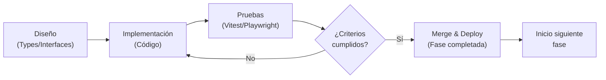
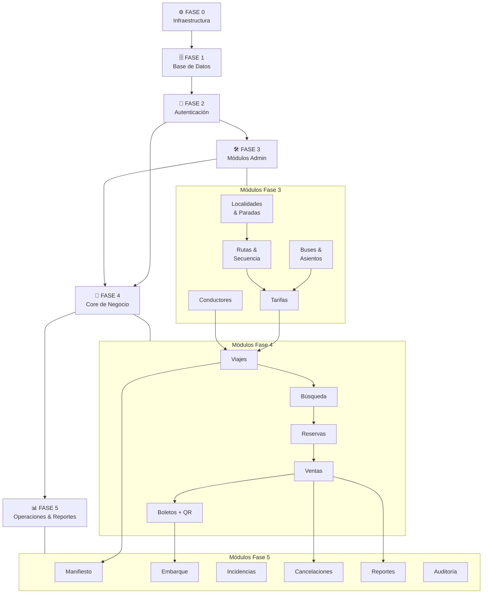
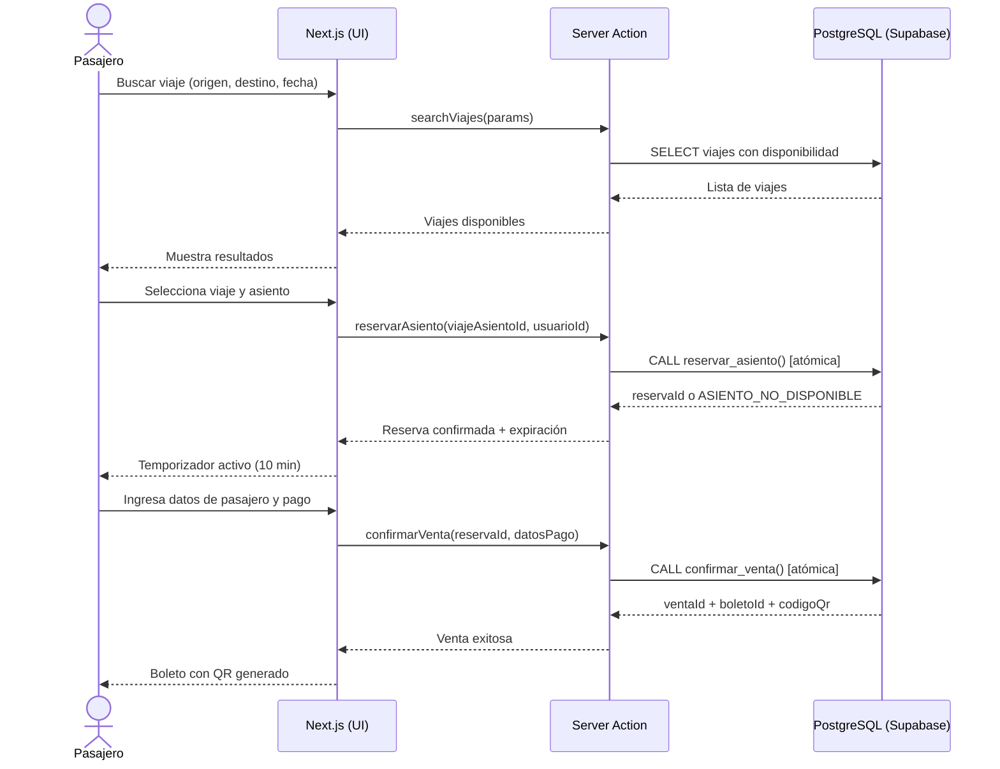
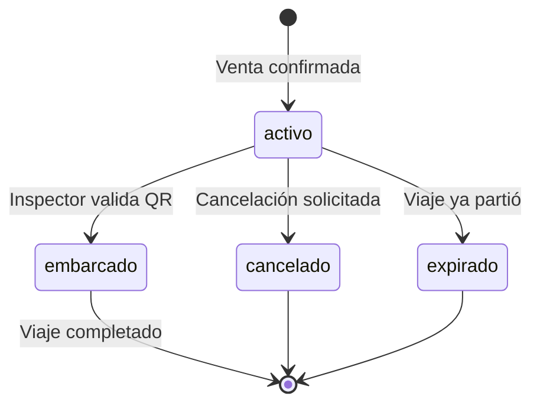
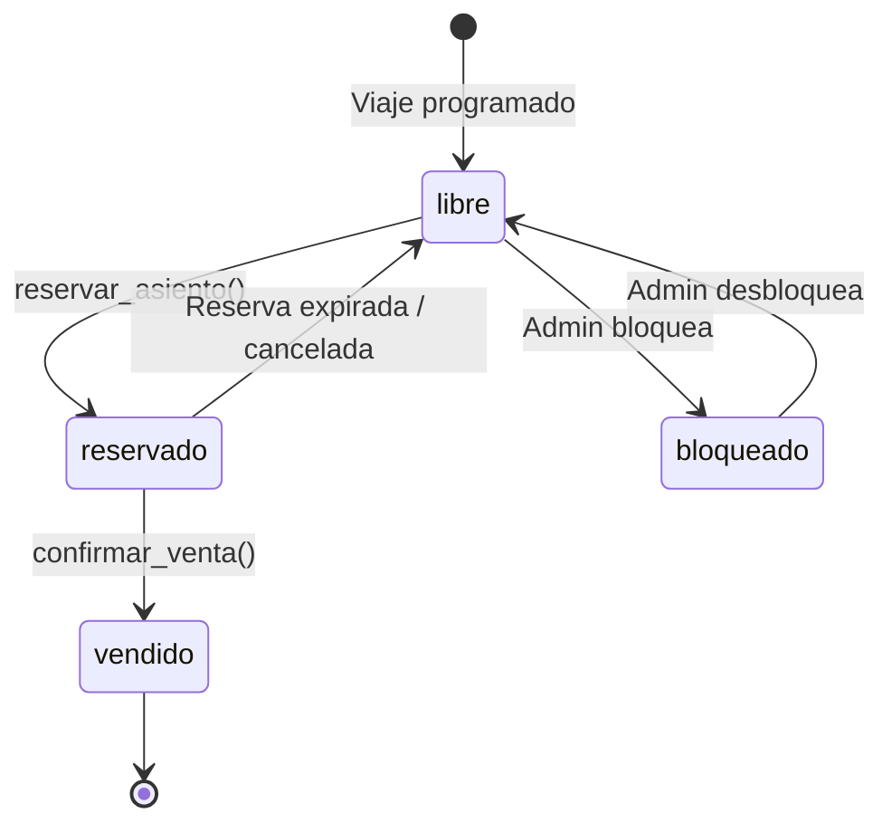

# Plan de Implementación — Ruta Norte

> **Versión:** 1.0.0  
> **Fecha:** 2026-10-11  
> **Estado:** Activo

---

## 1. Metodología

El desarrollo de **Ruta Norte** sigue un modelo **iterativo por fases**, donde cada fase entrega software funcional y verificable antes de continuar con la siguiente.

### Principios fundamentales

| Principio | Descripción |
|-----------|-------------|
| **Entrega incremental** | Cada fase produce un incremento de software deployable y verificado |
| **Pruebas primero** | No se avanza a la siguiente fase sin que los criterios de aceptación de la actual estén cumplidos |
| **Contratos explícitos** | Los tipos TypeScript compartidos se definen antes de comenzar el desarrollo de cada módulo |
| **Revisión de calidad** | Todo código pasa por revisión de tipos, linting y pruebas automatizadas |
| **Documentación continua** | Cada módulo incluye JSDoc, comentarios de RLS y docstrings relevantes |

### Flujo de trabajo por fase



---

## 2. Fases de Implementación

### Fase 0 — Infraestructura y Configuración

> **Prerequisito de todas las fases siguientes. Ninguna otra fase puede comenzar sin que esta esté completa.**

**Objetivo:** Establecer el entorno de desarrollo con todas las herramientas configuradas y funcionando correctamente.

#### Tareas

| # | Tarea | Detalle |
|---|-------|---------|
| 0.1 | Inicializar proyecto Next.js | `npx create-next-app@15` con TypeScript strict, App Router, src/ directory |
| 0.2 | Configurar `tsconfig.json` | `strict: true`, `noUncheckedIndexedAccess: true`, paths alias `@/*` |
| 0.3 | Configurar Tailwind CSS v4 | PostCSS, configuración base, reset |
| 0.4 | Instalar y configurar shadcn/ui | `npx shadcn@latest init`, tema "default", componentes base |
| 0.5 | Configurar Supabase | Crear proyecto en Supabase Cloud, obtener `SUPABASE_URL` y `SUPABASE_ANON_KEY` |
| 0.6 | Configurar variables de entorno | `.env.local`, `.env.example`, nunca commitear secrets |
| 0.7 | Configurar Vitest | `vitest.config.ts`, `@testing-library/react`, `jsdom` |
| 0.8 | Configurar Playwright | `playwright.config.ts`, navegadores, base URL |
| 0.9 | Crear estructura de directorios | Ver sección de estructura del proyecto |
| 0.10 | Configurar ESLint y Prettier | Reglas TypeScript, Tailwind plugin |
| 0.11 | Configurar Husky y lint-staged | Pre-commit hooks para calidad de código |

#### Estructura de directorios objetivo

```
src/
├── app/                        # App Router (Next.js)
│   ├── (auth)/                 # Grupo de rutas de autenticación
│   │   ├── login/
│   │   └── register/
│   ├── (dashboard)/            # Rutas protegidas con layout compartido
│   │   ├── admin/
│   │   ├── operator/
│   │   ├── seller/
│   │   └── inspector/
│   ├── (public)/               # Búsqueda y compra pública
│   │   ├── buscar/
│   │   └── viaje/[id]/
│   └── api/                    # Route Handlers
├── components/
│   ├── ui/                     # Componentes shadcn/ui (auto-generados)
│   ├── shared/                 # Componentes reutilizables custom
│   ├── forms/                  # Formularios con React Hook Form + Zod
│   └── charts/                 # Componentes Recharts
├── lib/
│   ├── supabase/               # Clientes Supabase (server, client, middleware)
│   ├── validations/            # Esquemas Zod
│   └── utils/                  # Utilidades generales
├── types/                      # Tipos TypeScript compartidos
│   ├── domain.ts               # Entidades de dominio
│   ├── supabase.ts             # Tipos generados por Supabase CLI
│   └── api.ts                  # Tipos de respuestas API
├── hooks/                      # Custom React hooks
├── actions/                    # Server Actions (Next.js)
├── middleware.ts               # Middleware de autenticación
└── constants/                  # Constantes de la aplicación
supabase/
├── migrations/                 # Archivos SQL de migración
├── seed.sql                    # Datos de prueba
└── functions/                  # Edge Functions (si aplica)
docs/                           # Documentación del proyecto
tests/
├── unit/                       # Pruebas unitarias (Vitest)
├── integration/                # Pruebas de integración (Vitest)
└── e2e/                        # Pruebas end-to-end (Playwright)
```

#### Criterio de aceptación — Fase 0

- [ ] `npm run dev` levanta sin errores en `localhost:3000`
- [ ] `npm run build` compila sin errores de TypeScript
- [ ] `npm run test` ejecuta al menos 1 prueba unitaria de ejemplo y pasa
- [ ] `npm run test:e2e` ejecuta al menos 1 prueba Playwright y pasa
- [ ] Variables de entorno documentadas en `.env.example`
- [ ] Pre-commit hook activo: bloquea commits con errores de TypeScript o linting

---

### Fase 1 — Base de Datos y Migraciones

**Objetivo:** Definir el esquema completo de la base de datos en PostgreSQL a través de Supabase, con RLS activo y datos semilla para desarrollo.

#### Tareas

| # | Tarea | Detalle |
|---|-------|---------|
| 1.1 | Migración: tablas de catálogo | `localidades`, `paradas`, `buses`, `asientos`, `conductores` |
| 1.2 | Migración: tablas de ruta | `rutas`, `ruta_paradas` (secuencia ordenada) |
| 1.3 | Migración: tablas de operación | `viajes`, `viaje_asientos`, `tarifas` |
| 1.4 | Migración: tablas de negocio | `reservas`, `ventas`, `boletos`, `embarques` |
| 1.5 | Migración: tablas de auditoría | `incidencias`, `auditoria_log`, `cancelaciones` |
| 1.6 | Migración: tablas de usuarios | `perfiles` (extensión de `auth.users`), `roles` |
| 1.7 | Habilitar RLS | En todas las tablas, política base de denegación |
| 1.8 | Crear políticas RLS | Por rol: admin, operator, seller, inspector, passenger |
| 1.9 | Crear funciones PostgreSQL | `reservar_asiento()`, `confirmar_venta()`, `expira_reservas()` |
| 1.10 | Crear triggers | Expiración automática de reservas, actualización de estado de asientos |
| 1.11 | Crear índices | En columnas de búsqueda frecuente: `viaje_id`, `estado`, `codigo_qr` |
| 1.12 | Generar tipos TypeScript | `npx supabase gen types typescript` → `src/types/supabase.ts` |
| 1.13 | Crear seed data | Localidades, rutas, buses, horarios de ejemplo para Ecuador norte |

#### Criterio de aceptación — Fase 1

- [ ] Todas las migraciones se aplican en orden sin errores
- [ ] `supabase db reset` ejecuta migraciones + seed sin errores
- [ ] Cada tabla tiene RLS habilitado (verificable en Supabase Studio)
- [ ] Las políticas permiten exactamente lo que cada rol necesita (ni más, ni menos)
- [ ] Los tipos TypeScript generados están actualizados y sin conflictos
- [ ] La función `expira_reservas()` modifica correctamente el estado de reservas vencidas

---

### Fase 2 — Autenticación y Autorización

**Objetivo:** Implementar el sistema de autenticación con Supabase Auth, protección de rutas mediante middleware de Next.js y gestión de roles.

#### Tareas

| # | Tarea | Detalle |
|---|-------|---------|
| 2.1 | Configurar Supabase Auth | Email/password, gestión de sesiones con cookies SSR |
| 2.2 | Crear clientes Supabase | Server Client (RSC), Browser Client, Middleware Client |
| 2.3 | Implementar middleware | Verificar sesión, redirigir no autenticados, adjuntar rol al request |
| 2.4 | Página de login | Formulario con React Hook Form + Zod, manejo de errores |
| 2.5 | Página de registro de pasajero | Registro público, asignación automática de rol `passenger` |
| 2.6 | Recuperación de contraseña | Flujo de reset por email |
| 2.7 | Server Actions de auth | `loginAction`, `logoutAction`, `registerAction` |
| 2.8 | Hook `useSession` | Estado de sesión en cliente |
| 2.9 | Componente `RoleGuard` | Protección de UI basada en rol |
| 2.10 | Layouts protegidos | Layout de dashboard con verificación de sesión |
| 2.11 | Gestión de roles por admin | UI para asignar/revocar roles a usuarios |
| 2.12 | Pruebas de autenticación | Vitest para lógica, Playwright para flujo completo |

#### Criterio de aceptación — Fase 2

- [x] Login y logout funcionan correctamente con Server Actions y cookies `@supabase/ssr`
- [x] Usuarios no autenticados son redirigidos a `/login` desde rutas protegidas mediante `requireAuth()`
- [x] Usuarios con rol incorrecto reciben redirección a `/unauthorized` (403) mediante `requireRole()`
- [x] El rol del usuario está verificado en base de datos (`user_roles`) sin confiar en el cliente
- [x] Pruebas unitarias ejecutadas con éxito (39/39 pruebas pasando, 7 suites)
- [ ] Pruebas E2E completas con Playwright contra Supabase en vivo (requiere instancia real conectada)

---

### Fase 3 — Módulos Administrativos (CRUD Operativo)

**Objetivo:** Implementar todos los módulos de gestión de catálogos y configuración que utilizará el rol `admin`.

#### Tareas por módulo

**Localidades y Paradas**
- CRUD de localidades (ciudades/cantones de Ecuador norte)
- CRUD de paradas con coordenadas y dirección
- Vista de mapa referencial (opcional)

**Rutas y Secuencia de Paradas**
- CRUD de rutas (origen → destino)
- Gestión de secuencia de paradas con orden y tiempo estimado
- Visualización del recorrido

**Buses y Asientos**
- CRUD de buses (placa, tipo, capacidad, empresa)
- Configuración de layout de asientos por bus (posición, tipo: normal/preferente/litera)
- Activar/desactivar asientos

**Conductores**
- CRUD de conductores (licencia, tipo, vigencia)
- Asignación de conductor a viajes

**Tarifas**
- Definición de tarifas por ruta y tipo de asiento
- Historial de cambios de tarifa

#### Criterio de aceptación — Fase 3

- [ ] Admin puede crear, listar, editar y eliminar (o desactivar) cada entidad
- [ ] Validaciones Zod activas en todos los formularios
- [ ] Mensajes de error claros y accesibles
- [ ] Paginación en listados con más de 20 registros
- [ ] Pruebas unitarias para Server Actions de cada módulo (cobertura ≥ 80%)

---

### Fase 4 — Core de Negocio (Viajes, Reservas, Ventas)

**Objetivo:** Implementar el flujo completo de compra de boletos, desde la búsqueda hasta la emisión del QR, con manejo correcto de concurrencia en reservas.

#### Tareas

| # | Tarea | Detalle |
|---|-------|---------|
| 4.1 | Programación de viajes | Operador programa viajes asignando ruta, bus, conductor, fecha/hora |
| 4.2 | Búsqueda pública | Formulario origen/destino/fecha, resultados con disponibilidad |
| 4.3 | Vista detalle de viaje | Información completa, selector de asientos |
| 4.4 | Selector de asientos | Mapa visual del bus, estados: libre/reservado/vendido/bloqueado |
| 4.5 | Reserva temporal | `reservar_asiento()` atómica, expiración configurable (ej. 10 min) |
| 4.6 | Temporizador de reserva | Contador regresivo en UI, liberación automática al expirar |
| 4.7 | Formulario de pasajero | Datos del pasajero por asiento, validación Zod |
| 4.8 | Pago simulado | Formulario de tarjeta ficticio, confirmación inmediata |
| 4.9 | Confirmación de venta | `confirmar_venta()`, genera boleto con UUID |
| 4.10 | Generación de QR | Código QR único por boleto (librería `qrcode`) |
| 4.11 | Vista de boleto | PDF-like con QR, datos del pasajero, viaje |
| 4.12 | Mis boletos | Historial de boletos del pasajero autenticado |
| 4.13 | Pruebas de concurrencia | Simular múltiples usuarios reservando el mismo asiento |

#### Criterio de aceptación — Fase 4

- [ ] Flujo completo búsqueda → reserva → pago → boleto QR funciona sin errores
- [ ] Dos usuarios no pueden reservar el mismo asiento simultáneamente (verificado por prueba de concurrencia)
- [ ] La reserva expira automáticamente y el asiento queda disponible nuevamente
- [ ] El código QR es único y verificable
- [ ] El boleto se puede visualizar e imprimir correctamente
- [ ] Prueba E2E del flujo completo pasa en Playwright

---

### Fase 5 — Operaciones y Reportes

**Objetivo:** Implementar las herramientas operativas para inspectores y operadores, y los dashboards de reportes para administradores.

#### Tareas

| # | Tarea | Detalle |
|---|-------|---------|
| 5.1 | Manifiesto de pasajeros | Listado completo por viaje para operador/conductor |
| 5.2 | Validación de embarque | Inspector escanea/ingresa código QR, sistema valida y registra embarque |
| 5.3 | Estados de boleto en embarque | `pendiente` → `embarcado` (único uso), detección de duplicados |
| 5.4 | Incidencias operativas | Registro de incidencias por viaje (retraso, accidente, etc.) |
| 5.5 | Cancelaciones | Flujo de cancelación con trazabilidad, política de reembolso |
| 5.6 | Dashboard admin | Métricas clave: ventas diarias, ocupación, rutas populares |
| 5.7 | Reportes con Recharts | Gráficos de ventas por período, ocupación por ruta, ingresos |
| 5.8 | Auditoría | Log de acciones críticas consultable por admin |
| 5.9 | Exportación de reportes | CSV de manifiestos y ventas |

#### Criterio de aceptación — Fase 5

- [ ] Inspector puede validar un boleto válido y queda registrado el embarque
- [ ] El sistema rechaza boletos ya usados, cancelados o de otro viaje
- [ ] Los reportes muestran datos reales de la base de datos
- [ ] El log de auditoría registra todas las operaciones críticas
- [ ] Prueba E2E: flujo de embarque completo pasa en Playwright

---

## 3. Mapa de Dependencias entre Módulos



---

## 4. Asignación de Responsabilidades por Agente

| Fase | Módulo | Agente responsable | Archivos principales |
|------|--------|-------------------|----------------------|
| 0 | Infraestructura general | **agent-infra** | `package.json`, `tsconfig.json`, `tailwind.config.ts`, `vitest.config.ts`, `playwright.config.ts` |
| 0 | Estructura de directorios | **agent-infra** | `src/` (esqueleto), `.env.example` |
| 1 | Migraciones SQL | **agent-db** | `supabase/migrations/*.sql`, `supabase/seed.sql` |
| 1 | Tipos generados | **agent-db** | `src/types/supabase.ts` |
| 1 | Funciones y triggers | **agent-db** | `supabase/migrations/*_functions.sql` |
| 2 | Supabase Auth | **agent-auth** | `src/lib/supabase/`, `src/middleware.ts` |
| 2 | UI de autenticación | **agent-auth** | `src/app/(auth)/`, `src/actions/auth.ts` |
| 2 | Gestión de roles | **agent-auth** | `src/components/shared/RoleGuard.tsx`, `src/hooks/useSession.ts` |
| 3 | Localidades y Paradas | **agent-admin** | `src/app/(dashboard)/admin/localidades/`, `src/app/(dashboard)/admin/paradas/` |
| 3 | Rutas | **agent-admin** | `src/app/(dashboard)/admin/rutas/` |
| 3 | Buses y Asientos | **agent-admin** | `src/app/(dashboard)/admin/buses/` |
| 3 | Conductores | **agent-admin** | `src/app/(dashboard)/admin/conductores/` |
| 3 | Tarifas | **agent-admin** | `src/app/(dashboard)/admin/tarifas/` |
| 4 | Programación de Viajes | **agent-ops** | `src/app/(dashboard)/operator/viajes/` |
| 4 | Búsqueda pública | **agent-booking** | `src/app/(public)/buscar/` |
| 4 | Selector de asientos | **agent-booking** | `src/components/shared/SeatMap.tsx` |
| 4 | Reservas y Ventas | **agent-booking** | `src/actions/reservas.ts`, `src/actions/ventas.ts` |
| 4 | Boletos y QR | **agent-booking** | `src/app/(dashboard)/passenger/boletos/`, `src/lib/utils/qr.ts` |
| 5 | Manifiesto y Embarque | **agent-inspector** | `src/app/(dashboard)/inspector/`, `src/actions/embarque.ts` |
| 5 | Incidencias y Cancelaciones | **agent-ops** | `src/app/(dashboard)/operator/incidencias/`, `src/actions/cancelaciones.ts` |
| 5 | Reportes y Dashboard | **agent-reporting** | `src/app/(dashboard)/admin/reportes/`, `src/components/charts/` |
| 5 | Auditoría | **agent-reporting** | `src/app/(dashboard)/admin/auditoria/` |

---

## 5. Contratos entre Agentes

> [!IMPORTANT]
> Los siguientes tipos TypeScript deben existir y estar aprobados **antes** de que cada agente comience su trabajo. Ningún agente debe duplicar ni redefinir estos tipos; deben importarlos desde `src/types/`.

### 5.1 Tipos de Dominio Compartidos (`src/types/domain.ts`)

Estos tipos deben estar disponibles antes de la **Fase 3**:

```typescript
// src/types/domain.ts

export type Rol = 'admin' | 'operator' | 'seller' | 'inspector' | 'passenger';

export type EstadoAsiento = 'libre' | 'reservado' | 'vendido' | 'bloqueado' | 'fuera_de_servicio';

export type EstadoReserva = 'pendiente' | 'confirmada' | 'expirada' | 'cancelada';

export type EstadoVenta = 'completada' | 'reembolsada' | 'cancelada';

export type EstadoBoleto = 'activo' | 'embarcado' | 'cancelado' | 'expirado';

export type EstadoViaje = 'programado' | 'en_curso' | 'completado' | 'cancelado' | 'postergado';

export type TipoAsiento = 'normal' | 'preferente' | 'litera_alta' | 'litera_baja';

export type TipoBus = 'bus' | 'buseta' | 'furgoneta';

export type MetodoPago = 'tarjeta_credito' | 'tarjeta_debito' | 'transferencia' | 'efectivo';

export interface Localidad {
  id: string;
  nombre: string;
  provincia: string;
  pais: string;
  activo: boolean;
  created_at: string;
}

export interface Parada {
  id: string;
  localidad_id: string;
  nombre: string;
  direccion: string | null;
  latitud: number | null;
  longitud: number | null;
  activo: boolean;
  created_at: string;
  localidad?: Localidad;
}

export interface Ruta {
  id: string;
  nombre: string;
  parada_origen_id: string;
  parada_destino_id: string;
  distancia_km: number | null;
  duracion_estimada_min: number | null;
  activo: boolean;
  created_at: string;
  parada_origen?: Parada;
  parada_destino?: Parada;
  paradas?: RutaParada[];
}

export interface RutaParada {
  id: string;
  ruta_id: string;
  parada_id: string;
  orden: number;
  tiempo_desde_origen_min: number;
  parada?: Parada;
}

export interface Bus {
  id: string;
  placa: string;
  tipo: TipoBus;
  empresa: string;
  capacidad_total: number;
  activo: boolean;
  created_at: string;
  asientos?: Asiento[];
}

export interface Asiento {
  id: string;
  bus_id: string;
  numero: string;
  tipo: TipoAsiento;
  fila: number;
  columna: number;
  activo: boolean;
}

export interface Conductor {
  id: string;
  nombre: string;
  apellido: string;
  cedula: string;
  licencia_numero: string;
  licencia_tipo: string;
  licencia_vencimiento: string;
  activo: boolean;
  created_at: string;
}

export interface Tarifa {
  id: string;
  ruta_id: string;
  tipo_asiento: TipoAsiento;
  precio: number;
  vigencia_desde: string;
  vigencia_hasta: string | null;
  activo: boolean;
}

export interface Viaje {
  id: string;
  ruta_id: string;
  bus_id: string;
  conductor_id: string;
  fecha_salida: string;
  hora_salida: string;
  fecha_llegada_estimada: string | null;
  hora_llegada_estimada: string | null;
  estado: EstadoViaje;
  capacidad_disponible: number;
  created_at: string;
  ruta?: Ruta;
  bus?: Bus;
  conductor?: Conductor;
}

export interface ViajeAsiento {
  id: string;
  viaje_id: string;
  asiento_id: string;
  estado: EstadoAsiento;
  asiento?: Asiento;
}

export interface Reserva {
  id: string;
  viaje_id: string;
  viaje_asiento_id: string;
  usuario_id: string;
  estado: EstadoReserva;
  expira_en: string;
  created_at: string;
}

export interface Venta {
  id: string;
  reserva_id: string;
  usuario_id: string;
  monto_total: number;
  metodo_pago: MetodoPago;
  referencia_pago: string;
  estado: EstadoVenta;
  created_at: string;
  boletos?: Boleto[];
}

export interface Boleto {
  id: string;
  venta_id: string;
  viaje_asiento_id: string;
  pasajero_nombre: string;
  pasajero_cedula: string;
  pasajero_email: string | null;
  codigo_qr: string;
  estado: EstadoBoleto;
  created_at: string;
  viaje_asiento?: ViajeAsiento & { viaje?: Viaje; asiento?: Asiento };
}

export interface Embarque {
  id: string;
  boleto_id: string;
  inspector_id: string;
  viaje_id: string;
  embarcado_en: string;
  observacion: string | null;
}

export interface Incidencia {
  id: string;
  viaje_id: string;
  reportado_por: string;
  tipo: string;
  descripcion: string;
  created_at: string;
}

export interface Perfil {
  id: string;
  user_id: string;
  nombre: string;
  apellido: string;
  cedula: string | null;
  telefono: string | null;
  rol: Rol;
  activo: boolean;
  created_at: string;
}
```

### 5.2 Tipos de Respuesta de Server Actions (`src/types/api.ts`)

Deben estar disponibles antes de la **Fase 2**:

```typescript
// src/types/api.ts

export type ActionResult<T = void> =
  | { success: true; data: T; message?: string }
  | { success: false; error: string; fieldErrors?: Record<string, string[]> };

export type PaginatedResult<T> = {
  data: T[];
  total: number;
  page: number;
  pageSize: number;
  totalPages: number;
};

export interface SearchViajesParams {
  origen_id: string;
  destino_id: string;
  fecha: string;
  pasajeros?: number;
}

export interface SearchViajesResult {
  viaje: Viaje;
  asientos_disponibles: number;
  precio_desde: number;
}
```

### 5.3 Props de Componentes Compartidos (`src/types/components.ts`)

Deben estar disponibles antes de la **Fase 3**:

```typescript
// src/types/components.ts
import type { ViajeAsiento, Asiento, EstadoAsiento } from './domain';

export interface SeatMapProps {
  viajeAsientos: (ViajeAsiento & { asiento: Asiento })[];
  seleccionados: string[];          // IDs de viaje_asiento
  onSeleccionar: (id: string) => void;
  maxSeleccion?: number;
  readonly?: boolean;
}

export interface QRDisplayProps {
  codigoQr: string;
  size?: number;
  className?: string;
}

export interface RoleGuardProps {
  roles: Rol[];
  children: React.ReactNode;
  fallback?: React.ReactNode;
}

export interface DataTableProps<T> {
  data: T[];
  columns: ColumnDef<T>[];
  loading?: boolean;
  pagination?: PaginatedResult<T>;
  onPageChange?: (page: number) => void;
}
```

---

## 6. Criterios de Aceptación por Módulo

| Módulo | Criterio | Cómo verificar |
|--------|----------|----------------|
| **Infraestructura** | Build sin errores TypeScript | `npm run build` → exit code 0 |
| **Infraestructura** | Pruebas de ejemplo pasan | `npm run test` → todos en verde |
| **Base de datos** | Todas las tablas tienen RLS | Supabase Studio → Authentication → Policies |
| **Base de datos** | Seed crea datos coherentes | `supabase db reset && supabase db seed` → sin errores |
| **Base de datos** | Función `expira_reservas()` funciona | Prueba unitaria SQL o pg-tap |
| **Autenticación** | Login con credenciales válidas | E2E Playwright: usuario ingresa → ve dashboard |
| **Autenticación** | Ruta protegida redirige | E2E Playwright: acceso sin sesión → `/login` |
| **Autenticación** | Rol incorrecto → 403 | Test: `passenger` accede a `/admin` → 403 |
| **Localidades** | CRUD completo | Test: crear, leer, editar, deshabilitar localidad |
| **Rutas** | Secuencia de paradas ordenada | Assert: `orden` incrementa de 1 en 1, sin duplicados |
| **Buses** | Layout de asientos coherente | Assert: suma de asientos = capacidad declarada |
| **Tarifas** | No solapamiento de vigencias | Zod: validar que `vigencia_desde` < `vigencia_hasta` |
| **Viajes** | Programar viaje válido | Operador crea viaje → aparece en búsqueda pública |
| **Búsqueda** | Resultados filtrados correctamente | Solo viajes en fecha/ruta solicitada con disponibilidad > 0 |
| **Reservas** | Atomicidad de reserva | Test concurrencia: 2 requests simultáneos → solo 1 exitoso |
| **Reservas** | Expiración automática | Crear reserva con `expira_en` en pasado → estado `expirada` |
| **Ventas** | Transacción atómica | Fallo en pago → reserva no confirmada, asiento libre |
| **Boletos** | QR único por boleto | `SELECT COUNT(*) WHERE codigo_qr = x` → siempre 1 |
| **Embarque** | Boleto válido → embarque exitoso | Inspector ingresa código → respuesta OK, estado `embarcado` |
| **Embarque** | Boleto ya usado → rechazado | Segundo intento con mismo código → error descriptivo |
| **Embarque** | Boleto de otro viaje → rechazado | Código válido pero de viaje diferente → error descriptivo |
| **Reportes** | Datos en tiempo real | Gráficos reflejan ventas/embarques reales de la BD |
| **Auditoría** | Acciones críticas registradas | Crear venta → aparece en log de auditoría |

---

## 7. Riesgos Técnicos y Mitigaciones

### 7.1 Concurrencia en Reservas

> [!CAUTION]
> Este es el riesgo técnico más crítico del sistema. Una implementación incorrecta puede resultar en doble venta del mismo asiento.

**Riesgo:** Dos usuarios intentan reservar el mismo asiento simultáneamente, resultando en overbooking.

**Mitigación:**
- Usar `SELECT ... FOR UPDATE` dentro de una transacción en la función `reservar_asiento()`
- La función debe ejecutarse como una sola operación atómica en PostgreSQL (RPC de Supabase)
- Nunca realizar la reserva en múltiples pasos desde el cliente
- El estado `reservado` en `viaje_asientos` es la fuente de verdad

```sql
-- Estructura de la función crítica
CREATE OR REPLACE FUNCTION reservar_asiento(
  p_viaje_asiento_id UUID,
  p_usuario_id UUID,
  p_minutos_expiracion INTEGER DEFAULT 10
) RETURNS UUID AS $$
DECLARE
  v_reserva_id UUID;
BEGIN
  -- Bloqueo optimista: verificar y actualizar en una sola operación
  UPDATE viaje_asientos
  SET estado = 'reservado'
  WHERE id = p_viaje_asiento_id AND estado = 'libre'
  RETURNING id INTO v_reserva_id;

  IF v_reserva_id IS NULL THEN
    RAISE EXCEPTION 'ASIENTO_NO_DISPONIBLE';
  END IF;

  -- Crear registro de reserva
  INSERT INTO reservas (viaje_asiento_id, usuario_id, expira_en)
  VALUES (p_viaje_asiento_id, p_usuario_id, NOW() + (p_minutos_expiracion || ' minutes')::INTERVAL)
  RETURNING id INTO v_reserva_id;

  RETURN v_reserva_id;
END;
$$ LANGUAGE plpgsql SECURITY DEFINER;
```

### 7.2 Expiración de Reservas

**Riesgo:** Las reservas expiradas no se liberan automáticamente, bloqueando asientos indefinidamente.

**Opciones de implementación:**

| Opción | Pros | Contras | Decisión |
|--------|------|---------|----------|
| **Trigger PostgreSQL** (`pg_cron`) | Automático, sin dependencias externas | Requiere extensión `pg_cron` en Supabase | ✅ Preferida |
| **Supabase Edge Function** (cron) | Fácil de implementar | Costo por invocación, latencia | Alternativa |
| **Verificación lazy** | Sin jobs externos | Asientos "bloqueados" hasta próxima consulta | ❌ Evitar |

**Implementación recomendada:**
```sql
-- Activar pg_cron en Supabase (plan Pro)
SELECT cron.schedule('expirar-reservas', '*/5 * * * *', $$
  SELECT expira_reservas();
$$);
```

**Fallback si pg_cron no está disponible:**
- Supabase Edge Function ejecutada cada 5 minutos via cron externo (GitHub Actions o similar)
- La función de búsqueda filtra asientos con reservas expiradas en tiempo real

### 7.3 Compatibilidad de Versiones

**Riesgo:** Incompatibilidades entre versiones de Next.js, React, shadcn/ui y sus dependencias.

**Mitigación:**
- Usar versiones exactas en `package.json` (sin `^` ni `~` en dependencias críticas)
- `package-lock.json` commiteado al repositorio
- Probar actualizaciones en rama separada antes de mergear
- Ver Sección 9 para versiones recomendadas exactas

### 7.4 Políticas RLS Incorrectas

**Riesgo:** Una política RLS mal configurada puede exponer datos de otros usuarios o bloquear funcionalidad legítima.

**Mitigación:**
- Pruebas automatizadas de RLS con diferentes roles (usando `set_config('role', ...)`)
- Revisión manual de políticas en Supabase Studio antes de cada release
- Principio de mínimo privilegio: denegar por defecto, permitir explícitamente
- No usar `SECURITY DEFINER` salvo en funciones críticas y documentadas

### 7.5 Rendimiento en Búsqueda de Viajes

**Riesgo:** La búsqueda de viajes puede ser lenta con muchos registros si no hay índices correctos.

**Mitigación:**
```sql
-- Índices críticos para búsqueda
CREATE INDEX idx_viajes_ruta_fecha ON viajes(ruta_id, fecha_salida, estado);
CREATE INDEX idx_viaje_asientos_estado ON viaje_asientos(viaje_id, estado);
CREATE INDEX idx_boletos_codigo_qr ON boletos(codigo_qr);
CREATE INDEX idx_reservas_expiracion ON reservas(expira_en, estado);
```

### 7.6 Tiempo de Desarrollo

**Riesgo:** Subestimación del esfuerzo, especialmente en el core de negocio (Fase 4).

**Mitigación:**
- Las estimaciones en la Sección 8 incluyen buffer del 20%
- Priorizar el flujo crítico (búsqueda → reserva → venta → boleto) sobre features secundarias
- Las features de reportes avanzados pueden diferirse a una iteración posterior

---

## 8. Estimación de Esfuerzo

| Fase | Módulo/Tarea | Complejidad | Horas | Jornadas (8h) |
|------|-------------|-------------|-------|---------------|
| **0** | Configuración inicial del proyecto | Media | 8 | 1 |
| **0** | Estructura de directorios y boilerplate | Baja | 4 | 0.5 |
| **0** | Configuración de testing | Media | 6 | 0.75 |
| | **Subtotal Fase 0** | | **18** | **~2.25** |
| **1** | Diseño y escritura de migraciones SQL | Alta | 16 | 2 |
| **1** | Políticas RLS | Alta | 8 | 1 |
| **1** | Funciones y triggers PostgreSQL | Alta | 10 | 1.25 |
| **1** | Seed data y tipos generados | Baja | 4 | 0.5 |
| | **Subtotal Fase 1** | | **38** | **~4.75** |
| **2** | Supabase Auth + clientes + middleware | Media | 10 | 1.25 |
| **2** | UI de login, registro, recuperación | Media | 8 | 1 |
| **2** | Gestión de roles y protección de rutas | Media | 8 | 1 |
| **2** | Pruebas de autenticación | Media | 6 | 0.75 |
| | **Subtotal Fase 2** | | **32** | **~4** |
| **3** | CRUD Localidades y Paradas | Baja | 8 | 1 |
| **3** | CRUD Rutas y secuencia de paradas | Media | 10 | 1.25 |
| **3** | CRUD Buses y layout de asientos | Alta | 14 | 1.75 |
| **3** | CRUD Conductores | Baja | 6 | 0.75 |
| **3** | CRUD Tarifas | Media | 8 | 1 |
| **3** | Pruebas unitarias de módulos admin | Media | 10 | 1.25 |
| | **Subtotal Fase 3** | | **56** | **~7** |
| **4** | Programación de viajes | Media | 10 | 1.25 |
| **4** | Búsqueda pública | Media | 10 | 1.25 |
| **4** | Selector de asientos (SeatMap) | Alta | 16 | 2 |
| **4** | Lógica de reservas (atómica + expiración) | Muy Alta | 20 | 2.5 |
| **4** | Flujo de pago simulado | Media | 8 | 1 |
| **4** | Generación de boletos y QR | Media | 10 | 1.25 |
| **4** | Pruebas (incluyendo concurrencia) | Alta | 16 | 2 |
| | **Subtotal Fase 4** | | **90** | **~11.25** |
| **5** | Manifiesto de pasajeros | Baja | 6 | 0.75 |
| **5** | Validación de embarque (inspector) | Media | 10 | 1.25 |
| **5** | Incidencias y cancelaciones | Media | 10 | 1.25 |
| **5** | Dashboard y reportes Recharts | Alta | 16 | 2 |
| **5** | Auditoría | Media | 8 | 1 |
| **5** | Pruebas E2E finales | Alta | 12 | 1.5 |
| | **Subtotal Fase 5** | | **62** | **~7.75** |
| | **TOTAL** | | **296** | **~37** |

> [!NOTE]
> Las estimaciones incluyen un buffer del 20% sobre el tiempo base. Un equipo de 2-3 desarrolladores podría completar el proyecto en aproximadamente **3-4 semanas** con dedicación completa.

---

## 9. Stack de Versiones Recomendadas

Las siguientes versiones han sido validadas para compatibilidad mutua. Usar estas versiones exactas en `package.json`.

### Dependencias de producción

```json
{
  "dependencies": {
    "next": "15.3.3",
    "react": "19.1.0",
    "react-dom": "19.1.0",
    "@supabase/supabase-js": "2.49.8",
    "@supabase/ssr": "0.6.1",
    "zod": "3.25.64",
    "react-hook-form": "7.56.4",
    "@hookform/resolvers": "5.0.1",
    "recharts": "2.15.3",
    "qrcode": "1.5.4",
    "qrcode.react": "4.2.0",
    "lucide-react": "0.511.0",
    "class-variance-authority": "0.7.1",
    "clsx": "2.1.1",
    "tailwind-merge": "3.3.0",
    "date-fns": "4.1.0",
    "sonner": "2.0.5",
    "@radix-ui/react-dialog": "1.1.14",
    "@radix-ui/react-select": "2.2.5",
    "@radix-ui/react-tabs": "1.1.12",
    "@radix-ui/react-tooltip": "1.2.7",
    "@radix-ui/react-popover": "1.1.14",
    "@radix-ui/react-dropdown-menu": "2.1.15",
    "@radix-ui/react-alert-dialog": "1.1.14",
    "@radix-ui/react-separator": "1.1.7",
    "@radix-ui/react-slot": "1.2.3",
    "@radix-ui/react-label": "2.1.7",
    "@radix-ui/react-checkbox": "1.3.2",
    "@radix-ui/react-switch": "1.2.5",
    "@radix-ui/react-badge": "1.0.4",
    "next-themes": "0.4.6"
  }
}
```

### Dependencias de desarrollo

```json
{
  "devDependencies": {
    "typescript": "5.8.3",
    "@types/node": "22.15.29",
    "@types/react": "19.1.6",
    "@types/react-dom": "19.1.6",
    "@types/qrcode": "1.5.5",
    "tailwindcss": "4.1.8",
    "@tailwindcss/postcss": "4.1.8",
    "postcss": "8.5.4",
    "eslint": "9.28.0",
    "eslint-config-next": "15.3.3",
    "@typescript-eslint/eslint-plugin": "8.33.0",
    "@typescript-eslint/parser": "8.33.0",
    "prettier": "3.5.3",
    "prettier-plugin-tailwindcss": "0.6.12",
    "vitest": "3.2.3",
    "@vitest/ui": "3.2.3",
    "@testing-library/react": "16.3.0",
    "@testing-library/user-event": "14.6.1",
    "@testing-library/jest-dom": "6.6.3",
    "@vitejs/plugin-react": "4.5.2",
    "jsdom": "26.1.0",
    "playwright": "1.52.0",
    "@playwright/test": "1.52.0",
    "husky": "9.1.7",
    "lint-staged": "16.1.0",
    "supabase": "2.23.4"
  }
}
```

### Comandos de instalación

```bash
# 1. Crear el proyecto Next.js
npx create-next-app@15.3.3 ruta-norte \
  --typescript \
  --tailwind \
  --eslint \
  --app \
  --src-dir \
  --import-alias "@/*"

# 2. Instalar dependencias de producción
npm install \
  @supabase/supabase-js@2.49.8 \
  @supabase/ssr@0.6.1 \
  zod@3.25.64 \
  react-hook-form@7.56.4 \
  @hookform/resolvers@5.0.1 \
  recharts@2.15.3 \
  qrcode@1.5.4 \
  qrcode.react@4.2.0 \
  lucide-react@0.511.0 \
  class-variance-authority@0.7.1 \
  clsx@2.1.1 \
  tailwind-merge@3.3.0 \
  date-fns@4.1.0 \
  sonner@2.0.5 \
  next-themes@0.4.6

# 3. Instalar shadcn/ui
npx shadcn@latest init

# 4. Instalar dependencias de desarrollo
npm install -D \
  @types/qrcode@1.5.5 \
  vitest@3.2.3 \
  @vitest/ui@3.2.3 \
  @testing-library/react@16.3.0 \
  @testing-library/user-event@14.6.1 \
  @testing-library/jest-dom@6.6.3 \
  @vitejs/plugin-react@4.5.2 \
  jsdom@26.1.0 \
  @playwright/test@1.52.0 \
  husky@9.1.7 \
  lint-staged@16.1.0

# 5. Instalar Supabase CLI
npm install -D supabase@2.23.4

# 6. Instalar Playwright browsers
npx playwright install --with-deps chromium

# 7. Configurar Husky
npx husky init
```

### Scripts de `package.json`

```json
{
  "scripts": {
    "dev": "next dev --turbopack",
    "build": "next build",
    "start": "next start",
    "lint": "next lint",
    "lint:fix": "next lint --fix",
    "format": "prettier --write .",
    "type-check": "tsc --noEmit",
    "test": "vitest run",
    "test:watch": "vitest",
    "test:ui": "vitest --ui",
    "test:coverage": "vitest run --coverage",
    "test:e2e": "playwright test",
    "test:e2e:ui": "playwright test --ui",
    "db:start": "supabase start",
    "db:reset": "supabase db reset",
    "db:types": "supabase gen types typescript --local > src/types/supabase.ts",
    "db:migrate": "supabase db push"
  }
}
```

---

## Apéndice A: Diagrama de Flujo de Compra



## Apéndice B: Diagrama de Estados del Boleto



## Apéndice C: Diagrama de Estados del Asiento en Viaje


