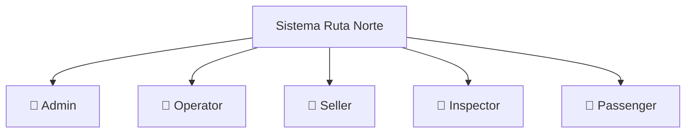

# Requisitos del Sistema — Ruta Norte

> **Versión:** 1.0.0
> **Fecha:** 2026-10-11
> **Estado:** Borrador para revisión
> **Repositorio:** `Proyecto Aplicaciones WEB / Rutas`

---

## Tabla de Contenidos

1. [Introducción](#1-introducción)
2. [Stakeholders y Roles de Usuario](#2-stakeholders-y-roles-de-usuario)
3. [Requisitos Funcionales](#3-requisitos-funcionales)
4. [Requisitos No Funcionales](#4-requisitos-no-funcionales)
5. [Restricciones Técnicas](#5-restricciones-técnicas)
6. [Supuestos y Dependencias](#6-supuestos-y-dependencias)
7. [Riesgos Identificados](#7-riesgos-identificados)
8. [Decisiones Pendientes de Aprobación](#8-decisiones-pendientes-de-aprobación)

---

## 1. Introducción

### 1.1 Propósito del Sistema

**Ruta Norte** es un sistema web de gestión de transporte interparroquial y emisión de boletos diseñado para operar en la zona norte de Ecuador. Su propósito central es digitalizar y centralizar los procesos de planificación de rutas, programación de viajes, venta de boletos, validación de embarque e inspección de pasajeros, reemplazando los flujos manuales en papel y las operaciones descoordinadas entre cooperativas interparroquiales.

El sistema provee una plataforma unificada accesible desde navegadores web modernos, orientada tanto al personal operativo de las cooperativas de transporte como a los pasajeros que realizan viajes entre localidades y parroquias de la región norte del Ecuador.

### 1.2 Alcance

El sistema abarca los siguientes dominios funcionales:

- **Administración de infraestructura de transporte:** parroquias, localidades, paradas, rutas, buses y conductores.
- **Programación operativa:** viajes con asignación de ruta, bus y conductor.
- **Comercialización:** tarifas por trayecto, búsqueda de viajes, selección de asientos, reservas temporales, ventas simuladas con pago ficticio y emisión de boletos digitales con código QR.
- **Operación en ruta:** validación de embarque mediante escaneo de QR, gestión de manifiestos de pasajeros e incidencias operativas.
- **Control y auditoría:** cancelaciones, trazabilidad de transacciones, reportes de gestión y registros de auditoría.
- **Datos de demostración:** datos semilla representativos del contexto geográfico de la zona norte del Ecuador.

Quedan **fuera del alcance** de esta versión:

- Integración con pasarelas de pago reales (SRI, bancos, plataformas fintech).
- Aplicaciones móviles nativas (iOS / Android).
- Seguimiento GPS en tiempo real de los buses.
- Integración con sistemas externos de terceros (ANT, SERCOP, etc.).
- Infraestructura de telecomunicaciones para validación QR offline.

### 1.3 Definiciones y Glosario de Términos del Dominio

| Término | Definición |
|---|---|
| **Parroquia** | División político-administrativa de nivel parroquial en Ecuador. Constituye el ámbito geográfico principal de operación. |
| **Localidad** | Población, comunidad o centro urbano dentro de una parroquia. |
| **Parada** | Punto físico georreferenciado donde el bus detiene su marcha para embarcar o desembarcar pasajeros. Pertenece a una localidad. |
| **Ruta** | Itinerario fijo que define una secuencia ordenada de paradas, con un origen y un destino determinados. Representa el recorrido abstracto, independiente de una fecha o bus específico. |
| **Viaje** | Materialización concreta de una ruta en una fecha y hora determinadas, con un bus y un conductor asignados. Es la unidad comercializable del sistema. |
| **Reserva** | Retención temporal de uno o más asientos en un viaje. Tiene una ventana de expiración configurable (por defecto 15 minutos). Si no se completa la venta en ese período, los asientos se liberan automáticamente. |
| **Venta** | Operación comercial confirmada que transforma una reserva en un compromiso de transporte. Incluye la simulación de un pago y la generación del boleto correspondiente. |
| **Pago Simulado** | Representación ficticia del proceso de cobro. No involucra movimiento real de dinero ni integración con pasarelas externas. Se confirma con un clic del operador o del pasajero. |
| **Boleto** | Documento digital que acredita el derecho de embarque de un pasajero en un asiento específico de un viaje determinado. Contiene un código QR único e irrepetible. |
| **Embarque** | Acto de validar el uso de un boleto en el punto de abordaje. El inspector escanea el QR del boleto; el sistema verifica su vigencia y registra el evento. |
| **Manifiesto** | Lista consolidada de todos los pasajeros con boleto válido para un viaje, utilizada por el conductor o inspector para el control de abordaje. |
| **Incidencia** | Evento operativo anormal registrado durante un viaje (p.ej., asiento dañado, pasajero no presentado, retraso, accidente menor). |
| **RLS** | *Row Level Security* — mecanismo de PostgreSQL/Supabase que restringe el acceso a filas individuales según el rol o identidad del usuario autenticado. |
| **QR** | Código de respuesta rápida (*Quick Response Code*) bidimensional que codifica el identificador único del boleto. |
| **Dato Semilla** | Registro de demostración insertado durante la inicialización del sistema. Está claramente marcado como demo y sirve para ilustrar el funcionamiento sin datos reales. |

### 1.4 Audiencia del Documento

Este documento está dirigido a:

- **Equipo de desarrollo:** como especificación de referencia para el diseño, implementación y pruebas del sistema.
- **Docentes evaluadores:** como evidencia del análisis de requisitos para la defensa del proyecto universitario.
- **Stakeholders operativos:** cooperativas de transporte, inspectores y personal administrativo que podrían adoptar el sistema en un escenario real.
- **Testers y auditores de calidad:** como base para la construcción de casos de prueba funcionales y no funcionales.

---

## 2. Stakeholders y Roles de Usuario

El sistema define cinco roles de usuario con responsabilidades y permisos diferenciados. El control de acceso se implementa a nivel de aplicación (middleware Next.js) y a nivel de base de datos (Row Level Security en Supabase).

### 2.1 Resumen de Roles

### 2.2 Descripción Detallada de Roles

#### 2.2.1 Admin (Administrador del Sistema)

| Atributo | Detalle |
|---|---|
| **Descripción** | Usuario con control total sobre el sistema. Generalmente corresponde al responsable técnico o directivo de la cooperativa. |
| **Permisos generales** | CRUD completo sobre todas las entidades. Acceso a todos los módulos. Gestión de usuarios y asignación de roles. |
| **Casos de uso principales** | Crear y gestionar parroquias, localidades y paradas; definir rutas y secuencias; registrar buses y conductores; configurar tarifas; acceder a reportes de auditoría completos; gestionar datos semilla. |

#### 2.2.2 Operator (Operador)

| Atributo | Detalle |
|---|---|
| **Descripción** | Personal administrativo de la cooperativa encargado de la planificación operativa diaria. |
| **Permisos generales** | Lectura de infraestructura (rutas, paradas, buses). CRUD sobre viajes y programación. Acceso a manifiestos. Registro de incidencias. Lectura de reportes operativos. |
| **Casos de uso principales** | Programar viajes (asignar ruta, bus, conductor, fecha/hora); cancelar viajes; ver manifiestos; registrar incidencias; consultar ocupación de buses. |

#### 2.2.3 Seller (Vendedor)

| Atributo | Detalle |
|---|---|
| **Descripción** | Agente de taquilla que realiza transacciones comerciales en nombre de los pasajeros. |
| **Permisos generales** | Búsqueda de viajes disponibles; creación de reservas; confirmación de ventas; emisión de boletos; procesamiento de cancelaciones dentro de política; consulta de ventas propias. |
| **Casos de uso principales** | Buscar viajes por origen/destino/fecha; seleccionar asientos disponibles; generar reserva temporal; confirmar venta con pago simulado; imprimir/enviar boleto con QR; cancelar boleto bajo condiciones permitidas. |

#### 2.2.4 Inspector

| Atributo | Detalle |
|---|---|
| **Descripción** | Personal de control en los puntos de abordaje y durante el trayecto. |
| **Permisos generales** | Lectura de manifiestos del viaje asignado; validación de boletos QR; registro de embarque; registro de incidencias. No puede crear ni modificar ventas. |
| **Casos de uso principales** | Consultar manifiesto del viaje; escanear/ingresar código QR de boleto; validar embarque; registrar pasajero no presentado; reportar incidencia operativa. |

#### 2.2.5 Passenger (Pasajero)

| Atributo | Detalle |
|---|---|
| **Descripción** | Usuario final que realiza la reserva y compra de boletos de forma autónoma a través del portal público. |
| **Permisos generales** | Acceso al buscador de viajes (público); registro e inicio de sesión; reserva y compra de asientos propios; consulta y descarga de boletos propios; cancelación de boletos propios. |
| **Casos de uso principales** | Registrarse en el sistema; buscar viajes disponibles; seleccionar asiento; reservar temporalmente; confirmar compra con pago simulado; descargar boleto con QR; ver historial de viajes y cancelaciones. |

---

## 3. Requisitos Funcionales

Los requisitos funcionales se identifican con el formato **RF-XXX**, donde las decenas indican el módulo al que pertenecen (RF-01x = Módulo 1, RF-02x = Módulo 2, etc.).

### Módulo 1 — Autenticación y Autorización por Roles

**Descripción:** Gestión del ciclo de vida de la sesión de usuario y control de acceso basado en roles (RBAC) a todas las funcionalidades del sistema.

| ID | Requisito |
|---|---|
| RF-011 | El sistema debe permitir el registro de nuevos usuarios con correo electrónico y contraseña, utilizando Supabase Auth como proveedor de identidad. |
| RF-012 | El sistema debe autenticar usuarios mediante correo electrónico y contraseña, generando una sesión JWT gestionada por Supabase Auth. |
| RF-013 | Cada usuario debe tener asignado exactamente un rol del conjunto `{admin, operator, seller, inspector, passenger}`. El rol se almacena en la tabla de perfiles de usuario y se propaga mediante las *claims* del JWT. |
| RF-014 | El middleware de Next.js debe proteger todas las rutas del dashboard verificando la sesión activa y el rol del usuario. Los usuarios no autenticados deben ser redirigidos a la página de inicio de sesión. |
| RF-015 | Las políticas RLS de Supabase deben restringir el acceso a las filas de cada tabla según el `user_id` y el rol del usuario autenticado, impidiendo el acceso no autorizado incluso si se realizan consultas directas a la API de Supabase. |
| RF-016 | El sistema debe soportar el cierre de sesión explícito, invalidando la sesión activa en Supabase y eliminando las cookies de cliente. |
| RF-017 | El administrador debe poder asignar o modificar el rol de cualquier usuario registrado desde el panel de administración. |

---

### Módulo 2 — Gestión de Parroquias, Localidades y Paradas

**Descripción:** Administración del catálogo geográfico que sirve como base para la definición de rutas.

| ID | Requisito |
|---|---|
| RF-021 | El sistema debe permitir al administrador crear, editar y eliminar parroquias, registrando nombre, provincia y descripción opcional. |
| RF-022 | El sistema debe permitir al administrador crear, editar y eliminar localidades, asociando cada una a una parroquia existente. |
| RF-023 | El sistema debe permitir al administrador crear, editar y eliminar paradas, asociando cada parada a una localidad y registrando nombre, dirección de referencia y coordenadas geográficas opcionales (latitud/longitud). |
| RF-024 | El sistema no debe permitir la eliminación de una parroquia o localidad que tenga registros dependientes activos (localidades, paradas o rutas). Debe mostrar un mensaje de error descriptivo. |
| RF-025 | El sistema debe mostrar las paradas en listas paginadas y filtradas por parroquia o localidad desde cualquier interfaz de selección. |

---

### Módulo 3 — Gestión de Rutas y Secuencia de Paradas

**Descripción:** Definición de itinerarios fijos con sus paradas ordenadas, tiempos estimados y estado operativo.

| ID | Requisito |
|---|---|
| RF-031 | El sistema debe permitir al administrador crear una ruta especificando nombre, descripción, parada de origen, parada de destino y estado (`activa` / `inactiva`). |
| RF-032 | El sistema debe permitir definir la secuencia ordenada de paradas de una ruta, indicando para cada parada su posición en el itinerario y el tiempo estimado de llegada desde el origen (en minutos). |
| RF-033 | El sistema debe validar que la secuencia de paradas de una ruta tenga al menos dos paradas (origen y destino) y que no haya paradas duplicadas dentro de la misma secuencia. |
| RF-034 | El sistema debe permitir editar la secuencia de paradas de una ruta únicamente si no existen viajes programados en estado `activo` o `en curso` para esa ruta. |
| RF-035 | El sistema debe listar todas las rutas con su estado, número de paradas, origen y destino, con capacidad de filtrado por estado. |
| RF-036 | El sistema debe permitir la desactivación lógica de una ruta sin eliminarla, preservando el historial de viajes asociados. |

---

### Módulo 4 — Gestión de Buses, Capacidades y Asientos

**Descripción:** Catálogo de la flota vehicular con su configuración de asientos.

| ID | Requisito |
|---|---|
| RF-041 | El sistema debe permitir al administrador registrar un bus con los campos: placa, marca, modelo, año de fabricación, número de asientos totales y estado operativo (`disponible`, `en mantenimiento`, `fuera de servicio`). |
| RF-042 | El sistema debe generar automáticamente la configuración de asientos de un bus al momento de su creación, basándose en el número total de asientos declarado. Cada asiento tendrá un identificador alfanumérico (ej. A1, A2, B1, …). |
| RF-043 | El sistema debe permitir al administrador marcar asientos individuales como `inhabilitados` (por daño u otras causas), lo que impedirá su selección en futuros viajes. |
| RF-044 | El sistema debe impedir la eliminación de un bus que tenga viajes programados en estado `activo` o `en curso`. Debe permitir la desactivación lógica. |
| RF-045 | El sistema debe mostrar en el listado de buses su estado actual y número de asientos disponibles vs. totales. |

---

### Módulo 5 — Gestión de Conductores

**Descripción:** Registro y administración del personal conductor asignado a los viajes.

| ID | Requisito |
|---|---|
| RF-051 | El sistema debe permitir al administrador registrar un conductor con los datos: nombres, apellidos, número de cédula (único), número de licencia profesional, categoría de licencia, teléfono de contacto y estado (`activo` / `inactivo`). |
| RF-052 | El sistema debe validar la unicidad del número de cédula y del número de licencia al crear o editar un conductor. |
| RF-053 | El sistema debe impedir la asignación de un conductor con estado `inactivo` a un viaje nuevo. |
| RF-054 | El sistema debe impedir la eliminación de un conductor que tenga viajes históricos registrados. Permitir únicamente la desactivación lógica. |
| RF-055 | El sistema debe permitir buscar conductores por nombre, cédula o número de licencia. |

---

### Módulo 6 — Programación de Viajes

**Descripción:** Creación y gestión del calendario operativo de viajes concretos.

| ID | Requisito |
|---|---|
| RF-061 | El sistema debe permitir al operador o administrador programar un viaje seleccionando: ruta activa, bus disponible, conductor activo, fecha y hora de salida. |
| RF-062 | El sistema debe validar que no existan conflictos de asignación: un mismo bus o conductor no puede tener dos viajes activos solapados en el tiempo. |
| RF-063 | El sistema debe calcular y almacenar la hora estimada de llegada a cada parada intermedia del viaje, basándose en los tiempos definidos en la secuencia de paradas de la ruta. |
| RF-064 | Un viaje puede tener los siguientes estados: `programado`, `en curso`, `completado`, `cancelado`. Las transiciones de estado válidas son: `programado → en curso`, `en curso → completado`, `programado → cancelado`. |
| RF-065 | Al cancelar un viaje, el sistema debe cancelar automáticamente todas las reservas y boletos activos asociados, y notificar el evento en el registro de auditoría. |
| RF-066 | El sistema debe permitir filtrar viajes por ruta, fecha, bus, conductor y estado desde la vista de gestión operativa. |

---

### Módulo 7 — Tarifas por Trayecto

**Descripción:** Definición del precio de cada segmento origen-destino dentro de una ruta.

| ID | Requisito |
|---|---|
| RF-071 | El sistema debe permitir al administrador definir tarifas para cada par de paradas (origen-destino) dentro de una ruta, expresadas en dólares estadounidenses (USD). |
| RF-072 | El sistema debe calcular automáticamente el precio total de un boleto según las paradas de origen y destino seleccionadas por el pasajero al momento de la compra. |
| RF-073 | Si no existe una tarifa explícita para un trayecto específico, el sistema debe mostrar un mensaje de advertencia al vendedor e impedir la venta hasta que el administrador defina la tarifa correspondiente. |
| RF-074 | El sistema debe mantener un historial de cambios de tarifas, registrando la fecha del cambio, el usuario que lo realizó y el valor anterior. |
| RF-075 | El sistema debe permitir listar todas las tarifas de una ruta en una tabla matricial origen × destino. |

---

### Módulo 8 — Búsqueda Pública de Viajes

**Descripción:** Interfaz de consulta disponible para pasajeros no autenticados y usuarios del sistema.

| ID | Requisito |
|---|---|
| RF-081 | El sistema debe ofrecer un formulario de búsqueda público (sin requerir autenticación) que permita filtrar viajes por parada de origen, parada de destino y fecha de viaje. |
| RF-082 | Los resultados de búsqueda deben mostrar, por cada viaje disponible: hora de salida, hora estimada de llegada, nombre de la ruta, número de asientos disponibles, precio del trayecto y estado del viaje. |
| RF-083 | El sistema debe mostrar únicamente viajes en estado `programado` con al menos un asiento disponible en los resultados de búsqueda pública. |
| RF-084 | El sistema debe ordenar los resultados de búsqueda por hora de salida de forma ascendente de manera predeterminada. |
| RF-085 | El sistema debe actualizar el conteo de asientos disponibles en tiempo real (o con una latencia máxima de 30 segundos) para reflejar reservas y ventas recientes. |

---

### Módulo 9 — Selección de Asientos

**Descripción:** Interfaz visual para la elección de asientos antes de confirmar la reserva o venta.

| ID | Requisito |
|---|---|
| RF-091 | El sistema debe presentar una representación visual de la planta del bus con el estado de cada asiento: `disponible`, `reservado`, `vendido` o `inhabilitado`. |
| RF-092 | El usuario debe poder seleccionar uno o más asientos disponibles en una sola operación, hasta el límite configurado por el administrador (por defecto: 4 asientos por transacción). |
| RF-093 | El sistema debe bloquear temporalmente los asientos seleccionados por el usuario desde el momento de la selección hasta que se complete o expire la reserva, evitando la doble selección concurrente. |
| RF-094 | El sistema debe mostrar el precio total acumulado (suma de tarifas por cada asiento seleccionado) en tiempo real mientras el usuario realiza su selección. |
| RF-095 | Los asientos marcados como `inhabilitados` en la configuración del bus no deben poder ser seleccionados bajo ninguna circunstancia. |

---

### Módulo 10 — Reservas Temporales con Expiración

**Descripción:** Mecanismo de retención temporal de asientos con liberación automática.

| ID | Requisito |
|---|---|
| RF-101 | Al confirmar la selección de asientos, el sistema debe crear una reserva con estado `pendiente` y registrar la fecha y hora de expiración (por defecto: 15 minutos desde la creación). |
| RF-102 | El sistema debe implementar un mecanismo automático (función de base de datos o proceso programado) que libere los asientos y cambie el estado de las reservas expiradas a `expirada`. |
| RF-103 | Una reserva puede tener los estados: `pendiente`, `confirmada` (convertida en venta), `cancelada` (por el usuario), `expirada` (por tiempo). |
| RF-104 | El sistema debe mostrar al usuario un contador visual regresivo del tiempo restante para completar la compra desde la pantalla de resumen de reserva. |
| RF-105 | El sistema debe impedir la creación de una nueva reserva para asientos que ya se encuentren en estado `pendiente` por otra reserva activa. |
| RF-106 | El administrador debe poder configurar el tiempo de expiración de reservas a nivel global del sistema. |

---

### Módulo 11 — Venta Simulada de Boletos

**Descripción:** Proceso de confirmación de la compra con pago ficticio.

| ID | Requisito |
|---|---|
| RF-111 | El sistema debe presentar al usuario un resumen de la reserva antes de confirmar la venta, mostrando: viaje, asientos, trayecto, precio total y datos del pasajero. |
| RF-112 | El sistema debe simular el proceso de pago mediante un formulario con campos de tarjeta de crédito (número, titular, fecha de vencimiento, CVV) que no realizan ninguna transacción real. El sistema siempre aprueba el pago simulado. |
| RF-113 | Al confirmar la venta, el sistema debe cambiar el estado de la reserva a `confirmada`, crear los registros de venta y generar los boletos correspondientes en una sola operación transaccional. |
| RF-114 | El sistema debe registrar en la venta: fecha y hora de la transacción, usuario vendedor (o pasajero), monto total, y referencia de pago simulado (cadena aleatoria). |
| RF-115 | El seller puede procesar ventas en nombre de cualquier pasajero. El passenger sólo puede comprar para sí mismo. |
| RF-116 | El sistema debe mostrar una pantalla de confirmación exitosa con los boletos emitidos y la opción de descargarlos inmediatamente. |

---

### Módulo 12 — Emisión de Boletos con QR

**Descripción:** Generación y entrega del boleto digital con código QR verificable.

| ID | Requisito |
|---|---|
| RF-121 | Cada boleto debe contener un identificador único (UUID v4) que se codifica en el código QR. Este ID debe ser irrepetible en todo el sistema. |
| RF-122 | El código QR debe generarse en el cliente (o servidor) al momento de la emisión del boleto, codificando como mínimo: el UUID del boleto, el ID del viaje y la fecha de expiración del boleto. |
| RF-123 | El boleto debe mostrar la siguiente información legible por humanos: nombre del pasajero, número de asiento, parada de origen, parada de destino, fecha y hora del viaje, precio pagado y código QR. |
| RF-124 | El sistema debe permitir descargar el boleto en formato PDF o visualizarlo en pantalla en una página optimizada para impresión. |
| RF-125 | Un boleto puede tener los estados: `emitido`, `embarcado`, `cancelado`. Un boleto `cancelado` o `embarcado` no puede usarse nuevamente. |

---

### Módulo 13 — Cancelaciones y Trazabilidad

**Descripción:** Gestión de anulaciones y registro histórico de todas las operaciones.

| ID | Requisito |
|---|---|
| RF-131 | El sistema debe permitir al seller o passenger cancelar un boleto emitido hasta una hora antes de la salida del viaje. Pasado ese plazo, sólo un administrador podrá autorizar la cancelación. |
| RF-132 | Al cancelar un boleto, el sistema debe registrar: fecha y hora de cancelación, usuario que solicitó la cancelación, motivo (texto libre) y cambiar el estado del boleto a `cancelado`. |
| RF-133 | El asiento correspondiente a un boleto cancelado debe volver al estado `disponible` de forma inmediata. |
| RF-134 | El sistema debe mantener un registro de auditoría completo e inmutable de todas las operaciones sobre reservas, ventas y boletos, incluyendo los valores anteriores y posteriores al cambio. |
| RF-135 | El administrador debe poder consultar el historial de transacciones completo de cualquier viaje, incluyendo reservas, ventas, cancelaciones y embarques. |

---

### Módulo 14 — Manifiestos y Validación de Embarque

**Descripción:** Herramientas para el control de abordaje de pasajeros.

| ID | Requisito |
|---|---|
| RF-141 | El sistema debe generar automáticamente el manifiesto de pasajeros de un viaje, listando todos los boletos en estado `emitido`, con: número de asiento, nombre del pasajero, trayecto (origen → destino) y estado de embarque. |
| RF-142 | El inspector debe poder acceder al manifiesto de los viajes asignados a su turno filtrado por fecha y ruta. |
| RF-143 | El sistema debe permitir al inspector registrar el embarque de un pasajero ingresando manualmente el código del boleto o mediante un campo de texto compatible con lectores QR externos. |
| RF-144 | Al validar un embarque, el sistema debe verificar: que el boleto existe, que su estado es `emitido`, que corresponde al viaje correcto, y que no ha sido previamente embarcado. Si alguna condición falla, debe mostrar un mensaje de error específico. |
| RF-145 | Al registrar el embarque correctamente, el sistema debe cambiar el estado del boleto a `embarcado` y registrar la hora exacta de validación. |
| RF-146 | El manifiesto debe poder exportarse en formato PDF o CSV para uso fuera de línea del conductor. |

---

### Módulo 15 — Incidencias Operativas

**Descripción:** Registro de eventos anormales durante los viajes.

| ID | Requisito |
|---|---|
| RF-151 | El sistema debe permitir al operador o inspector registrar una incidencia durante un viaje, especificando: tipo de incidencia (de un catálogo predefinido), descripción libre, fecha y hora del evento y viaje afectado. |
| RF-152 | El catálogo de tipos de incidencia debe incluir al menos: `Retraso`, `Avería mecánica`, `Accidente`, `Asiento dañado`, `Pasajero conflictivo`, `Otro`. El administrador debe poder extenderlo. |
| RF-153 | Las incidencias deben quedar asociadas al viaje, al usuario que las registró y al estado del viaje al momento del registro. |
| RF-154 | El sistema debe permitir al administrador consultar el historial de incidencias filtrado por fecha, tipo, ruta o bus. |
| RF-155 | Una incidencia de tipo `Cancelación de viaje` debe disparar el flujo de cancelación masiva de boletos descrito en RF-065. |

---

### Módulo 16 — Reportes

**Descripción:** Panel de inteligencia de negocio con métricas operativas y comerciales.

| ID | Requisito |
|---|---|
| RF-161 | El sistema debe proveer un reporte de **ventas por período** que muestre: número de boletos vendidos, ingresos totales simulados, desglose por ruta y promedio de ocupación por viaje. |
| RF-162 | El sistema debe proveer un reporte de **ocupación de buses** que muestre el porcentaje de ocupación promedio por bus, ruta y período. |
| RF-163 | El sistema debe proveer un reporte de **cancelaciones** que muestre: número de cancelaciones por período, motivos más frecuentes y proporción respecto al total de ventas. |
| RF-164 | El sistema debe proveer un reporte de **incidencias** por período, tipo y ruta, con conteo y descripción. |
| RF-165 | Los reportes deben visualizarse con gráficos de barras, líneas o torta implementados con Recharts. Los datos deben poder exportarse en formato CSV. |
| RF-166 | El acceso a los reportes debe estar restringido a los roles `admin` y `operator`. |

---

### Módulo 17 — Auditoría

**Descripción:** Registro sistemático e inmutable de las acciones realizadas en el sistema.

| ID | Requisito |
|---|---|
| RF-171 | El sistema debe registrar en una tabla de auditoría cada operación de escritura (INSERT, UPDATE, DELETE) sobre las entidades críticas: usuarios, rutas, viajes, reservas, ventas y boletos. |
| RF-172 | Cada registro de auditoría debe contener: ID del usuario que realizó la acción, tipo de acción, nombre de la tabla afectada, ID del registro afectado, valores anteriores (JSONB), valores nuevos (JSONB) y timestamp con zona horaria. |
| RF-173 | El registro de auditoría debe ser inmutable: ningún usuario, ni el administrador, puede modificar o eliminar registros de auditoría desde la interfaz del sistema. |
| RF-174 | El administrador debe poder consultar el log de auditoría filtrado por usuario, tabla, tipo de acción y rango de fechas. |
| RF-175 | El sistema debe implementar triggers en PostgreSQL para capturar automáticamente los eventos de auditoría, sin depender de la capa de aplicación para su registro. |

---

### Módulo 18 — Datos Semilla

**Descripción:** Conjunto de datos de demostración para validación funcional del sistema.

| ID | Requisito |
|---|---|
| RF-181 | El sistema debe incluir un script de datos semilla (`seed.sql` o equivalente) que poblar la base de datos con datos representativos de la zona norte del Ecuador (parroquias de Carchi, Imbabura y Sucumbíos). |
| RF-182 | Los datos semilla deben incluir: al menos 3 parroquias, 5 localidades, 8 paradas, 3 rutas con sus secuencias de paradas, 5 buses, 5 conductores, 10 viajes programados, tarifas para todos los trayectos de cada ruta y al menos 20 boletos emitidos. |
| RF-183 | Todos los registros de datos semilla deben marcarse explícitamente con un campo o etiqueta `is_seed = true` para distinguirlos de datos reales en producción. |
| RF-184 | Los usuarios semilla deben incluir al menos un usuario de cada rol, con contraseñas documentadas en el archivo `README.md` del proyecto. |
| RF-185 | El script de semilla debe ser idempotente: ejecutarlo múltiples veces no debe generar duplicados ni errores. |

---

## 4. Requisitos No Funcionales

### 4.1 Rendimiento

| ID | Requisito |
|---|---|
| RNF-01 | Las páginas del sistema deben cargarse en menos de 3 segundos bajo condiciones normales de red (LCP < 3s, medido con Lighthouse en modo mobile). |
| RNF-02 | Las consultas de búsqueda de viajes deben responder en menos de 1 segundo para conjuntos de datos con hasta 10.000 viajes. |
| RNF-03 | El sistema debe soportar hasta 50 usuarios concurrentes sin degradación significativa del tiempo de respuesta (< 20% de incremento de latencia). |
| RNF-04 | La generación del código QR y la visualización del boleto deben completarse en menos de 2 segundos. |

### 4.2 Seguridad

| ID | Requisito |
|---|---|
| RNF-05 | Todas las tablas de la base de datos deben tener políticas RLS activas. Por defecto, el acceso debe estar denegado a menos que una política explícita lo autorice. |
| RNF-06 | No se debe almacenar ningún dato de pago real (números de tarjeta, CVV). Los campos del formulario de pago simulado no deben persistirse en la base de datos. |
| RNF-07 | Las contraseñas de usuario deben ser gestionadas íntegramente por Supabase Auth (bcrypt + salt). La aplicación no accede nunca a contraseñas en texto plano. |
| RNF-08 | Todas las comunicaciones entre cliente y servidor deben realizarse sobre HTTPS. Las variables de entorno sensibles (claves de Supabase) no deben exponerse en el bundle del cliente. |
| RNF-09 | Las rutas del dashboard deben validar el rol del usuario tanto en el middleware (server-side) como en los componentes que renderizan contenido sensible (defense in depth). |

### 4.3 Accesibilidad (WCAG 2.1 AA)

| ID | Requisito |
|---|---|
| RNF-10 | Todos los formularios del sistema deben contar con etiquetas `<label>` correctamente asociadas a sus controles y mensajes de error accesibles mediante `aria-describedby`. |
| RNF-11 | El contraste mínimo de color entre texto y fondo debe cumplir la relación 4.5:1 para texto normal y 3:1 para texto grande, según WCAG 2.1 criterio 1.4.3. |
| RNF-12 | La navegación completa del sistema debe ser operable mediante teclado, sin trampas de foco. Los elementos interactivos deben tener indicadores de foco visibles. |
| RNF-13 | Las imágenes informativas deben incluir texto alternativo (`alt`). Los iconos decorativos deben marcarse con `aria-hidden="true"`. |
| RNF-14 | El sistema debe ser funcional sin depender de animaciones esenciales, respetando la preferencia `prefers-reduced-motion`. |

### 4.4 Mantenibilidad

| ID | Requisito |
|---|---|
| RNF-15 | El código fuente debe estar organizado siguiendo la arquitectura de App Router de Next.js, con separación clara entre Server Components, Client Components y Server Actions. |
| RNF-16 | Toda la lógica de validación de formularios debe implementarse con Zod schemas reutilizables, compartidos entre cliente y servidor. |
| RNF-17 | La cobertura de pruebas unitarias (Vitest) debe alcanzar al menos el 70% en funciones de lógica de negocio crítica (cálculo de tarifas, expiración de reservas, validación de embarque). |
| RNF-18 | Las pruebas de integración end-to-end (Playwright) deben cubrir los flujos principales: compra de boleto, validación de embarque y cancelación. |
| RNF-19 | El proyecto debe incluir un archivo `README.md` con instrucciones de instalación, configuración de variables de entorno y ejecución de datos semilla. |

### 4.5 Escalabilidad

| ID | Requisito |
|---|---|
| RNF-20 | El esquema de base de datos debe diseñarse con índices en todas las claves foráneas y en los campos usados en filtros frecuentes (fecha de viaje, estado de boleto, ID de ruta). |
| RNF-21 | Los Server Components de Next.js deben aprovechar el caché del servidor para las consultas de datos que no cambian frecuentemente (catálogo de paradas, rutas activas). |
| RNF-22 | La arquitectura debe permitir la incorporación futura de servicios de notificación (correo electrónico, SMS) sin modificaciones al núcleo del sistema. |

### 4.6 Observabilidad

| ID | Requisito |
|---|---|
| RNF-23 | El sistema debe registrar en consola (o en servicio de logging) los errores no controlados de las Server Actions y los API routes, con suficiente contexto para la depuración. |
| RNF-24 | El módulo de auditoría (Módulo 17) provee la trazabilidad operativa mínima requerida para el diagnóstico de incidentes. |

---

## 5. Restricciones Técnicas

### 5.1 Stack Tecnológico Obligatorio

El sistema **debe** implementarse exclusivamente con el siguiente stack tecnológico. No se permite la sustitución de ninguno de estos componentes sin aprobación expresa del equipo docente.

| Capa | Tecnología | Versión mínima |
|---|---|---|
| Framework frontend/backend | Next.js (App Router) | 14.x |
| Lenguaje | TypeScript (modo `strict`) | 5.x |
| Estilos | Tailwind CSS | 3.x |
| Componentes UI | shadcn/ui | Última estable |
| Iconos | Lucide React | Última estable |
| Autenticación | Supabase Auth | — |
| Base de datos | Supabase PostgreSQL | 15.x |
| Seguridad BD | Row Level Security (RLS) | — |
| Validación | Zod | 3.x |
| Formularios | React Hook Form | 7.x |
| Gráficos | Recharts | 2.x |
| Pruebas unitarias | Vitest | 1.x |
| Pruebas E2E | Playwright | 1.x |

### 5.2 Pagos Sin Dinero Real

El sistema **no** debe integrar ni referenciar ninguna pasarela de pago real (Stripe, PayPal, Kushki, PayPhone, redes bancarias, etc.). El pago es exclusivamente simulado y se confirma mediante interacción de usuario sin procesamiento financiero. Esta restricción es absoluta para el contexto universitario del proyecto.

### 5.3 Sin Backends Independientes No Justificados

No se permite la creación de servicios backend separados (microservicios, APIs REST externas, funciones serverless propias) sin documentación de la justificación técnica y aprobación. Toda la lógica del servidor debe residir en:

- **Server Components** de Next.js para renderizado.
- **Server Actions** de Next.js para mutaciones.
- **API Routes** de Next.js para endpoints específicos (ej. webhooks de validación QR).
- **Supabase Edge Functions** sólo si hay justificación documentada.

### 5.4 Identificación de Datos Semilla

Todo dato cargado mediante el script de semilla debe estar marcado de forma inequívoca (campo `is_seed = true` o tabla de metadatos equivalente) para evitar confusiones con datos operativos reales en entornos de demostración.

### 5.5 Variables de Entorno

Las claves `SUPABASE_URL`, `SUPABASE_ANON_KEY` y `SUPABASE_SERVICE_ROLE_KEY` deben gestionarse estrictamente como variables de entorno. El `SERVICE_ROLE_KEY` nunca debe incluirse en el bundle del cliente (solo debe usarse en contextos server-side).

---

## 6. Supuestos y Dependencias

### 6.1 Supuestos

| # | Supuesto |
|---|---|
| S-01 | Los usuarios finales cuentan con acceso a internet y un navegador web moderno (Chrome 90+, Firefox 88+, Edge 90+, Safari 14+). |
| S-02 | El sistema operará inicialmente en un entorno de demostración (Supabase free tier o proyecto de prueba), sin garantías de SLA de producción. |
| S-03 | No se requiere soporte offline ni Progressive Web App (PWA) en esta versión. |
| S-04 | Los inspectores dispondrán de dispositivos con cámara o lectores QR físicos compatibles con entrada de texto para la validación de embarque. |
| S-05 | El pago simulado siempre tiene resultado exitoso; no se modela el rechazo de pago. |
| S-06 | La zona horaria del sistema es America/Guayaquil (UTC-5). Todos los timestamps se almacenan en UTC y se convierten en el cliente. |
| S-07 | La concurrencia máxima esperada en el entorno de demostración es de 50 usuarios simultáneos. |
| S-08 | Los datos geográficos (coordenadas de paradas) son opcionales y no se requiere integración con mapas interactivos en esta versión. |

### 6.2 Dependencias

| # | Dependencia | Tipo | Riesgo |
|---|---|---|---|
| D-01 | Disponibilidad del servicio Supabase (Auth + PostgreSQL) | Externa | Medio |
| D-02 | Disponibilidad del CDN de Vercel para el despliegue de Next.js | Externa | Bajo |
| D-03 | Estabilidad de la API de shadcn/ui y sus dependencias de Radix UI | Externa | Bajo |
| D-04 | Librería de generación de QR (ej. `qrcode.react` o `react-qr-code`) | Externa | Bajo |
| D-05 | Librería de generación de PDF (ej. `@react-pdf/renderer` o `jsPDF`) | Externa | Medio |
| D-06 | Acceso al entorno de desarrollo con Node.js 18+ instalado | Interna | Bajo |

---

## 7. Riesgos Identificados

| ID | Riesgo | Probabilidad | Impacto | Estrategia de Mitigación |
|---|---|---|---|---|
| R-01 | Condiciones de carrera en la reserva concurrente de asientos | Media | Alta | Implementar bloqueo optimista a nivel de base de datos con transacciones y verificación de estado antes de insertar la reserva. |
| R-02 | Expiración de reservas no ejecutada por ausencia de mecanismo de polling | Alta | Media | Usar triggers o funciones `pg_cron` en Supabase para la limpieza automática de reservas expiradas, sin depender del cliente. |
| R-03 | Exposición accidental del `SERVICE_ROLE_KEY` de Supabase en el bundle del cliente | Baja | Crítica | Auditoría de variables de entorno en CI/CD; uso exclusivo de `NEXT_PUBLIC_*` para claves de cliente. |
| R-04 | Políticas RLS incompletas que permitan acceso no autorizado a datos | Media | Alta | Pruebas automatizadas de RLS por rol como parte del suite de Playwright. |
| R-05 | Degradación de rendimiento con volumen creciente de datos de auditoría | Media | Media | Particionar la tabla de auditoría por mes o implementar archivado periódico. |
| R-06 | Inconsistencia de datos si una venta se registra parcialmente (error en transacción) | Baja | Alta | Usar transacciones atómicas en Supabase (funciones PL/pgSQL con `BEGIN/COMMIT/ROLLBACK`) para la operación de confirmación de venta. |
| R-07 | Problemas de compatibilidad de la librería PDF con Server Components | Media | Media | Evaluar y seleccionar librería compatible antes del sprint de implementación del Módulo 12. |
| R-08 | Pérdida de cobertura de pruebas al priorizar velocidad de desarrollo | Alta | Media | Definir umbrales mínimos de cobertura en la configuración de Vitest y bloquear el merge si no se alcanzan. |

---

## 8. Decisiones Pendientes de Aprobación

Las siguientes decisiones técnicas o de diseño están en discusión y requieren resolución antes o durante el desarrollo del módulo correspondiente.

| ID | Decisión | Módulos Afectados | Opciones en Consideración | Fecha Límite |
|---|---|---|---|---|
| DP-01 | Mecanismo de limpieza de reservas expiradas | M10 | (A) `pg_cron` en Supabase; (B) Cron job en Vercel; (C) Verificación lazy al momento de la selección | Inicio Sprint 3 |
| DP-02 | Librería de generación de PDF para boletos | M12 | (A) `@react-pdf/renderer`; (B) `jsPDF` + `html2canvas`; (C) API de impresión del navegador | Inicio Sprint 4 |
| DP-03 | Estrategia de generación de QR | M12 | (A) Generación client-side con `react-qr-code`; (B) Generación server-side con `qrcode` (Node.js) e imagen embebida | Inicio Sprint 4 |
| DP-04 | Límite de asientos por transacción configurable | M9, M11 | Definir si el límite (actualmente 4) es configurable por el administrador o es una constante del sistema | Inicio Sprint 3 |
| DP-05 | Política de cancelación tardía | M13 | Definir el plazo exacto de corte para cancelación sin intervención admin (actualmente: 1 hora antes de salida) | Inicio Sprint 4 |
| DP-06 | Formato de identificador de asiento | M4, M9 | (A) Alfanumérico libre (A1, B3...); (B) Numérico secuencial (1-45); (C) Configurable por layout de bus | Inicio Sprint 2 |
| DP-07 | Estrategia de despliegue para defensa | General | (A) Vercel + Supabase cloud; (B) Demo local con Docker; (C) Railway + Supabase cloud | 2 semanas antes de defensa |

---

*Documento generado para el proyecto universitario **Ruta Norte** — Aplicaciones Web, Ecuador 2026.*
*Cualquier modificación a este documento debe registrarse con número de versión, fecha y autor del cambio.*
