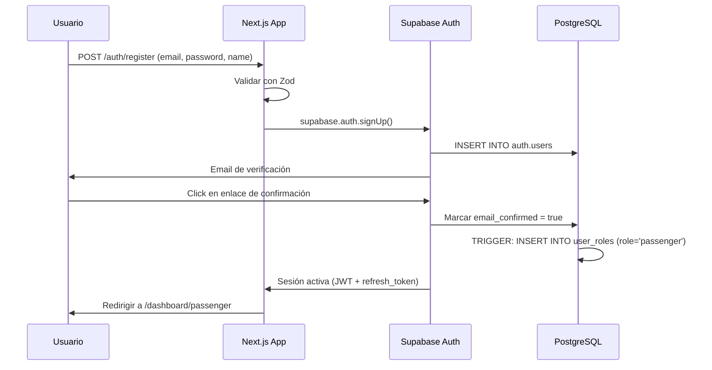
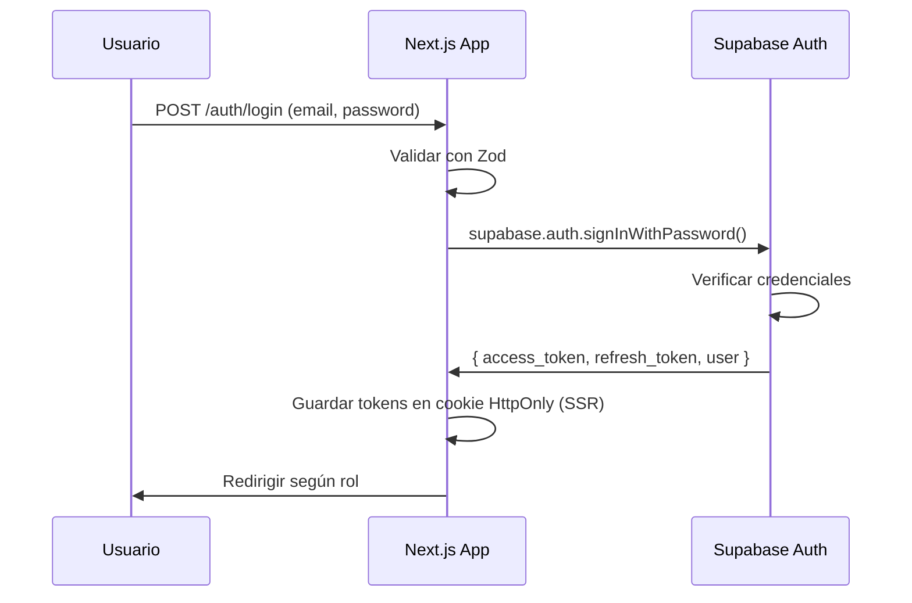

# Modelo de Seguridad — Ruta Norte

> **Versión:** 1.0.0  
> **Última actualización:** 2026-10-11  
> **Audiencia:** Arquitectos, desarrolladores backend, revisores de seguridad

---

## Tabla de Contenidos

1. [Principios de Seguridad](#1-principios-de-seguridad)
2. [Roles y Permisos](#2-roles-y-permisos)
3. [Políticas RLS por Tabla](#3-políticas-rls-por-tabla)
4. [Autenticación](#4-autenticación)
5. [Autorización](#5-autorización)
6. [Protección de Datos](#6-protección-de-datos)
7. [Protección contra Vulnerabilidades Comunes](#7-protección-contra-vulnerabilidades-comunes)
8. [Variables de Entorno Requeridas](#8-variables-de-entorno-requeridas)
9. [Checklist de Seguridad Pre-Producción](#9-checklist-de-seguridad-pre-producción)

---

## 1. Principios de Seguridad

Ruta Norte adopta un modelo de seguridad en capas basado en los siguientes principios fundamentales:

### 1.1 Defense in Depth (Defensa en Profundidad)

Ninguna capa de seguridad es suficiente por sí sola. El sistema implementa múltiples capas independientes que deben ser comprometidas simultáneamente para lograr acceso no autorizado:

| Capa | Mecanismo |
|------|-----------|
| Red | HTTPS obligatorio; Supabase gestiona TLS |
| Aplicación | Next.js middleware + Server Actions con verificación de roles |
| Base de datos | Row Level Security (RLS) en todas las tablas |
| API | Políticas de Supabase + Service Role solo en servidor |
| Auditoría | Registro de acciones sensibles en `audit_logs` |

### 1.2 Least Privilege (Mínimo Privilegio)

- Cada rol tiene acceso únicamente a los recursos y operaciones estrictamente necesarios para su función.
- La clave `anon` de Supabase solo puede acceder a datos públicos (horarios, rutas activas).
- La clave `service_role` **nunca** se expone al cliente ni a variables de entorno `NEXT_PUBLIC_*`.
- Los Server Components y Server Actions de Next.js son la única puerta de entrada al uso de `service_role`.

### 1.3 Sin Confianza en el Cliente

- Toda validación de negocio y seguridad se realiza en el servidor.
- Los datos enviados desde el cliente (formularios, parámetros de URL) son validados con **Zod** antes de cualquier operación.
- El cliente no decide su propio rol ni los permisos; estos se leen exclusivamente desde la base de datos.
- Las RLS en PostgreSQL son la última línea de defensa: **operan independientemente del código de la aplicación**.

### 1.4 Secretos Solo en Servidor

- Las claves secretas (`SUPABASE_SERVICE_ROLE_KEY`, etc.) solo se cargan en contextos de servidor.
- No existe ninguna clave secreta en variables `NEXT_PUBLIC_*`.
- Los JWTs de usuario no contienen datos sensibles más allá de `sub` (user id) y `role`.

### 1.5 Sin Pagos Reales

- El módulo de pagos es **completamente simulado**. No se integra ninguna pasarela de pago real.
- No se almacenan datos bancarios, de tarjetas ni información financiera personal.
- Los registros de `payments` contienen únicamente el método simulado, monto y estado lógico.

---

## 2. Roles y Permisos

### 2.1 Definición de Roles

| Rol | Descripción | Contexto típico |
|-----|-------------|-----------------|
| `admin` | Administrador del sistema completo | Back-office central |
| `operator` | Gestor de rutas, buses y viajes | Oficina de la cooperativa |
| `seller` | Vendedor de boletos en taquilla | Terminal terrestre |
| `inspector` | Validador de boletos en embarque | Plataforma de abordaje |
| `passenger` | Usuario final que compra boletos | App pública / web |

### 2.2 Matriz de Permisos por Recurso

Las letras indican las acciones permitidas: **C** = Create, **R** = Read, **U** = Update, **D** = Delete  
`—` indica que la acción está **completamente prohibida** para ese rol.

#### Infraestructura de Transporte

| Recurso | admin | operator | seller | inspector | passenger |
|---------|-------|----------|--------|-----------|-----------|
| `localities` | CRUD | CR | R | R | R |
| `stops` | CRUD | CRUD | R | R | R |
| `routes` | CRUD | CRUD | R | R | R |
| `route_stops` | CRUD | CRUD | R | R | R |
| `buses` | CRUD | CRUD | R | — | — |
| `bus_seats` | CRUD | CRUD | R | — | — |
| `drivers` | CRUD | CRUD | R | — | — |

#### Operaciones de Viaje

| Recurso | admin | operator | seller | inspector | passenger |
|---------|-------|----------|--------|-----------|-----------|
| `trips` | CRUD | CRUD | R | R | R (activos) |
| `trip_fares` | CRUD | CRUD | R | — | R |

#### Comercial y Embarque

| Recurso | admin | operator | seller | inspector | passenger |
|---------|-------|----------|--------|-----------|-----------|
| `bookings` | CRUD | CR | CRU | R (propias del viaje) | CRU (propias) |
| `booking_seats` | CRUD | CR | CR | R | CR (propias) |
| `payments` | CRUD | R | CR | — | CR (propios) |
| `tickets` | CRUD | R | CR | R (validar) | R (propios) |

#### Incidencias, Reportes y Auditoría

| Recurso | admin | operator | seller | inspector | passenger |
|---------|-------|----------|--------|-----------|-----------|
| `incidents` | CRUD | CRU | CR | CR | — |
| `reports` | CR | R | — | — | — |
| `audit_logs` | R | — | — | — | — |
| `user_roles` | CRUD | R | — | — | — |

> [!IMPORTANT]
> El **soft delete** reemplaza a DELETE en tablas con historial operacional (`trips`, `bookings`, `tickets`, `payments`). El borrado físico solo es aplicable a registros de configuración por parte del `admin`.

---

## 3. Políticas RLS por Tabla

> [!NOTE]
> RLS está **habilitado en todas las tablas**. La política por defecto es **denegar todo**. Solo se permite lo que esté explícitamente definido mediante `CREATE POLICY`. El usuario `service_role` de Supabase bypasea RLS por diseño de PostgreSQL; por eso **nunca** se expone al cliente.

### Configuración base

```sql
-- Función auxiliar para obtener el rol del usuario autenticado
CREATE OR REPLACE FUNCTION get_user_role()
RETURNS TEXT
LANGUAGE sql
STABLE
SECURITY DEFINER
AS $$
  SELECT role
  FROM user_roles
  WHERE user_id = auth.uid()
  LIMIT 1;
$$;

-- Función auxiliar para verificar si el usuario tiene uno de los roles indicados
CREATE OR REPLACE FUNCTION has_role(VARIADIC roles TEXT[])
RETURNS BOOLEAN
LANGUAGE sql
STABLE
SECURITY DEFINER
AS $$
  SELECT EXISTS (
    SELECT 1
    FROM user_roles
    WHERE user_id = auth.uid()
      AND role = ANY(roles)
  );
$$;
```

---

### 3.1 Tabla: `localities`

```sql
ALTER TABLE localities ENABLE ROW LEVEL SECURITY;

-- Lectura: todos los usuarios autenticados y anónimos
CREATE POLICY "localities_select_public"
  ON localities FOR SELECT
  USING (true);

-- Insertar: solo admin
CREATE POLICY "localities_insert_admin"
  ON localities FOR INSERT
  WITH CHECK (has_role('admin'));

-- Actualizar: solo admin
CREATE POLICY "localities_update_admin"
  ON localities FOR UPDATE
  USING (has_role('admin'))
  WITH CHECK (has_role('admin'));

-- Eliminar: solo admin
CREATE POLICY "localities_delete_admin"
  ON localities FOR DELETE
  USING (has_role('admin'));
```

---

### 3.2 Tabla: `stops`

```sql
ALTER TABLE stops ENABLE ROW LEVEL SECURITY;

CREATE POLICY "stops_select_public"
  ON stops FOR SELECT
  USING (true);

CREATE POLICY "stops_insert_admin_operator"
  ON stops FOR INSERT
  WITH CHECK (has_role('admin', 'operator'));

CREATE POLICY "stops_update_admin_operator"
  ON stops FOR UPDATE
  USING (has_role('admin', 'operator'))
  WITH CHECK (has_role('admin', 'operator'));

CREATE POLICY "stops_delete_admin"
  ON stops FOR DELETE
  USING (has_role('admin'));
```

---

### 3.3 Tabla: `routes`

```sql
ALTER TABLE routes ENABLE ROW LEVEL SECURITY;

CREATE POLICY "routes_select_public"
  ON routes FOR SELECT
  USING (true);

CREATE POLICY "routes_insert_admin_operator"
  ON routes FOR INSERT
  WITH CHECK (has_role('admin', 'operator'));

CREATE POLICY "routes_update_admin_operator"
  ON routes FOR UPDATE
  USING (has_role('admin', 'operator'))
  WITH CHECK (has_role('admin', 'operator'));

CREATE POLICY "routes_delete_admin"
  ON routes FOR DELETE
  USING (has_role('admin'));
```

---

### 3.4 Tabla: `route_stops`

```sql
ALTER TABLE route_stops ENABLE ROW LEVEL SECURITY;

CREATE POLICY "route_stops_select_public"
  ON route_stops FOR SELECT
  USING (true);

CREATE POLICY "route_stops_insert_admin_operator"
  ON route_stops FOR INSERT
  WITH CHECK (has_role('admin', 'operator'));

CREATE POLICY "route_stops_update_admin_operator"
  ON route_stops FOR UPDATE
  USING (has_role('admin', 'operator'))
  WITH CHECK (has_role('admin', 'operator'));

CREATE POLICY "route_stops_delete_admin_operator"
  ON route_stops FOR DELETE
  USING (has_role('admin', 'operator'));
```

---

### 3.5 Tabla: `buses`

```sql
ALTER TABLE buses ENABLE ROW LEVEL SECURITY;

-- Solo personal interno puede ver buses
CREATE POLICY "buses_select_staff"
  ON buses FOR SELECT
  USING (has_role('admin', 'operator', 'seller'));

CREATE POLICY "buses_insert_admin_operator"
  ON buses FOR INSERT
  WITH CHECK (has_role('admin', 'operator'));

CREATE POLICY "buses_update_admin_operator"
  ON buses FOR UPDATE
  USING (has_role('admin', 'operator'))
  WITH CHECK (has_role('admin', 'operator'));

CREATE POLICY "buses_delete_admin"
  ON buses FOR DELETE
  USING (has_role('admin'));
```

---

### 3.6 Tabla: `bus_seats`

```sql
ALTER TABLE bus_seats ENABLE ROW LEVEL SECURITY;

CREATE POLICY "bus_seats_select_staff"
  ON bus_seats FOR SELECT
  USING (has_role('admin', 'operator', 'seller'));

CREATE POLICY "bus_seats_insert_admin_operator"
  ON bus_seats FOR INSERT
  WITH CHECK (has_role('admin', 'operator'));

CREATE POLICY "bus_seats_update_admin_operator"
  ON bus_seats FOR UPDATE
  USING (has_role('admin', 'operator'))
  WITH CHECK (has_role('admin', 'operator'));

CREATE POLICY "bus_seats_delete_admin"
  ON bus_seats FOR DELETE
  USING (has_role('admin'));
```

---

### 3.7 Tabla: `drivers`

```sql
ALTER TABLE drivers ENABLE ROW LEVEL SECURITY;

CREATE POLICY "drivers_select_staff"
  ON drivers FOR SELECT
  USING (has_role('admin', 'operator', 'seller'));

CREATE POLICY "drivers_insert_admin_operator"
  ON drivers FOR INSERT
  WITH CHECK (has_role('admin', 'operator'));

CREATE POLICY "drivers_update_admin_operator"
  ON drivers FOR UPDATE
  USING (has_role('admin', 'operator'))
  WITH CHECK (has_role('admin', 'operator'));

CREATE POLICY "drivers_delete_admin"
  ON drivers FOR DELETE
  USING (has_role('admin'));
```

---

### 3.8 Tabla: `trips`

```sql
ALTER TABLE trips ENABLE ROW LEVEL SECURITY;

-- Pasajeros solo ven viajes activos (no cancelados, no archivados)
CREATE POLICY "trips_select_passenger"
  ON trips FOR SELECT
  USING (
    CASE
      WHEN has_role('admin', 'operator', 'seller', 'inspector') THEN true
      ELSE status IN ('scheduled', 'boarding', 'in_progress')
    END
  );

CREATE POLICY "trips_insert_admin_operator"
  ON trips FOR INSERT
  WITH CHECK (has_role('admin', 'operator'));

CREATE POLICY "trips_update_admin_operator"
  ON trips FOR UPDATE
  USING (has_role('admin', 'operator'))
  WITH CHECK (has_role('admin', 'operator'));

-- Soft delete: no se permite DELETE físico; se actualiza status = 'cancelled'
-- La siguiente política bloquea borrado físico para todos
CREATE POLICY "trips_no_delete"
  ON trips FOR DELETE
  USING (false);
```

---

### 3.9 Tabla: `trip_fares`

```sql
ALTER TABLE trip_fares ENABLE ROW LEVEL SECURITY;

CREATE POLICY "trip_fares_select_authenticated"
  ON trip_fares FOR SELECT
  USING (auth.uid() IS NOT NULL);

CREATE POLICY "trip_fares_insert_admin_operator"
  ON trip_fares FOR INSERT
  WITH CHECK (has_role('admin', 'operator'));

CREATE POLICY "trip_fares_update_admin_operator"
  ON trip_fares FOR UPDATE
  USING (has_role('admin', 'operator'))
  WITH CHECK (has_role('admin', 'operator'));

CREATE POLICY "trip_fares_delete_admin"
  ON trip_fares FOR DELETE
  USING (has_role('admin'));
```

---

### 3.10 Tabla: `bookings`

```sql
ALTER TABLE bookings ENABLE ROW LEVEL SECURITY;

-- Pasajeros ven solo sus propias reservas
-- Personal interno ve todas
CREATE POLICY "bookings_select"
  ON bookings FOR SELECT
  USING (
    has_role('admin', 'operator', 'seller', 'inspector')
    OR passenger_id = auth.uid()
  );

-- Pasajeros y sellers pueden crear reservas
CREATE POLICY "bookings_insert"
  ON bookings FOR INSERT
  WITH CHECK (
    has_role('admin', 'operator', 'seller')
    OR (
      has_role('passenger')
      AND passenger_id = auth.uid()
    )
  );

-- Solo se permite cancelar (actualizar status); no modificar datos de viaje
CREATE POLICY "bookings_update"
  ON bookings FOR UPDATE
  USING (
    has_role('admin', 'operator', 'seller')
    OR (has_role('passenger') AND passenger_id = auth.uid())
  )
  WITH CHECK (
    has_role('admin', 'operator', 'seller')
    OR (has_role('passenger') AND passenger_id = auth.uid())
  );

-- No se permiten borrados físicos
CREATE POLICY "bookings_no_delete"
  ON bookings FOR DELETE
  USING (false);
```

---

### 3.11 Tabla: `booking_seats`

```sql
ALTER TABLE booking_seats ENABLE ROW LEVEL SECURITY;

CREATE POLICY "booking_seats_select"
  ON booking_seats FOR SELECT
  USING (
    has_role('admin', 'operator', 'seller', 'inspector')
    OR EXISTS (
      SELECT 1 FROM bookings b
      WHERE b.id = booking_seats.booking_id
        AND b.passenger_id = auth.uid()
    )
  );

CREATE POLICY "booking_seats_insert"
  ON booking_seats FOR INSERT
  WITH CHECK (
    has_role('admin', 'operator', 'seller')
    OR EXISTS (
      SELECT 1 FROM bookings b
      WHERE b.id = booking_seats.booking_id
        AND b.passenger_id = auth.uid()
        AND has_role('passenger')
    )
  );

-- No se modifican filas individuales; se cancela la reserva completa
CREATE POLICY "booking_seats_no_update"
  ON booking_seats FOR UPDATE
  USING (has_role('admin'));

CREATE POLICY "booking_seats_no_delete"
  ON booking_seats FOR DELETE
  USING (false);
```

---

### 3.12 Tabla: `payments`

```sql
ALTER TABLE payments ENABLE ROW LEVEL SECURITY;

CREATE POLICY "payments_select"
  ON payments FOR SELECT
  USING (
    has_role('admin', 'operator')
    OR (
      has_role('seller', 'passenger')
      AND payer_id = auth.uid()
    )
  );

CREATE POLICY "payments_insert"
  ON payments FOR INSERT
  WITH CHECK (
    has_role('admin', 'seller')
    OR (has_role('passenger') AND payer_id = auth.uid())
  );

-- Solo admin puede rectificar un pago (reembolso simulado)
CREATE POLICY "payments_update_admin"
  ON payments FOR UPDATE
  USING (has_role('admin'))
  WITH CHECK (has_role('admin'));

CREATE POLICY "payments_no_delete"
  ON payments FOR DELETE
  USING (false);
```

---

### 3.13 Tabla: `tickets`

```sql
ALTER TABLE tickets ENABLE ROW LEVEL SECURITY;

-- Pasajeros ven solo sus propios boletos
-- Inspectores ven todos los boletos (para validar)
CREATE POLICY "tickets_select"
  ON tickets FOR SELECT
  USING (
    has_role('admin', 'operator', 'seller', 'inspector')
    OR passenger_id = auth.uid()
  );

-- Los boletos se generan por el servidor (service_role); nadie los crea directamente
CREATE POLICY "tickets_insert_admin_seller"
  ON tickets FOR INSERT
  WITH CHECK (has_role('admin', 'seller'));

-- Solo actualización de status (used, cancelled) por inspector o admin
CREATE POLICY "tickets_update_inspector_admin"
  ON tickets FOR UPDATE
  USING (has_role('admin', 'inspector'))
  WITH CHECK (has_role('admin', 'inspector'));

CREATE POLICY "tickets_no_delete"
  ON tickets FOR DELETE
  USING (false);
```

---

### 3.14 Tabla: `incidents`

```sql
ALTER TABLE incidents ENABLE ROW LEVEL SECURITY;

CREATE POLICY "incidents_select"
  ON incidents FOR SELECT
  USING (has_role('admin', 'operator', 'seller', 'inspector'));

CREATE POLICY "incidents_insert"
  ON incidents FOR INSERT
  WITH CHECK (has_role('admin', 'operator', 'seller', 'inspector'));

CREATE POLICY "incidents_update"
  ON incidents FOR UPDATE
  USING (has_role('admin', 'operator'))
  WITH CHECK (has_role('admin', 'operator'));

CREATE POLICY "incidents_delete_admin"
  ON incidents FOR DELETE
  USING (has_role('admin'));
```

---

### 3.15 Tabla: `audit_logs`

```sql
ALTER TABLE audit_logs ENABLE ROW LEVEL SECURITY;

-- Solo admin puede leer logs; nadie puede escribir directamente (solo triggers)
CREATE POLICY "audit_logs_select_admin"
  ON audit_logs FOR SELECT
  USING (has_role('admin'));

-- Escritura solo por triggers del sistema (no hay policy INSERT para usuarios)
-- La función de trigger usa SECURITY DEFINER para saltar RLS

CREATE POLICY "audit_logs_no_insert"
  ON audit_logs FOR INSERT
  WITH CHECK (false);

CREATE POLICY "audit_logs_no_update"
  ON audit_logs FOR UPDATE
  USING (false);

CREATE POLICY "audit_logs_no_delete"
  ON audit_logs FOR DELETE
  USING (false);
```

---

### 3.16 Tabla: `user_roles`

```sql
ALTER TABLE user_roles ENABLE ROW LEVEL SECURITY;

-- Un usuario puede leer su propio rol; admin ve todos
CREATE POLICY "user_roles_select"
  ON user_roles FOR SELECT
  USING (
    has_role('admin')
    OR user_id = auth.uid()
  );

-- Solo admin puede asignar roles
CREATE POLICY "user_roles_insert_admin"
  ON user_roles FOR INSERT
  WITH CHECK (has_role('admin'));

CREATE POLICY "user_roles_update_admin"
  ON user_roles FOR UPDATE
  USING (has_role('admin'))
  WITH CHECK (has_role('admin'));

CREATE POLICY "user_roles_delete_admin"
  ON user_roles FOR DELETE
  USING (has_role('admin'));
```

> [!CAUTION]
> Un usuario que pueda modificar `user_roles` sin restricción podría escalar sus privilegios a `admin`. La política `user_roles_insert_admin` es crítica. Debe auditarse con un trigger que registre cada cambio de rol en `audit_logs`.

---

## 4. Autenticación

### 4.1 Supabase Auth con JWT

Ruta Norte usa **Supabase Auth** como proveedor de identidad. Al autenticarse, el servidor emite un JWT firmado con la clave secreta del proyecto Supabase.

```
┌─────────────┐     credentials      ┌──────────────────┐
│   Cliente   │ ─────────────────▶  │  Supabase Auth   │
│  (Browser)  │ ◀─────────────────  │  (GoTrue)        │
└─────────────┘   JWT + refresh_token└──────────────────┘
```

**Contenido del JWT:**
- `sub`: UUID del usuario (equivale a `auth.uid()` en RLS)
- `email`: correo verificado
- `role`: siempre `authenticated` (el rol de negocio se lee de `user_roles`)
- `exp`: expiración del access token (1 hora por defecto)
- `iat`: emisión

> [!NOTE]
> El rol de negocio (`admin`, `operator`, etc.) **no** se almacena en el JWT. Esto evita que un token comprometido tenga permisos elevados de forma permanente. El rol se consulta en tiempo de ejecución desde `user_roles`.

### 4.2 Flujo de Registro



**Trigger de asignación de rol por defecto:**

```sql
CREATE OR REPLACE FUNCTION assign_default_role()
RETURNS TRIGGER
LANGUAGE plpgsql
SECURITY DEFINER
AS $$
BEGIN
  INSERT INTO public.user_roles (user_id, role)
  VALUES (NEW.id, 'passenger');
  RETURN NEW;
END;
$$;

CREATE TRIGGER on_auth_user_created
  AFTER INSERT ON auth.users
  FOR EACH ROW
  EXECUTE FUNCTION assign_default_role();
```

### 4.3 Flujo de Login



### 4.4 Manejo de Sesión en Next.js Middleware

```typescript
// middleware.ts
import { createServerClient } from '@supabase/ssr'
import { NextResponse } from 'next/server'
import type { NextRequest } from 'next/server'

export async function middleware(request: NextRequest) {
  const response = NextResponse.next()

  const supabase = createServerClient(
    process.env.NEXT_PUBLIC_SUPABASE_URL!,
    process.env.NEXT_PUBLIC_SUPABASE_ANON_KEY!,
    {
      cookies: {
        getAll: () => request.cookies.getAll(),
        setAll: (cookies) => {
          cookies.forEach(({ name, value, options }) => {
            response.cookies.set(name, value, options)
          })
        },
      },
    }
  )

  // Refresca la sesión si el access_token expiró
  const { data: { session } } = await supabase.auth.getSession()

  const { pathname } = request.nextUrl

  // Rutas públicas que no requieren autenticación
  const publicPaths = ['/', '/auth/login', '/auth/register', '/auth/forgot-password']
  if (publicPaths.includes(pathname)) return response

  // Redirigir a login si no hay sesión
  if (!session) {
    const loginUrl = new URL('/auth/login', request.url)
    loginUrl.searchParams.set('redirectTo', pathname)
    return NextResponse.redirect(loginUrl)
  }

  return response
}

export const config = {
  matcher: ['/((?!_next/static|_next/image|favicon.ico|api/health).*)'],
}
```

### 4.5 Protección de Rutas por Rol

Para proteger rutas específicas por rol, se usa una capa adicional en el layout de cada sección:

```typescript
// app/dashboard/admin/layout.tsx
import { redirect } from 'next/navigation'
import { createServerClient } from '@/lib/supabase/server'
import { getUserRole } from '@/lib/auth/get-user-role'

export default async function AdminLayout({ children }: { children: React.ReactNode }) {
  const supabase = await createServerClient()
  const { data: { user } } = await supabase.auth.getUser()

  if (!user) redirect('/auth/login')

  const role = await getUserRole(user.id)

  if (role !== 'admin') redirect('/unauthorized')

  return <>{children}</>
}
```

### 4.6 Refresh Token Strategy

- El `access_token` expira en **1 hora** (configurable en Supabase Dashboard).
- El `refresh_token` expira en **7 días** (single-use, se rota en cada uso).
- `@supabase/ssr` con cookies HttpOnly gestiona el refresco automáticamente en el middleware.
- Al detectar un `access_token` expirado, el middleware llama implícitamente a `supabase.auth.getSession()`, que usa el `refresh_token` para emitir un nuevo par de tokens.
- Si el `refresh_token` también expiró, el usuario es redirigido a `/auth/login`.

---

## 5. Autorización

### 5.1 Verificación de Rol en Server Actions

```typescript
// lib/auth/require-role.ts
import { createServerClient } from '@/lib/supabase/server'
import { getUserRole } from '@/lib/auth/get-user-role'

type AllowedRole = 'admin' | 'operator' | 'seller' | 'inspector' | 'passenger'

export async function requireRole(...allowedRoles: AllowedRole[]): Promise<string> {
  const supabase = await createServerClient()
  const { data: { user }, error } = await supabase.auth.getUser()

  if (error || !user) {
    throw new Error('UNAUTHENTICATED')
  }

  const role = await getUserRole(user.id)

  if (!allowedRoles.includes(role as AllowedRole)) {
    throw new Error('UNAUTHORIZED')
  }

  return user.id
}
```

```typescript
// app/actions/trips.ts (ejemplo de Server Action protegida)
'use server'

import { requireRole } from '@/lib/auth/require-role'
import { createTripSchema } from '@/lib/schemas/trip'
import { db } from '@/lib/supabase/server'

export async function createTrip(formData: unknown) {
  // 1. Verificar rol antes de cualquier operación
  const userId = await requireRole('admin', 'operator')

  // 2. Validar datos con Zod
  const parsed = createTripSchema.safeParse(formData)
  if (!parsed.success) {
    return { error: parsed.error.flatten() }
  }

  // 3. Ejecutar operación de base de datos
  const { data, error } = await db
    .from('trips')
    .insert({ ...parsed.data, created_by: userId })
    .select()
    .single()

  if (error) return { error: error.message }
  return { data }
}
```

### 5.2 Protección de Rutas de API (Route Handlers)

```typescript
// app/api/trips/[id]/route.ts
import { NextRequest, NextResponse } from 'next/server'
import { createServerClient } from '@/lib/supabase/server'
import { getUserRole } from '@/lib/auth/get-user-role'

export async function DELETE(
  _request: NextRequest,
  { params }: { params: { id: string } }
) {
  const supabase = await createServerClient()
  const { data: { user } } = await supabase.auth.getUser()

  if (!user) {
    return NextResponse.json({ error: 'No autenticado' }, { status: 401 })
  }

  const role = await getUserRole(user.id)

  if (role !== 'admin') {
    return NextResponse.json({ error: 'No autorizado' }, { status: 403 })
  }

  // Soft delete
  const { error } = await supabase
    .from('trips')
    .update({ status: 'cancelled', deleted_at: new Date().toISOString() })
    .eq('id', params.id)

  if (error) return NextResponse.json({ error: error.message }, { status: 500 })

  return NextResponse.json({ success: true })
}
```

### 5.3 Función `get_user_role()` en Supabase

La función `get_user_role()` definida en la [sección 3](#3-políticas-rls-por-tabla) también puede usarse desde el cliente para obtener el rol del usuario autenticado, sin exponer otros registros:

```sql
-- Función expuesta via RPC (solo devuelve el rol del usuario autenticado)
CREATE OR REPLACE FUNCTION get_my_role()
RETURNS TEXT
LANGUAGE sql
STABLE
SECURITY DEFINER
AS $$
  SELECT role
  FROM public.user_roles
  WHERE user_id = auth.uid()
  LIMIT 1;
$$;
```

```typescript
// Uso desde el cliente (App Router)
const { data: role } = await supabase.rpc('get_my_role')
```

> [!WARNING]
> Nunca usar el rol retornado por `get_my_role()` para tomar decisiones de seguridad en el servidor. Esta función es solo para personalizar la UI del cliente. Las decisiones de autorización siempre deben basarse en `getUserRole()` del lado del servidor.

---

## 6. Protección de Datos

### 6.1 Datos Sensibles Identificados

| Dato | Tabla | Nivel de sensibilidad | Control aplicado |
|------|-------|-----------------------|------------------|
| Contraseña | `auth.users` (Supabase) | Crítico | Gestionado por GoTrue; hash bcrypt |
| Cédula de identidad | `passengers` | Alto | Solo accesible por `admin`, `operator`, `seller` |
| Email | `auth.users` | Medio | RLS; solo el propio usuario y admin |
| Número de boleto | `tickets` | Medio | RLS por propietario e inspector |
| Código QR | `tickets.qr_payload` | Medio | No contiene datos personales (ver 6.2) |
| Datos de pago simulado | `payments` | Bajo-Medio | Solo payer y admin/operator |
| Historial de viajes | `bookings`, `tickets` | Bajo-Medio | RLS por propietario |

### 6.2 Protección del Código QR

El código QR de un boleto **no debe exponer datos personales** del pasajero. El payload del QR debe ser:

```typescript
// Estructura del QR payload — NO incluye nombre, cédula ni email
interface QrPayload {
  ticket_id: string       // UUID del boleto
  trip_id: string         // UUID del viaje
  seat_number: string     // Número de asiento
  issued_at: string       // ISO 8601
  hmac: string            // HMAC-SHA256 para verificar autenticidad
}
```

**Generación del HMAC:**

```typescript
import { createHmac } from 'crypto'

function generateTicketHmac(ticketId: string, tripId: string, seatNumber: string): string {
  const secret = process.env.TICKET_HMAC_SECRET! // Solo en servidor
  const payload = `${ticketId}:${tripId}:${seatNumber}`
  return createHmac('sha256', secret).update(payload).digest('hex')
}
```

**Validación en embarque:** el inspector escanea el QR → el servidor verifica el HMAC y consulta el estado del boleto. El inspector **nunca** ve datos personales del pasajero mediante el QR.

### 6.3 Audit Logs para Acciones Sensibles

Las siguientes acciones generan un registro automático en `audit_logs` mediante triggers de PostgreSQL:

| Acción | Disparador |
|--------|-----------|
| Cambio de rol de usuario | `AFTER UPDATE ON user_roles` |
| Cancelación de un viaje | `AFTER UPDATE ON trips WHERE status='cancelled'` |
| Reembolso de pago | `AFTER UPDATE ON payments WHERE status='refunded'` |
| Marcado de boleto como usado | `AFTER UPDATE ON tickets WHERE status='used'` |
| Inicio/cierre de sesión | `auth.audit_log_entries` (nativo Supabase) |

```sql
-- Estructura de audit_logs
CREATE TABLE audit_logs (
  id          UUID PRIMARY KEY DEFAULT gen_random_uuid(),
  user_id     UUID REFERENCES auth.users(id),
  action      TEXT NOT NULL,         -- 'role_change', 'trip_cancel', etc.
  table_name  TEXT NOT NULL,
  record_id   UUID NOT NULL,
  old_values  JSONB,
  new_values  JSONB,
  ip_address  INET,
  created_at  TIMESTAMPTZ DEFAULT now()
);

-- Trigger genérico de auditoría
CREATE OR REPLACE FUNCTION log_sensitive_change()
RETURNS TRIGGER
LANGUAGE plpgsql
SECURITY DEFINER
AS $$
BEGIN
  INSERT INTO public.audit_logs (user_id, action, table_name, record_id, old_values, new_values)
  VALUES (
    auth.uid(),
    TG_ARGV[0],       -- acción pasada como argumento
    TG_TABLE_NAME,
    NEW.id,
    to_jsonb(OLD),
    to_jsonb(NEW)
  );
  RETURN NEW;
END;
$$;
```

### 6.4 Soft Delete para Registros Históricos

Las tablas operacionales nunca eliminan registros físicamente. El campo `deleted_at TIMESTAMPTZ` indica borrado lógico:

```sql
-- Columna en tablas con historial
ALTER TABLE trips     ADD COLUMN deleted_at TIMESTAMPTZ;
ALTER TABLE bookings  ADD COLUMN deleted_at TIMESTAMPTZ;
ALTER TABLE tickets   ADD COLUMN deleted_at TIMESTAMPTZ;
ALTER TABLE payments  ADD COLUMN deleted_at TIMESTAMPTZ;

-- Vista que excluye registros borrados para el uso común
CREATE VIEW active_trips AS
  SELECT * FROM trips WHERE deleted_at IS NULL;
```

---

## 7. Protección contra Vulnerabilidades Comunes

### 7.1 SQL Injection

**Riesgo:** Un atacante podría inyectar SQL para leer o modificar datos no autorizados.

**Mitigación:** El cliente de Supabase (`@supabase/supabase-js`) utiliza exclusivamente **consultas parametrizadas** y la API PostgREST, que no construye SQL dinámico con input del usuario. Adicionalmente:

- Las funciones de base de datos que aceptan parámetros de texto usan `$1, $2, ...` (parámetros posicionales).
- No se usa `supabase.rpc()` con strings SQL concatenados.
- Las Server Actions validan con Zod antes de pasar datos a Supabase.

```typescript
// ✅ Correcto — parámetros seguros
const { data } = await supabase
  .from('trips')
  .select('*')
  .eq('route_id', routeId)   // routeId es validado por Zod (uuid)
  .eq('status', 'scheduled')

// ❌ Incorrecto — nunca hacer esto
await supabase.rpc('raw_query', { sql: `SELECT * FROM trips WHERE route_id = '${routeId}'` })
```

### 7.2 CSRF (Cross-Site Request Forgery)

**Riesgo:** Un sitio malicioso podría enviar solicitudes en nombre de un usuario autenticado.

**Mitigación:**
- Las **Server Actions de Next.js** incluyen protección CSRF automática mediante el encabezado `Origin` verificado por el framework.
- Las cookies de sesión de Supabase se configuran con `SameSite=Lax`.
- Los Route Handlers críticos (POST, PATCH, DELETE) verifican el encabezado `Origin`.

```typescript
// Verificación de origen en Route Handlers críticos
function verifyOrigin(request: NextRequest): boolean {
  const origin = request.headers.get('origin')
  const allowedOrigins = [process.env.NEXT_PUBLIC_APP_URL!]
  return origin !== null && allowedOrigins.includes(origin)
}
```

### 7.3 XSS (Cross-Site Scripting)

**Riesgo:** Inyección de scripts maliciosos en el HTML renderizado.

**Mitigación:**
- **React escapa automáticamente** todo contenido renderizado con JSX mediante `{variable}`.
- Se prohíbe el uso de `dangerouslySetInnerHTML` salvo en componentes dedicados con sanitización explícita.
- Se configura una **Content Security Policy (CSP)** estricta:

```typescript
// next.config.ts
const ContentSecurityPolicy = `
  default-src 'self';
  script-src 'self' 'nonce-${nonce}';
  style-src 'self' 'unsafe-inline';
  img-src 'self' data: blob:;
  connect-src 'self' ${process.env.NEXT_PUBLIC_SUPABASE_URL};
  frame-ancestors 'none';
`.replace(/\n/g, '')

const securityHeaders = [
  { key: 'Content-Security-Policy', value: ContentSecurityPolicy },
  { key: 'X-Frame-Options', value: 'DENY' },
  { key: 'X-Content-Type-Options', value: 'nosniff' },
  { key: 'Referrer-Policy', value: 'strict-origin-when-cross-origin' },
  { key: 'Permissions-Policy', value: 'camera=(), microphone=(), geolocation=()' },
]
```

### 7.4 Brute Force

**Riesgo:** Intentos masivos de adivinar contraseñas.

**Mitigación:**
- **Supabase Auth (GoTrue)** incluye rate limiting nativo por IP para los endpoints `/auth/v1/token` y `/auth/v1/signup`.
- Se configuran los límites en el Dashboard de Supabase: máximo **5 intentos de login** por minuto por IP.
- Tras el límite, el usuario recibe un período de espera exponencial.
- Para entornos de producción se recomienda colocar Supabase Auth detrás de Cloudflare con reglas de rate limiting adicionales.

### 7.5 Concurrencia en Reservas

**Riesgo:** Dos usuarios reservando el mismo asiento simultáneamente.

**Mitigación:** Se usa una función PostgreSQL con bloqueo pesimista (`SELECT ... FOR UPDATE`) dentro de una transacción explícita:

```sql
CREATE OR REPLACE FUNCTION create_booking(
  p_trip_id       UUID,
  p_passenger_id  UUID,
  p_seat_ids      UUID[]
)
RETURNS UUID
LANGUAGE plpgsql
SECURITY DEFINER
AS $$
DECLARE
  v_booking_id UUID;
  v_seat_id    UUID;
BEGIN
  -- Bloquear los asientos para evitar condición de carrera
  PERFORM id
  FROM trip_seat_availability
  WHERE trip_id = p_trip_id
    AND seat_id = ANY(p_seat_ids)
    AND is_available = true
  FOR UPDATE;  -- Bloqueo exclusivo

  -- Verificar que todos los asientos siguen disponibles
  IF (
    SELECT COUNT(*) FROM trip_seat_availability
    WHERE trip_id = p_trip_id
      AND seat_id = ANY(p_seat_ids)
      AND is_available = true
  ) < array_length(p_seat_ids, 1) THEN
    RAISE EXCEPTION 'SEAT_UNAVAILABLE';
  END IF;

  -- Crear la reserva
  INSERT INTO bookings (trip_id, passenger_id, status, expires_at)
  VALUES (p_trip_id, p_passenger_id, 'pending', now() + INTERVAL '15 minutes')
  RETURNING id INTO v_booking_id;

  -- Registrar los asientos
  FOREACH v_seat_id IN ARRAY p_seat_ids LOOP
    INSERT INTO booking_seats (booking_id, seat_id)
    VALUES (v_booking_id, v_seat_id);

    UPDATE trip_seat_availability
    SET is_available = false, booking_id = v_booking_id
    WHERE trip_id = p_trip_id AND seat_id = v_seat_id;
  END LOOP;

  RETURN v_booking_id;
END;
$$;
```

> [!TIP]
> Las reservas tienen una expiración de **15 minutos**. Un job de PostgreSQL (pg_cron) ejecuta cada 5 minutos la liberación de asientos de reservas expiradas que no fueron confirmadas con pago.

```sql
-- Job de limpieza de reservas expiradas (requiere pg_cron)
SELECT cron.schedule(
  'release-expired-bookings',
  '*/5 * * * *',
  $$
    UPDATE trip_seat_availability tsa
    SET is_available = true, booking_id = NULL
    FROM bookings b
    WHERE b.id = tsa.booking_id
      AND b.status = 'pending'
      AND b.expires_at < now();

    UPDATE bookings
    SET status = 'expired'
    WHERE status = 'pending' AND expires_at < now();
  $$
);
```

---

## 8. Variables de Entorno Requeridas

### 8.1 Variables Públicas (accesibles en cliente)

Estas variables pueden estar prefijadas con `NEXT_PUBLIC_` ya que no son secretos:

| Variable | Descripción | Ejemplo |
|----------|-------------|---------|
| `NEXT_PUBLIC_SUPABASE_URL` | URL del proyecto Supabase | `https://abcdef.supabase.co` |
| `NEXT_PUBLIC_SUPABASE_ANON_KEY` | Clave anónima de Supabase (JWT público) | `eyJhbGciOiJIUzI1NiIs...` |
| `NEXT_PUBLIC_APP_URL` | URL pública de la aplicación | `https://rutanorte.ec` |

> [!NOTE]
> La `ANON_KEY` es pública por diseño. Su seguridad depende enteramente de las políticas RLS. Sin RLS correctas, la `ANON_KEY` daría acceso total a los datos.

### 8.2 Variables Secretas (solo servidor)

> [!CAUTION]
> Las siguientes variables **NUNCA** deben usarse en componentes de cliente ni en variables `NEXT_PUBLIC_*`. Una filtración de `SUPABASE_SERVICE_ROLE_KEY` bypassea todas las políticas RLS.

| Variable | Descripción | Uso |
|----------|-------------|-----|
| `SUPABASE_SERVICE_ROLE_KEY` | Clave de servicio con acceso total (bypass RLS) | Server Actions administrativas, migrations |
| `TICKET_HMAC_SECRET` | Secreto para firmar el payload del QR de boletos | Generación y validación de boletos |
| `NEXTAUTH_SECRET` | Secreto de cifrado para cookies de sesión (si se usa next-auth como complemento) | Middleware de sesión |
| `CRON_SECRET` | Token para autenticar llamadas a endpoints de cron externos | `/api/cron/*` Route Handlers |
| `DATABASE_URL` | URL de conexión directa a PostgreSQL (para migrations con Drizzle/Prisma si aplica) | Tooling de base de datos |

### 8.3 Archivo `.env.local` de Referencia

```bash
# .env.local — NO subir a control de versiones
# Ver .env.example para el template sin valores

# ── Públicas ──────────────────────────────────────────────────────────────────
NEXT_PUBLIC_SUPABASE_URL=https://TU_PROYECTO.supabase.co
NEXT_PUBLIC_SUPABASE_ANON_KEY=eyJhbGciOiJIUzI1NiIsInR5cCI6IkpXVCJ9...
NEXT_PUBLIC_APP_URL=http://localhost:3000

# ── Secretas (solo servidor) ──────────────────────────────────────────────────
SUPABASE_SERVICE_ROLE_KEY=eyJhbGciOiJIUzI1NiIsInR5cCI6IkpXVCJ9...
TICKET_HMAC_SECRET=un_secreto_aleatorio_minimo_32_caracteres
CRON_SECRET=otro_secreto_aleatorio_para_cron
```

```bash
# .env.example — SÍ subir a control de versiones
NEXT_PUBLIC_SUPABASE_URL=
NEXT_PUBLIC_SUPABASE_ANON_KEY=
NEXT_PUBLIC_APP_URL=

SUPABASE_SERVICE_ROLE_KEY=
TICKET_HMAC_SECRET=
CRON_SECRET=
```

---

## 9. Checklist de Seguridad Pre-Producción

Verificar cada ítem antes de desplegar a producción:

### 9.1 Base de Datos y RLS

- [ ] RLS habilitado en **todas** las tablas de `public`
- [ ] Políticas RLS definidas para cada tabla (SELECT, INSERT, UPDATE, DELETE)
- [ ] Política por defecto es DENY (ninguna policy implícita de ALLOW)
- [ ] `get_user_role()` y `has_role()` definidas como `SECURITY DEFINER`
- [ ] Trigger `assign_default_role` activo en `auth.users`
- [ ] Función `create_booking` con bloqueo pesimista probada bajo concurrencia
- [ ] Job pg_cron de limpieza de reservas expiradas activo
- [ ] `audit_logs` poblándose correctamente para todas las acciones sensibles
- [ ] Columna `deleted_at` presente en todas las tablas de historial
- [ ] Sin tablas sin `ENABLE ROW LEVEL SECURITY`

### 9.2 Autenticación y Autorización

- [ ] Middleware de Next.js protege todas las rutas privadas
- [ ] Cada layout de sección (`/admin`, `/operator`, etc.) verifica el rol
- [ ] Todas las Server Actions llaman a `requireRole()` antes de operar
- [ ] Todos los Route Handlers verifican autenticación y rol
- [ ] Los tokens de sesión usan cookies `HttpOnly`, `Secure`, `SameSite=Lax`
- [ ] El refresh token rota en cada uso (configurado en Supabase Dashboard)
- [ ] Rate limiting de login activo en Supabase Auth
- [ ] `SUPABASE_SERVICE_ROLE_KEY` no aparece en ningún bundle del cliente

### 9.3 Protección de Datos

- [ ] Payload QR no contiene nombre, cédula ni email del pasajero
- [ ] HMAC de boletos generado y verificado correctamente
- [ ] `TICKET_HMAC_SECRET` es aleatorio, con al menos 32 caracteres
- [ ] No existen `console.log` con datos de usuario en producción
- [ ] Los datos sensibles no aparecen en error messages devueltos al cliente

### 9.4 Headers y Configuración HTTP

- [ ] CSP configurada en `next.config.ts` (Content-Security-Policy)
- [ ] `X-Frame-Options: DENY` activo
- [ ] `X-Content-Type-Options: nosniff` activo
- [ ] `Referrer-Policy: strict-origin-when-cross-origin` activo
- [ ] HTTPS forzado (Supabase y el hosting lo gestionan)

### 9.5 Variables de Entorno

- [ ] `.env.local` no está en el repositorio (`.gitignore`)
- [ ] `.env.example` tiene todas las variables sin valores
- [ ] Las variables secretas solo están en el servidor de CI/CD o vault
- [ ] No hay claves hardcodeadas en el código fuente
- [ ] `NEXT_PUBLIC_*` contiene únicamente variables no secretas

### 9.6 Dependencias y Código

- [ ] `npm audit` sin vulnerabilidades críticas o altas
- [ ] Validación con Zod en **todos** los inputs de formularios y APIs
- [ ] No se usa `dangerouslySetInnerHTML` sin sanitización
- [ ] No hay endpoints de debug activos (`/api/debug`, `/api/seed-prod`, etc.)
- [ ] Los endpoints de cron (`/api/cron/*`) están protegidos con `CRON_SECRET`

### 9.7 Pruebas de Seguridad

- [ ] Tests de integración que verifican que RLS rechaza accesos no autorizados (Vitest + Supabase local)
- [ ] Tests E2E que verifican redirección de rutas protegidas sin sesión (Playwright)
- [ ] Test de concurrencia en reserva de asientos (al menos 2 sesiones simultáneas)
- [ ] Revisión manual de la matriz de permisos contra la implementación real

---

*Documento generado para el proyecto **Ruta Norte** — Sistema de Gestión de Transporte Interparroquial del Norte de Ecuador.*
